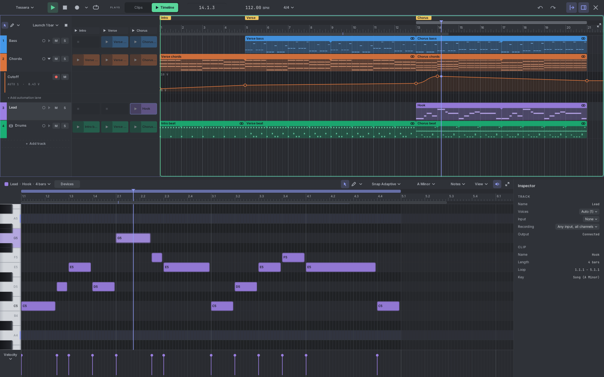

# Tessera

Tessera is a sequencer plugin for [VCV Rack 2](https://vcvrack.com). It brings the editors of a music program
(a "DAW") into your rack: a piano roll, a drum step editor, clips you can
launch live, a song timeline and automation. It plays the music as voltages (pitch, gates, velocity and CV) that
drive any module in the patch.



## What it does

- **Up to 64 tracks**, each playing chords of up to 16 notes on one poly cable.
- **Piano roll** with draw, paint, slice and chord tools, note chance and repeats, per-note bends, and transforms
  like quantize, humanize and strum.
- **Drum editor** with a step grid, up to 16 lanes per kit, choke groups, different lane lengths and Euclidean
  patterns.
- **Clip launcher and scenes** for playing live, and a **timeline** for arranging a song.
- **Keys and scales** that highlight, snap and fold the piano roll to the notes of a key.
- **Recording** from MIDI, CV or the computer keyboard.
- **Automation** curves that send CV, or turn other modules' knobs without a cable.
- **Export** to MIDI files and DAWproject, so a song made in Rack opens in any DAW.
- **Undo** for every change, with Ctrl+Z (Cmd+Z on a Mac).

## The modules

| Module | What it is for |
|---|---|
| **Tessera** | The sequencer. Holds the song, the transport and the editor. You can use more than one in a patch. |
| **Tessera Track Out** | The pitch, gate and velocity jacks of one instrument track. Place it next to the synth it plays. |
| **Tessera Drum Out** | One trigger jack per drum lane of one drum track. |
| **Tessera Auto Out** | The automation lanes of one track, one labelled jack each. |

Output modules find their Tessera on their own. They need no cable to it and do not have to sit beside it.

## User manual

The [user manual](docs/manual/README.md) explains every feature in plain words, with pictures. Start with
[Getting started](docs/manual/01-getting-started.md) for your first sound in five minutes.

## Building from source

You need the [Rack 2 SDK](https://vcvrack.com/manual/Building#Building-Rack-plugins) and a C++17 compiler.

```sh
RACK_DIR=~/Rack-SDK make -j          # builds plugin.so / plugin.dylib / plugin.dll
RACK_DIR=~/Rack-SDK make install     # copies the plugin into your Rack plugins folder
RACK_DIR=~/Rack-SDK make dist        # makes the .vcvplugin package in dist/
```

Restart Rack after `make install`. Rack only unpacks a new plugin when it starts.

### NixOS and macOS with Nix (including nix-darwin)

With `nixpkgs` available in your Nix search path, enter the development shell:

```sh
nix-shell
make -j4
make -j4 test
make dist
```

The shell provides the native C++ compiler, formatting tools, jansson, OpenGL headers on Linux, and the
tools needed to package the plugin. It downloads a checksum-verified Rack SDK 2.6.6 and sets `RACK_DIR`
automatically. Supported hosts are x86_64 NixOS/Linux and Intel or Apple Silicon macOS. The first invocation
needs network access to download the SDK and Nix dependencies. Nixpkgs comes from your configured channel
or `NIX_PATH`; it is not pinned by this repository.

To use your own matching SDK, run `RACK_DIR=/absolute/path/to/Rack-SDK nix-shell`. For a single command,
use `nix-shell --run 'make -j4 test'`. Run `make clean` when switching SDKs or compilers to discard old objects.
On macOS, `make dist` uses the host's `/usr/bin/codesign`. `make install` installs into Rack's usual user
plugin directory; the shell does not install or launch the Rack application.

Linux builds use Nix's libraries and may reference the Nix store. Use the existing GitHub release workflow
for distributable binaries intended for machines without Nix.

If the test binary hangs before printing anything on recent macOS, your Nixpkgs compiler may have the
[AddressSanitizer startup bug](https://github.com/llvm/llvm-project/pull/182943). Update to a toolchain
containing that fix, or run with only UndefinedBehaviorSanitizer in a separate build directory:

```sh
make -j4 test TEST_OBJ_DIR=build/tests/ubsan-obj TEST_BIN=build/tests/tessera_tests_ubsan \
  TEST_FLAGS='-std=c++17 -O1 -g -Wall -Wextra -pthread -fsanitize=undefined'
```

### Builds for every platform

GitHub builds Tessera for Linux, Windows, Intel Macs and Apple Silicon Macs, and runs the tests. Start it from the
**Actions** tab: **Build → Run workflow**. Each build's `.vcvplugin` files are at the bottom of its run page.

The tests also run on their own for every pull request and every push to `main`. A pull request shows a red
cross if any test fails.

Pushing a version tag also makes a GitHub Release with all four files. The tag must match the version in
`plugin.json`, with a `v` in front:

```sh
git tag v2.0.0 && git push origin v2.0.0
```

### Tests

The song model and the playback engine build without Rack, so the tests are a plain program. They need the
jansson JSON library (Arch: `jansson`, Debian/Ubuntu: `libjansson-dev`, Homebrew: `jansson`) and `jq`. On
Debian/Ubuntu they also need the OpenGL headers (`libgl-dev`).

```sh
RACK_DIR=~/Rack-SDK make -j test
```

## Licence

Tessera is free and open source. Copyright (c) 2026 Elis Vathi. You may use, share and change it under the
[GNU General Public License, version 3 or later](LICENSE-GPL-3.0.txt). See [LICENSE.txt](LICENSE.txt) for
details and for the licences of the bundled fonts.
