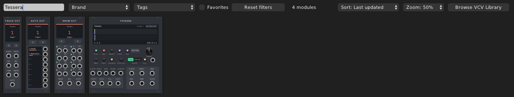
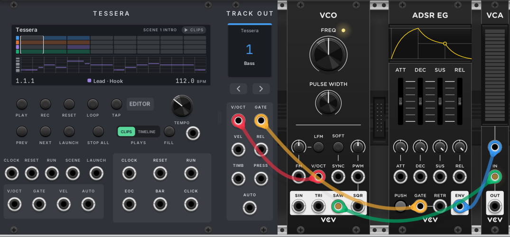
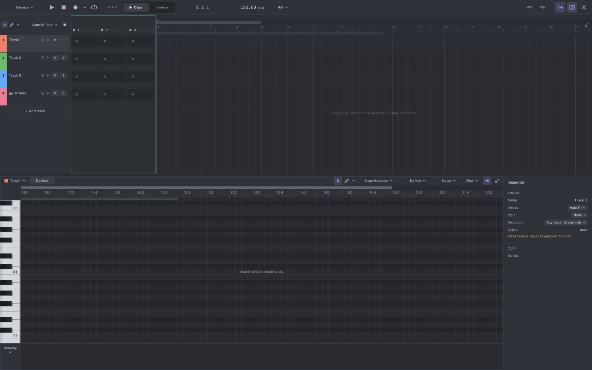
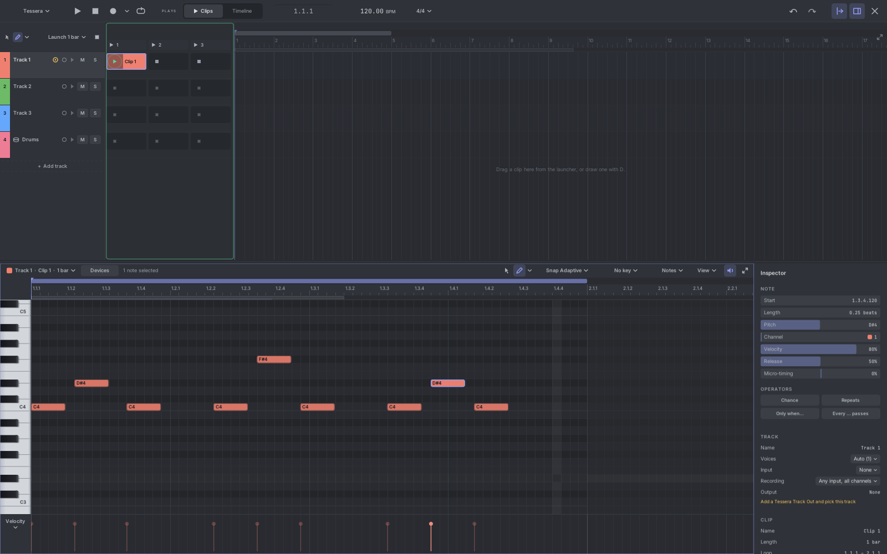

# 1. Getting started

This chapter takes you from an empty rack to a melody you can hear. It takes about five minutes.

## The four modules

Tessera is a small family of modules. You always need the first one. The others carry the music to the rest of
your patch.

| Module | Width | What it does |
|---|---|---|
| **Tessera** | 24 HP (or wider) | The sequencer. It holds the song, the transport (play, stop, tempo) and the editor. |
| **Track Out** | 6 HP | The outputs of one instrument track: pitch, gate, velocity and more. |
| **Drum Out** | 10 HP | The outputs of one drum track: a trigger and a velocity jack for each drum sound. |
| **Auto Out** | 8 HP | The automation curves of one track, on eight separate jacks. |

The output modules don't need to sit next to Tessera. Put each one next to the modules it plays, anywhere in the
rack. Each output module finds its Tessera by itself.

## Step 1: add Tessera

Right-click an empty spot in the rack to open Rack's module browser. Type **Tessera**. You will see the four
modules. Click **Tessera** to add it.

## Step 2: add a Track Out

Open the browser again and add a **Track Out**. It connects to your Tessera at once. Its screen shows the Tessera's
name, the track number and the track name ("1 Track 1").

A new Track Out always picks the first track that has no output yet. So if you add three Track Outs, they take
tracks 1, 2 and 3. You can change the track later with the arrow buttons.

## Step 3: patch a simple voice

Tessera makes no sound by itself. It tells other modules which notes to play. Here is the smallest voice, built
from VCV's free **Fundamental** modules:

1. Track Out **V/OCT** to the VCO's **V/OCT** input. This sets the pitch.
2. Track Out **GATE** to the ADSR's **GATE** input. This starts and stops each note.
3. VCO **SAW** to the VCA's **IN**.
4. ADSR **ENV** to the VCA's level input (the jack above IN).
5. VCA **OUT** to Rack's **Audio** module, so you can hear it.

> **Tip:** Track Out sends one voice per poly channel. A chord of three notes uses three channels. Fundamental's VCO,
> ADSR and VCA are polyphonic, so chords just work.

## Step 4: open the editor

Click **EDITOR** on the Tessera panel. The editor fills the Rack window.

A new Tessera has four tracks: three instrument tracks and one drum track. It has no clips yet. The top half shows
the song (tracks, clips and the timeline). The bottom half shows the notes of the selected track.

Press **Esc** or click **×** (top right) to close the editor. Your song stays as it is.

## Step 5: make a clip and draw notes

1. Make sure **Track 1** is selected (click its name on the left).
2. **Double-click** in the notes area at the bottom. A one-bar clip called "Clip 1" appears.
3. Press **D** to pick the Draw tool (or click the pencil in the notes header).
4. Click in the grid to place notes. Each click adds a note on the grid line at or before the mouse.
5. To delete a note, right-click it while the Draw tool is on.

The new clip shows a play ring in its slot. That means it is ready to play.

## Step 6: play

Press **Space** (or click **▶** in the editor, or **PLAY** on the panel). The clip plays in a loop and you hear
it through your voice. Press **Space** again to stop.

> **Keys go to the area under the mouse.** If a key does nothing, move the mouse over the editor first.

## Step 7: save

Tessera saves everything inside your Rack patch. Save the patch as usual (**Ctrl+S** in Rack). When you open the
patch again, the song, the editor layout and the output modules' tracks come back.

You can also save the song on its own as a project file. See [Files, export and import](14-files.md).

## What next

- Learn the parts of the editor: [The editor](03-editor.md).
- Draw and edit notes faster: [The piano roll](07-piano-roll.md).
- Make a beat: [Drums](09-drums.md).
- Build a song: [Clips and scenes](05-clips-and-scenes.md), then [The timeline](06-timeline.md).
