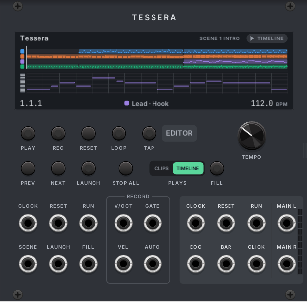
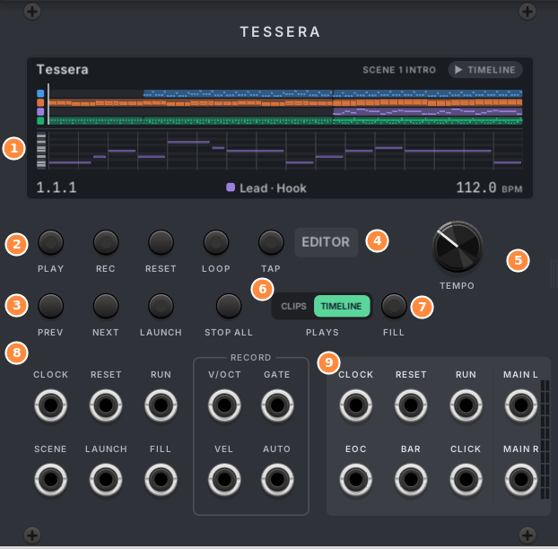
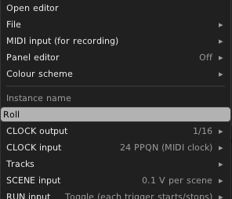
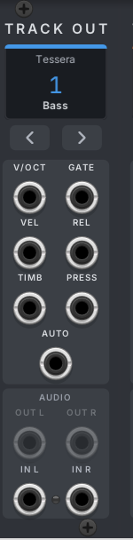
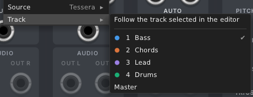
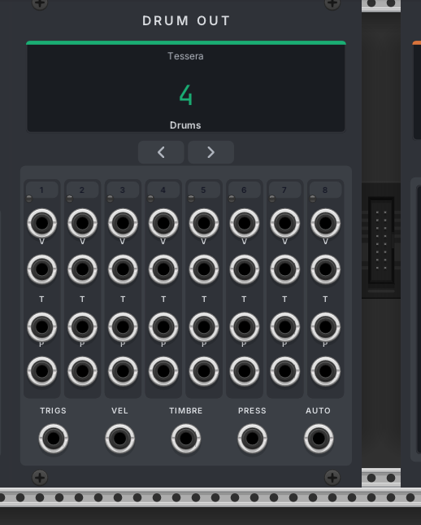
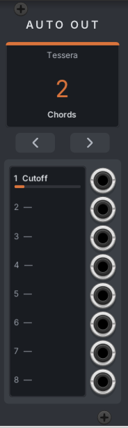

# 2. The modules

This chapter explains every knob, button, jack and menu on the four modules.

## Roll

Roll is the sequencer. It holds the song and plays it. You can use the panel alone for playing and launching
scenes, but you write the music in the editor.

### 1. The display

The display shows what Roll is doing:

- **Top line:** the instance name (for example "Roll" or "Drums B"), the selected scene ("SCENE 1 INTRO") and
  what plays (**CLIPS** or **TIMELINE**).
- **Middle:** a small picture of the song (one coloured line per track) and the notes of the selected clip.
- **Bottom line:** the song position (bar.beat.sixteenth), the selected track and clip, and the tempo. With an
  external clock patched, it says **EXT CLOCK**.

### 2. Transport buttons

| Button | What it does |
|---|---|
| **PLAY** | Starts and stops playback. Its light is on while playing. |
| **REC** | Records. Stopped: counts in (if set), then plays and records. Playing: starts recording at once. Recording: stops recording. See [Recording](11-recording.md). |
| **RESET** | Goes back to the start of the song, or to the loop start when the loop is on. |
| **LOOP** | Turns the song loop on and off. The loop region is set in the editor's ruler. |
| **TAP** | Tap it in time to set the tempo. From the second tap, the tempo follows the average of your last four taps. Wait two seconds to start a new count. |

### 3. Scene buttons

A scene is a row of clips that start together (see [Clips and scenes](05-clips-and-scenes.md)).

| Button | What it does |
|---|---|
| **PREV** / **NEXT** | Pick the scene before or after. The display shows the picked scene. |
| **LAUNCH** | Starts the picked scene. The light is on while it waits for the next bar. |
| **STOP ALL** | Stops every clip at the next launch line. |

### 4. EDITOR

Opens the full editor over the whole Rack window. See [The editor](03-editor.md).

### 5. TEMPO

Sets the tempo, from 20 to 300 BPM. You can also map it to MIDI or modulate it, like any Rack knob.

### 6. PLAYS

Chooses what the tracks play:

- **CLIPS:** each track plays the clip you launched on it.
- **TIMELINE:** each track plays the song as laid out on the timeline.

The same switch is in the editor's transport bar. See [Clips and scenes](05-clips-and-scenes.md#what-plays-clips-or-timeline).

### 7. FILL

Fill lets one clip hold both its normal pattern and a variation, such as a drum fill, and you choose when the
variation plays. Hold the **FILL** button, or keep the **FILL** input high (see [Inputs](#8-inputs)), and fill is on.
Let go and it is off again. In the editor, F1 does the same.

What fill changes is up to you: set a note's **Only when…** to **Fill** and it plays only while fill is on, or to
**Not fill** and it goes quiet while fill is on (see [Shaping notes](08-shaping-notes.md#operators-notes-that-change-from-pass-to-pass)).

For example: add a tom roll to the last beat of a one-bar drum clip and set its notes to **Fill**. Set the hi-hats
on that beat to **Not fill**. The clip plays its normal beat until you hold FILL; then the toms play instead of the
hats.

### 8. Inputs

The inputs sit on the left: the top row controls the transport, the row below it scenes and fill. The four jacks
in the box named **RECORD** are for recording.

| Input | What it does |
|---|---|
| **CLOCK** | An external clock. While a cable is in, the tempo and the song position follow it. The pulses per quarter note (PPQN) are set in the module menu: 1, 2, 4, 8, 12, 24 (MIDI clock, the default), 48 or 96. |
| **RESET** | A trigger returns to the start (or the loop start). With an external clock, it also restarts the pulse count. |
| **RUN** | Starts and stops the transport. In the module menu choose **Toggle** (each trigger starts or stops) or **Gate** (plays while high). |
| **SCENE** | Picks the scene that LAUNCH starts. In the menu choose **0.1 V per scene** or **1 semitone per scene** (so a keyboard can pick scenes). |
| **LAUNCH** | A trigger launches the picked scene. |
| **FILL** | Fill is on while the input is above 1 V, or while the FILL button is held. See [FILL](#7-fill). |
| **V/OCT** | Record input: the pitch of each note, per poly channel. |
| **GATE** | Record input: a note starts when the gate rises above 1 V and ends when it falls below 0.1 V. A new pitch on V/OCT while the gate stays high starts a new note. |
| **VEL** | Record input: velocity, 0 to 10 V. Without a cable, notes get 80%. |
| **AUTO** | Records automation. Poly: channel 1 goes to AUTO lane 1, channel 2 to lane 2, and so on. See [Automation](12-automation.md#recording-automation). |

### 9. Outputs

The outputs sit on the raised plate at the right. Its top row mirrors the transport inputs. All outputs line up
exactly with the notes on the output modules.

| Output | What it sends |
|---|---|
| **CLOCK** | A clock while playing. The rate is set in the module menu: 1/4, 1/8, 1/16 (default), 1/32, or 24, 48 or 96 PPQN. |
| **RESET** | A trigger when the transport resets. |
| **RUN** | High (10 V) while playing. |
| **EOC** | "End of cycle": a trigger each time the song loop wraps around. |
| **BAR** | A trigger on every bar. |
| **CLICK** | A trigger on every beat: 10 V on the first beat of the bar, 5 V on the others. Use it as a metronome. It also clicks during the count-in. |
| **MAIN L** / **MAIN R** | The Master: every audio track mixed, after the Master fader. 10 V is full scale (0 dB), what Rack's Audio module sends to your sound card at full volume. See [Audio](17-audio.md). |

MAIN sits in its own column at the right of the plate, with a two-bar meter beside it: one bar per side, red above
0 dB. An amber dot above the meter means the Master plays but nothing is patched into MAIN. Hover over MAIN to read
the Master's peak level.

### The module menu

Right-click the Roll panel for these settings.

| Item | What it does |
|---|---|
| **Open editor** | Same as the EDITOR button. |
| **Connect MAIN to Audio module** | Shown when the song has audio, MAIN has no cable and the patch has an Audio module: patches MAIN L and R into its first two inputs. See [Audio](17-audio.md#hearing-it-main-l-and-main-r). |
| **File** | New song, open and save project files, import MIDI and audio files, export MIDI and DAWproject. See [Files](14-files.md). |
| **MIDI input (for recording)** | The MIDI device and channel Tessera listens to. |
| **Panel editor** | Widens the panel to show a small editor in the rack: Off, 48, 80 or 120 HP. See [The editor](03-editor.md#the-editor-inside-the-panel). |
| **Colour scheme** | The look of the editor and panels. See [The editor](03-editor.md#colour-schemes). |
| **Editor size** | The size of the full editor: Auto (follows Rack's zoom) or 75% to 200%. |
| **Instance name** | The name the output modules show. Give each Roll its own name when you use more than one. |
| **CLOCK output** | The rate of the CLOCK output. |
| **CLOCK input** | The PPQN of the CLOCK input. |
| **Tracks** | Mute and solo each track without opening the editor. |
| **SCENE input** | 0.1 V per scene, or 1 semitone per scene. |
| **RUN input** | Toggle or Gate mode. |

## Track Out

Track Out plays one track: an instrument track, a drum track, an audio track, or the **Master**. The note jacks are
on the top plate, the **AUDIO** section below them. The note jacks are polyphonic: one channel per voice. The number
of channels follows the track's **Voices** setting (by default, as many as the track ever plays at once).

| Jack | What it sends |
|---|---|
| **V/OCT** | The pitch of each voice, 1 V per octave. Pitch bends are added here. |
| **GATE** | High while each note is held. When a voice is reused at once, the gate drops for a moment so envelopes start again. |
| **VEL** | Velocity, 0 to 10 V. |
| **REL** | Release velocity, 0 to 10 V. It stays after the gate falls. |
| **TIMB** | Timbre curve of each note, 0 to 10 V (see [Shaping notes](08-shaping-notes.md#bends-timbre-and-pressure)). |
| **PRESS** | Pressure curve of each note, 0 to 10 V. |
| **AUTO** | The track's automation lanes, one channel per AUTO lane, already in volts. |
| **OUT L / OUT R** | The track's sound before its fader, for an effect: an audio track's clips, or the master mix. 10 V is full scale (0 dB). |
| **IN L / IN R** (inputs) | Audio mixed into the track before its fader, at full level. Patch an effect's output here. With one side patched, both sides hear it; a poly cable is summed. |

**An effect on a track**: patch **OUT L/R** into the effect and the effect's output back into **IN L/R**. You hear
the track's sound together with what comes back, through the track's fader in the [mixer](18-mixer.md). The light
between IN L and IN R is green while audio comes back, red above 0 dB. A cable into IN of a note track gives that
track a strip in the mixer: plug a synth's output in, and the track has a fader, pan and meter like an audio track.

**Jacks that do nothing for the track are dim**: the note jacks on an audio track or the master, and OUT on a note
track (for now). Hover a dim jack and its tooltip says why; a cable on a dim jack gets an amber ring. **AUTO** works
for every track. Bypassing a Track Out never sends IN to OUT: what comes back simply drops out.

**The screen** shows the Roll's name, the track number in the track's colour, and the track name. It shows
"No source" when no Roll is found, and "Track missing" when the track was deleted. A Track Out never jumps to
another track by itself: undo the delete, or pick a track, and it plays again.

**The arrow buttons** step through the tracks, the master last. Each step can be undone. The screen shows **M** and
"Master" for the master.

**Right-click** for the **Source** (which Roll, by instance name) and **Track** menus.

- **Follow the track selected in the editor** makes the Track Out play whatever track you select. This is useful to
  try one synth with every part. Picking a track or pressing an arrow turns it off. While it follows, OUT and IN
  do nothing.
- A new Track Out picks the track selected in the editor when nothing plays it yet; otherwise the first note track
  without an output.
- Several Track Outs can play the same track. They all send the same thing.

On a **drum track**, you get one channel per drum output, with the lane's note as V/OCT.

## Drum Out

Drum Out plays one **drum track**. Each of the outputs 1 to 8 has a strip, like a mixer channel. On top is a chip
with the output's number in the colour of the lane that plays there. Under it are five jacks, one per row. The rows
are named once, at the left: **TRIG**, **VEL**, **PITCH**, **TIMBRE** and **PRESS**. Hover a jack to see which drum
it is, for example "Snare pitch".

| Jack | What it sends |
|---|---|
| **TRIG** row | A trigger (or gate) for the lane on that output. The small light above flashes on each hit. |
| **VEL** row | The velocity of the last hit, 0 to 10 V. |
| **PITCH** row | How far the hit is tuned away from normal, 1 V per octave: +12 semitones is +1 V. 0 V when the hit has no pitch. Patch it to a drum module's tune input. |
| **TIMBRE** row | The hit's timbre, 0 to 10 V. 0 V when it has none. |
| **PRESS** row | The hit's pressure, 0 to 10 V. 0 V when it has none. |
| **TRIGS**, **VEL**, **PITCH**, **TIMBRE**, **PRESS** | The same for all 16 outputs, on poly cables, one channel per output. |
| **AUTO** | The track's automation lanes, one channel per lane. |

Lanes on outputs 9 to 16 reach only the poly jacks. A lane sends a short 1 ms trigger by default, a gate of a set
length, or a gate as long as its note. See [Drums](09-drums.md#lane-settings).

Velocity, pitch, timbre and pressure hold until the lane's next hit. A hit's pitch, timbre and pressure can be one
value or a curve that moves across the hit. See [Pitch, timbre and pressure](09-drums.md#pitch-timbre-and-pressure).

The screen, arrows and menu work like Track Out's. A new Drum Out picks the first drum track with no output yet.

## Auto Out

Auto Out sends a track's automation lanes on eight separate jacks, AUTO 1 to AUTO 8. Next to each jack it shows the
lane's name and a bar with its value right now. It works with instrument and drum tracks.

Use it when you want each curve on its own cable without a poly splitter. The poly **AUTO** jack on Track Out and
Drum Out sends the same values.

## How output modules find Roll

You never connect a cable from Roll to an output module. Instead:

- A new output module follows the Roll you clicked last, on its first track of the right kind that has no output
  yet. With one Roll in the patch, you never have to pick it.
- The binding is saved in the patch.
- When you copy and paste a Roll together with its output modules, the pasted outputs follow the new copy. An
  output module pasted alone keeps following the original.
- You can have several Rolls in one patch. Give each a different **Instance name** so you can tell them apart in
  the **Source** menu.
- All outputs of all tracks run exactly one sample behind Roll, so every track stays in time with the others, in
  any order and on any number of threads.
- When Roll is bypassed or removed, every gate goes low. No note is left hanging.
