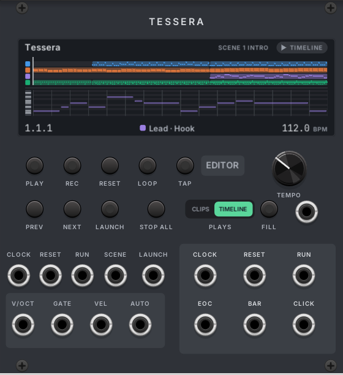
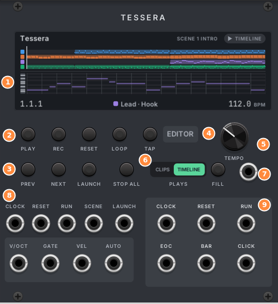
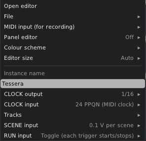
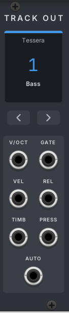
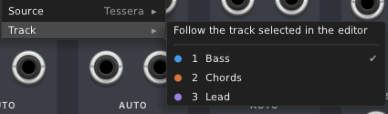
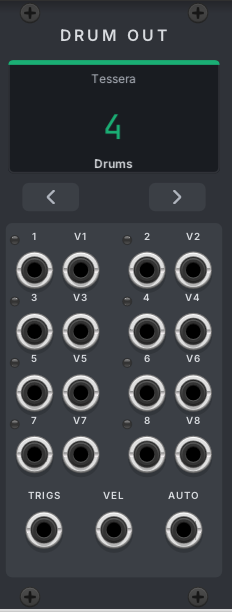
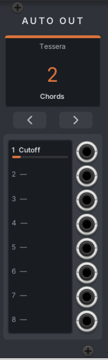

# 2. The modules

This chapter explains every knob, button, jack and menu on the four modules.

## Tessera

Tessera is the sequencer. It holds the song and plays it. You can use the panel alone for playing and launching
scenes, but you write the music in the editor.

### 1. The display

The display shows what Tessera is doing:

- **Top line:** the instance name (for example "Tessera" or "Drums B"), the selected scene ("SCENE 1 INTRO") and
  what plays (**CLIPS** or **TIMELINE**).
- **Middle:** a small picture of the song (one coloured line per track) and the notes of the selected clip.
- **Bottom line:** the song position (bar.beat.sixteenth), the selected track and clip, and the tempo. With an
  external clock patched, it says **EXT CLOCK**.

### 2. Transport buttons

| Button | What it does |
|---|---|
| **PLAY** | Starts and stops playback. Its light is on while playing. |
| **REC** | Records. Stopped: counts in (if set), then plays and records. Playing: starts recording at once. Recording: stops recording. See [Recording](11-recording.md). |
| **RESET** | Goes back to the start of the song, or to the loop start when the loop is on. |
| **LOOP** | Turns the song loop on and off. The loop region is set in the editor's ruler. |
| **TAP** | Tap it in time to set the tempo. From the second tap, the tempo follows the average of your last four taps. Wait two seconds to start a new count. |

### 3. Scene buttons

A scene is a row of clips that start together (see [Clips and scenes](05-clips-and-scenes.md)).

| Button | What it does |
|---|---|
| **PREV** / **NEXT** | Pick the scene before or after. The display shows the picked scene. |
| **LAUNCH** | Starts the picked scene. The light is on while it waits for the next bar. |
| **STOP ALL** | Stops every clip at the next launch line. |

### 4. EDITOR

Opens the full editor over the whole Rack window. See [The editor](03-editor.md).

### 5. TEMPO

Sets the tempo, from 20 to 300 BPM. You can also map it to MIDI or modulate it, like any Rack knob.

### 6. PLAYS

Chooses what the tracks play:

- **CLIPS:** each track plays the clip you launched on it.
- **TIMELINE:** each track plays the song as laid out on the timeline.

The same switch is in the editor's transport bar. See [Clips and scenes](05-clips-and-scenes.md#what-plays-clips-or-timeline).

### 7. FILL

Hold the **FILL** button, or send a high gate to the **FILL** input next to it, to turn "fill" on. Notes set to play
"only in a fill" (or "only when not in a fill") follow it. This is handy for drum fills. In the editor, F1 does the
same.

### 8. Inputs

The top row controls the transport. The box below it is for recording.

| Input | What it does |
|---|---|
| **CLOCK** | An external clock. While a cable is in, the tempo and the song position follow it. The pulses per quarter note (PPQN) are set in the module menu: 1, 2, 4, 8, 12, 24 (MIDI clock, the default), 48 or 96. |
| **RESET** | A trigger returns to the start (or the loop start). With an external clock, it also restarts the pulse count. |
| **RUN** | Starts and stops the transport. In the module menu choose **Toggle** (each trigger starts or stops) or **Gate** (plays while high). |
| **SCENE** | Picks the scene that LAUNCH starts. In the menu choose **0.1 V per scene** or **1 semitone per scene** (so a keyboard can pick scenes). |
| **LAUNCH** | A trigger launches the picked scene. |
| **V/OCT** | Record input: the pitch of each note, per poly channel. |
| **GATE** | Record input: a note starts when the gate rises above 1 V and ends when it falls below 0.1 V. |
| **VEL** | Record input: velocity, 0 to 10 V. Without a cable, notes get 80%. |
| **AUTO** | Records automation. Poly: channel 1 goes to AUTO lane 1, channel 2 to lane 2, and so on. See [Automation](12-automation.md#recording-automation). |

### 9. Outputs

All outputs line up exactly with the notes on the output modules.

| Output | What it sends |
|---|---|
| **CLOCK** | A clock while playing. The rate is set in the module menu: 1/4, 1/8, 1/16 (default), 1/32, or 24, 48 or 96 PPQN. |
| **RESET** | A trigger when the transport resets. |
| **RUN** | High (10 V) while playing. |
| **EOC** | "End of cycle": a trigger each time the song loop wraps around. |
| **BAR** | A trigger on every bar. |
| **CLICK** | A trigger on every beat: 10 V on the first beat of the bar, 5 V on the others. Use it as a metronome. It also clicks during the count-in. |

### The module menu

Right-click the Tessera panel for these settings.

| Item | What it does |
|---|---|
| **Open editor** | Same as the EDITOR button. |
| **File** | New song, open and save project files, import MIDI files, export MIDI and DAWproject. See [Files](14-files.md). |
| **MIDI input (for recording)** | The MIDI device and channel Tessera listens to. |
| **Panel editor** | Widens the panel to show a small editor in the rack: Off, 48, 80 or 120 HP. See [The editor](03-editor.md#the-editor-inside-the-panel). |
| **Colour scheme** | The look of the editor and panels. See [The editor](03-editor.md#colour-schemes). |
| **Editor size** | The size of the full editor: Auto (follows Rack's zoom) or 75% to 200%. |
| **Instance name** | The name the output modules show. Give each Tessera its own name when you use more than one. |
| **CLOCK output** | The rate of the CLOCK output. |
| **CLOCK input** | The PPQN of the CLOCK input. |
| **Tracks** | Mute and solo each track without opening the editor. |
| **SCENE input** | 0.1 V per scene, or 1 semitone per scene. |
| **RUN input** | Toggle or Gate mode. |

## Track Out

Track Out plays one **instrument track**. Each jack is polyphonic: one channel per voice. The number of channels
follows the track's **Voices** setting (by default, as many as the track ever plays at once).

| Jack | What it sends |
|---|---|
| **V/OCT** | The pitch of each voice, 1 V per octave. Pitch bends are added here. |
| **GATE** | High while each note is held. When a voice is reused at once, the gate drops for a moment so envelopes start again. |
| **VEL** | Velocity, 0 to 10 V. |
| **REL** | Release velocity, 0 to 10 V. It stays after the gate falls. |
| **TIMB** | Timbre curve of each note, 0 to 10 V (see [Shaping notes](08-shaping-notes.md#bends-timbre-and-pressure)). |
| **PRESS** | Pressure curve of each note, 0 to 10 V. |
| **AUTO** | The track's automation lanes, one channel per AUTO lane, already in volts. |

**The screen** shows the Tessera's name, the track number in the track's colour, and the track name. It shows
"No source" when no Tessera is found, and "Track missing" when the track was deleted. A Track Out never jumps to
another track by itself: undo the delete, or pick a track, and it plays again.

**The arrow buttons** step through the instrument tracks. Each step can be undone.

**Right-click** for the **Source** (which Tessera, by instance name) and **Track** menus.

- **Follow the track selected in the editor** makes the Track Out play whatever track you select. This is useful to
  try one synth with every part. Picking a track or pressing an arrow turns it off.
- Several Track Outs can play the same track. They all send the same thing.

You can also put a **drum track** on a Track Out. You get one channel per drum output, with the lane's note as
V/OCT.

## Drum Out

Drum Out plays one **drum track**. Each drum sound (a "lane", such as Kick or Snare) has an output number from 1 to
16.

| Jack | What it sends |
|---|---|
| **1** to **8** | A trigger (or gate) for the lanes on outputs 1 to 8. The small light flashes on each hit. |
| **V1** to **V8** | The velocity of the last hit on that output, 0 to 10 V. It holds until the next hit. |
| **TRIGS** | All 16 outputs on one poly cable, one channel per output. |
| **VEL** | All 16 velocities on one poly cable. |
| **AUTO** | The track's automation lanes, one channel per lane. |

Lanes on outputs 9 to 16 reach only the poly **TRIGS** and **VEL** jacks. A lane sends a short 1 ms trigger by
default, or a gate of a set length. See [Drums](09-drums.md#lane-settings).

The screen, arrows and menu work like Track Out's. A new Drum Out picks the first drum track with no output yet.

## Auto Out

Auto Out sends a track's automation lanes on eight separate jacks, AUTO 1 to AUTO 8. Next to each jack it shows the
lane's name and a bar with its value right now. It works with instrument and drum tracks.

Use it when you want each curve on its own cable without a poly splitter. The poly **AUTO** jack on Track Out and
Drum Out sends the same values.

## How output modules find Tessera

You never connect a cable from Tessera to an output module. Instead:

- A new output module follows the Tessera you clicked last, on its first track of the right kind that has no output
  yet. With one Tessera in the patch, you never have to pick it.
- The binding is saved in the patch.
- When you copy and paste a Tessera together with its output modules, the pasted outputs follow the new copy. An
  output module pasted alone keeps following the original.
- You can have several Tesseras in one patch. Give each a different **Instance name** so you can tell them apart in
  the **Source** menu.
- All outputs of all tracks run exactly one sample behind Tessera, so every track stays in time with the others, in
  any order and on any number of threads.
- When Tessera is bypassed or removed, every gate goes low. No note is left hanging.
