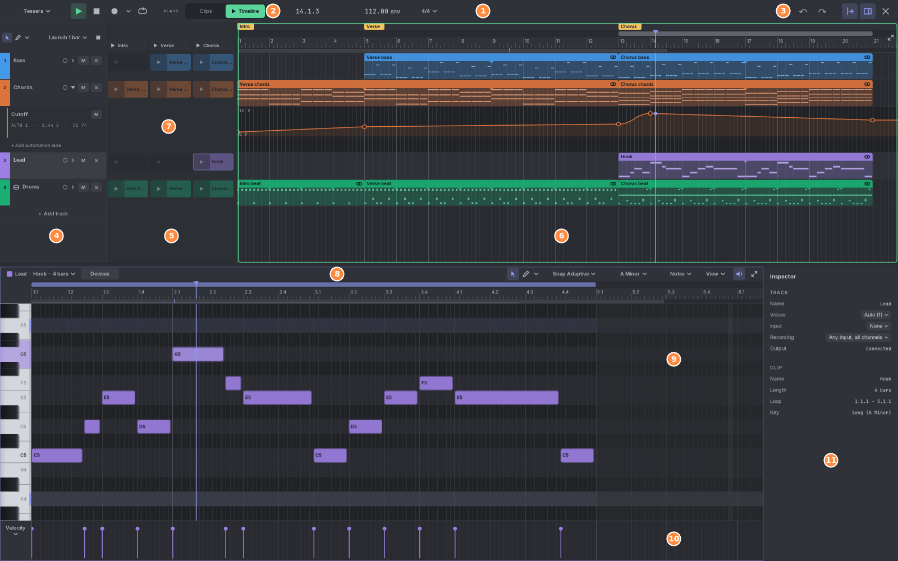
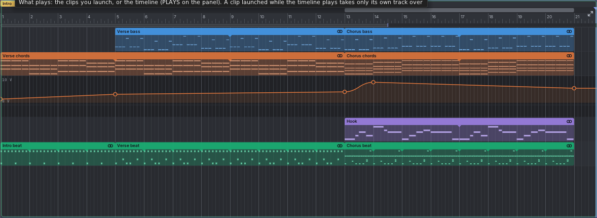
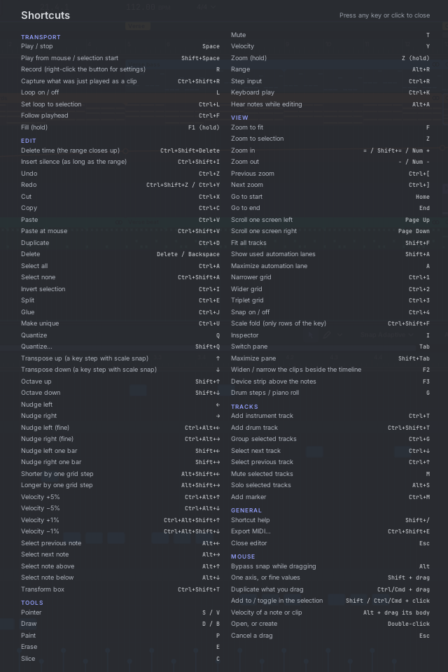
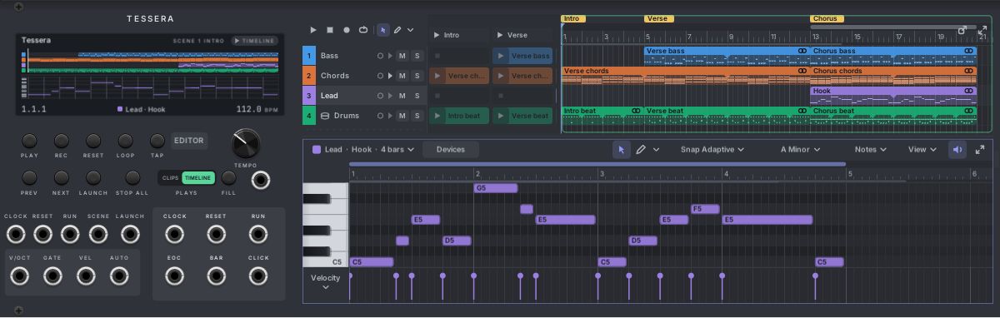
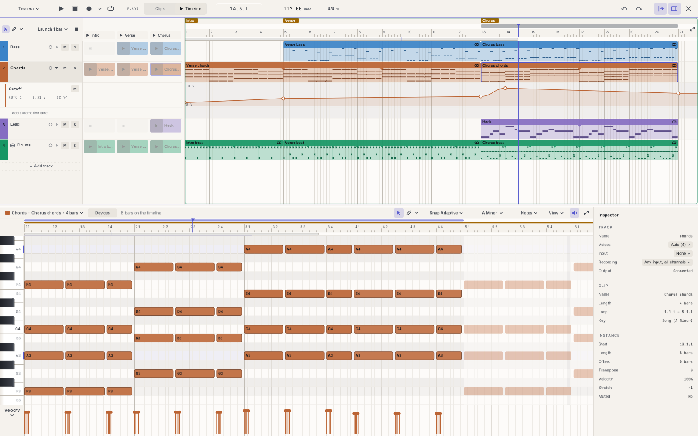

# 3. The editor

The editor is where you write music. This chapter shows its parts, how to move around in it, and how undo works.

## Opening and closing

- Click **EDITOR** on the Tessera panel, or right-click the panel and pick **Open editor**.
- The editor covers the whole Rack window. While it is open, the rack behind it doesn't react to the mouse or keys.
  **Ctrl+S** still saves the patch.
- Click **×** in the top-right corner to close it, or press **Esc**. Esc first cancels a drag, then clears the
  selection; once nothing is left to cancel, it closes the editor.

There is also a smaller editor inside the panel itself. See [The editor inside the panel](#the-editor-inside-the-panel).

## The parts of the editor

1. **Transport bar.** From the left: the **Tessera ▾** menu (files and colour schemes), play ▶, stop ■, record ●
   with its settings ▾, loop ⟳, the song position, the tempo, and **4/4 ▾** (time signature and swing).
2. **Plays switch.** What the tracks play: the **Clips** you launch or the **Timeline**. The half that plays is
   lit. See [Clips and scenes](05-clips-and-scenes.md#what-plays-clips-or-timeline).
3. **Undo and redo**, **follow the playhead**, **show the inspector**, and **close**.
4. **Track headers.** One row per track: number and colour, name, arm for recording, automation lanes arrow, mute
   (M) and solo (S). See [Tracks](04-tracks.md).
5. **Clips.** Each column is a scene, each row a track. Click ▶ in a slot to launch that clip. See
   [Clips and scenes](05-clips-and-scenes.md).
6. **Timeline.** The song from left to right, with the ruler, markers and the loop on top. See
   [The timeline](06-timeline.md).
7. **Automation lane.** A curve that moves a voltage over time. It opens under its track. See
   [Automation](12-automation.md).
8. **Notes header.** The clip's name and length, the **Devices** button, the tool switch, **Snap**, the key, the
   **Notes ▾** and **View ▾** menus, the speaker (hear notes while editing) and the maximize button.
9. **Piano roll.** The notes of the selected clip. On a drum track it is the drum editor, with lanes instead of
   keys. See [The piano roll](07-piano-roll.md) and [Drums](09-drums.md).
10. **Lower lane.** Velocity by default. Click its name ("Velocity ▾") to show another value or curve.
11. **Inspector.** Settings of the selected notes, track and clip. Press **I** to show or hide it.

The top half is the **song pane**. The bottom half is the **notes pane**. Drag the line between them to give one
more room.

## Panes, focus and keys

- **Keys act on the pane under the mouse.** Over the notes, Ctrl+A selects all notes. Over the song pane, it
  selects all clips or tracks. A thin ring shows which pane has the keys.
- With the mouse outside both panes (on the transport or the inspector), the pane you clicked last keeps the keys.
- **Tab** switches the pane. **Shift+Tab** maximizes the pane under the mouse, or restores both.
- Each pane has a **maximize** button in its top-right corner. Double-clicking the line between the panes does the
  same.
- **F2** widens the clips beside the timeline (handy when performing). Press it again to narrow them.
- **F3** opens the device strip above the notes. See [Devices](13-devices.md).

## Tools

Each pane has its own tool switch: **Select** (the arrow), **Draw** (the pencil) and a **▾** menu with more tools.
While a tool from the menu is on, the ▾ shows its icon.

| Tool | Key | In the notes pane | In the song pane |
|---|---|---|---|
| **Select** | S or V | Select, move and resize notes. | Select, move and resize clips. |
| **Draw** | D or B | Click to add a note. Right-click to delete. | Drag to make an empty clip; click for a one-bar clip. |
| **Paint** | P | Drag to add a note on every grid step. | — |
| **Erase** | E | Click or drag across notes to delete them. | Click or drag across clips to delete them. |
| **Slice** | C | Click to cut a note in two. | Click to cut a clip in two. |
| **Mute** | T | Click or drag to mute notes. | Click or drag to mute clips. |
| **Velocity** | Y | Drag up or down on a note to change velocity. | — |
| **Range** | Alt+R | — | Select a stretch of time across tracks. |
| **Zoom** | hold Z | Drag a box to zoom into it. Click zooms in, Alt+click out. | Same. |

> **Tip:** With something selected, choosing **Erase** deletes the selection and keeps your current tool.

## Moving around

These work in the piano roll, the drum editor, the timeline and automation lanes.

| To do this | Do this |
|---|---|
| Scroll up and down | Mouse wheel |
| Scroll sideways | Shift + wheel |
| Zoom in time | Ctrl + wheel. The spot under the mouse stays put. |
| Make rows taller or shorter (the row under the mouse stays put) | Alt + wheel |
| Pan (grab and move) | Middle-drag, or hold Space and drag. A short tap of Space still plays. |
| Zoom with the ruler | Drag up or down in the ruler. Drag sideways at the same time to pan. |
| Zoom to fit everything (or the selection) | **F** |
| Zoom to the selection | **Z** (a short tap) |
| Zoom into a box | Hold **Z** and drag a box |
| Zoom in or out a step | **=** and **-** |
| Go back to the previous zoom | **Ctrl+[** (and **Ctrl+]** to go forward again) |
| Jump to the start or end | **Home** / **End** |
| Scroll one screen | **Page Up** / **Page Down** |
| Fit all tracks in the song pane | **Shift+F** |

While you drag a note or clip near the edge, the view scrolls by itself.

### The ruler, loop and markers

- **Click** the ruler to move the playhead. **Double-click** to move it and start playing from there.
- The **loop strip** is the thin bar under the markers. Drag in it to draw the loop. Drag the loop to move it, drag
  its ends to resize it. Double-click it to turn the loop on or off. **L** also turns the loop on and off, and
  **Ctrl+L** sets the loop around what is selected.
- **Markers** (Intro, Verse, Chorus above) sit in the top row. Double-click the row to add one (or press
  **Ctrl+M**), drag a marker to move it, click it to jump there.
- The **overview bar** shows the whole song in small. Drag its window to scroll, drag the window's ends to zoom,
  click to jump, double-click to fit.

### Following the playhead

The follow button in the transport bar (or **Ctrl+F**) keeps the playhead in view while playing. Pick how it moves
in the notes header's **View ▾** menu: **Page by page** or **Scroll smoothly**. Following pauses while you drag or
right after you scroll, then comes back.

## Mouse keys that work everywhere

| While you drag or click | It means |
|---|---|
| **Alt** | No snapping: place freely. |
| **Shift** | Move in one direction only (decided by your first move). On values: fine steps. |
| **Ctrl + drag** | Copy what you drag. You can press Ctrl in the middle of a drag. |
| **Ctrl + click** | Add to or remove from the selection. |
| **Shift + click** | Add to the selection. |
| **Ctrl + drag from empty space** | Draw a selection box, with any tool. |
| **Double-click** | Open, or create (a note, a clip, a marker). |
| **Right-click** | The menu for what you clicked. With Draw in the piano roll, it deletes notes instead. |
| **Esc during a drag** | Cancel the drag. Everything goes back. |

## Undo

- Every change can be undone with **Ctrl+Z** and redone with **Ctrl+Shift+Z** or **Ctrl+Y**. The arrows in the
  transport bar do the same.
- One drag is one undo step, however long it was.
- Undo also brings back what was selected.
- Tessera uses Rack's own undo list, so **Edit → Undo** in Rack's menu works too.

## Help

Press **?** (Shift+/) in the editor to see every shortcut on one screen. Any key or click closes it.

Every button shows a tooltip after half a second, with its key in brackets.

## The editor inside the panel

Tessera's panel can grow wider to hold a small editor right in the rack. Drag the panel's right edge, or right-click
the panel and choose **Panel editor → 48, 80 or 120 HP**. Modules to the right move out of the way. Narrow it below
about 36 HP and it folds back to 24 HP. One undo restores the width and the neighbours.

- It shows the same song and the same editing tools as the full editor, just smaller. Edits in one show at once in
  the other. Each keeps its own zoom.
- Play, stop, record and loop sit at the top left. **Full editor** (a window with an arrow) and **maximize** sit at
  the top right.
- When the song pane is narrower than 600 px and the timeline plays, the clips fold into a **CLIPS** tab. Click it to
  open them.
- Keys go to the panel editor while the mouse is over it. Delete never deletes the module there.
- Rack modules are always the same height, so the panel editor is small. Zoom the rack in to give it more room.

## Colour schemes

Choose a look in **Tessera ▾ → Colour scheme** (or the module menu). The choice applies to every Tessera and its
panels.

- **Follow Rack** (the default): **Plaster** (light) when Rack uses light panels, **Slate** (dark) when it uses dark
  panels.
- Light: **Plaster**, **Sand**.
- Dark: **Slate**, **Gruvbox**, **Nord**, **Catppuccin**, **One Dark**, **Monokai**.

In **View ▾** in the notes header, **Name notes with flats** writes Db instead of C#, everywhere in Tessera.

## Editor size

Right-click the panel and pick **Editor size** to make the full editor larger or smaller: **Auto** follows Rack's own
zoom, or choose 75% to 200%.
