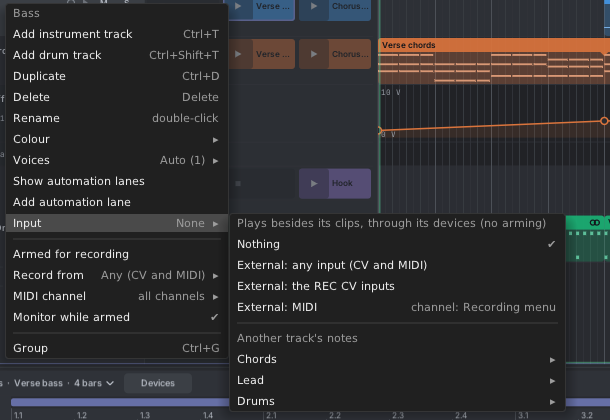

# 4. Tracks

A track is one part of your song: a bass line, chords, a lead, drums. Each track has its own clips, its own notes
and its own output module. A song has 1 to 64 tracks.

## Two kinds of track

- **Instrument tracks** play notes with pitch. Each plays through a **Track Out**. A track can play up to 16 notes
  at once.
- **Drum tracks** play drum sounds. Each sound is a "lane" with its own trigger output. They play through a
  **Drum Out**. Drum tracks open in the step grid. See [Drums](09-drums.md).

A new song has three instrument tracks and one drum track.

## The track header

Each track has a header row on the left:

- **The colour tile** with the track number. A drum track also shows a small drum.
- **The name.** Double-click it to rename. Enter keeps the new name, Esc cancels.
- **An amber jack** appears left of the arm button when the track has notes but no output module plays it. Add a
  Track Out (or Drum Out) and pick this track.
- **Arm** (the ring): arms the track for recording. It turns red while armed. See [Recording](11-recording.md).
- **The lanes arrow** (▸): shows the track's automation lanes under it. It is dim until the track has lanes.
- **M** mutes the track. **S** solos it.

Click a header to select the track. The piano roll then shows its clip.

## Adding and removing tracks

| To do this | Do this |
|---|---|
| Add an instrument track | **Ctrl+T**, or **+ Add track** under the last track |
| Add a drum track | **Ctrl+Shift+T** (with the mouse over the song pane), or **+ Add track → Drum** |
| Add a track at a spot | Right-click empty space in the headers or the timeline |
| Add an instrument track quickly | Double-click empty header space |
| Duplicate a track | **Ctrl+D** after clicking its header, or the track menu. The copy gets its own clips. |
| Delete a track | **Delete** after clicking its header, or the track menu. A song always keeps one track. |

New tracks go right after the selected one.

When you delete a track, an output module that played it shows **Track missing** and goes quiet. Undo the delete and
it plays again. Clips that only that track used are deleted with it; clips shared with other tracks stay.

## Selecting several tracks

- **Shift+click** headers to select a range. **Ctrl+click** to add or remove one.
- Mute, solo, colour and voices then change every selected track at once.
- **Ctrl+Up** and **Ctrl+Down** select the track above or below.

## Mute and solo

- **M** (or the **M** key) mutes. A muted track sounds nothing, at once.
- **S** solos a track: only soloed tracks play. Clicking **S** on another track adds it to the solo.
- **Shift+click S** solos only this track and un-solos the others.
- **Alt+S** adds the selected tracks to the solo.
- The **Tracks** submenu in Tessera's module menu also mutes and solos, without opening the editor.

## Reordering and groups

- **Drag a header** up or down to move the track. A line shows where it will land.
- **Ctrl+G** puts the selected tracks in a **group**. A group header gets a fold arrow. Folding hides the group's
  tracks and shows their clips on one row. Folding is only a view: it doesn't change the song.
- Drop a track on the lower half of a group header to put it in that group. Drag a group header to move the whole
  group.
- **Ungroup** is in the group's right-click menu.
- Groups can't hold other groups.

## Resizing rows

- Drag the bottom edge of a header to make the row taller or shorter. **Alt**+drag resizes every track.
- Double-click the bottom edge to switch between short and tall.
- **Shift+F** fits all tracks in the pane.

## The track menu

Right-click a track header for its menu.

| Item | What it does |
|---|---|
| **Add instrument track / Add drum track** | Adds a track after this one. |
| **Duplicate / Delete / Rename** | As above. |
| **Colour** | One of 16 track colours. Clips and notes take the track's colour. |
| **Voices** | How many poly channels the Track Out sends. **Auto** (the default) sends as many as the track ever plays at once: a part with 3-note chords sends 3. Or pick a fixed number from 1 to 16. |
| **Show automation lanes / Add automation lane** | See [Automation](12-automation.md). |
| **Input** | What the track plays besides its clips. See below. |
| **Armed for recording, Record from, MIDI channel, Monitor while armed** | See [Recording](11-recording.md). |
| **Group** | Groups the selected tracks. |

Voices, Input and the recording settings are also in the inspector's **TRACK** section when no notes are selected.
The inspector's **Output** row says which output module plays the track, or "None" with a hint.

## A track that plays another track (Input)

A track can play notes from somewhere else, all the time, without being armed. Set this in **Input**:

- **Nothing** (the default): the track plays only its clips.
- **External**: notes coming in from MIDI or the REC CV inputs.
- **Another track's notes**, either **after its devices** (what it really plays, such as an arpeggio) or **before
  its devices** (its clips as written).

The notes go through this track's own devices. So one melody can drive a second track that adds a chord, or an
arpeggio, with its own synth. The track's own clips keep playing too.

- A muted track still feeds the tracks that listen to it, like a MIDI send.
- Tracks that already listen to this one are greyed out in the menu, so you can't make a loop.
- If the source track is deleted, the menu shows **Missing track** and nothing plays until you undo.

Use a **Note Filter** device set to a MIDI channel to pick out one part of the other track. See
[Shaping notes](08-shaping-notes.md#midi-channels).
