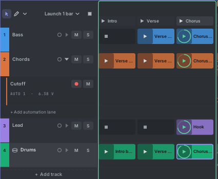
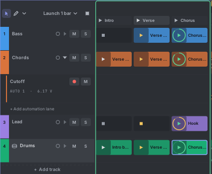
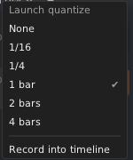

# 5. Clips and scenes

A **clip** is a short piece of music on one track, such as a 4-bar bass line. Clips loop. You start (launch) them
while the music plays. A **scene** is a column of clips, one per track, that
you launch together: "Intro", "Verse", "Chorus".

## The clips panel

The clips sit between the track headers and the timeline. Each **row** is a track. Each **column** is a scene, with
the scene's ▶ and name on top.

A slot can look like this:

| Slot | Meaning |
|---|---|
| Dark, sunken, with a faint ■ | Empty. Click the ■ to stop the track. |
| Coloured, with a name and ▶ | A clip, ready to launch. |
| Bright, with a ring around ▶ | Playing. The ring fills up as the clip loops. |
| Blinking yellow ▶ | Waiting to start at the next launch line. |
| Red | Recording into this slot. |

**F2** widens the clips to fill most of the song pane, for performing. Press it again to narrow them. You can also
drag the clips' right edge. **Shift+wheel** scrolls through scenes.

## Making clips

- **Double-click an empty slot.** A one-bar clip appears, is selected, and opens in the piano roll.
- Or select a track and **double-click the piano roll**.
- New clips are called "Clip 1", "Clip 2" and so on. Rename them from the clip's menu.
- A new clip on a track that plays nothing starts launched. Press play and you hear it.

## Launching and stopping

- **Click ▶ in a slot** to launch that clip.
  - While playing, it waits for the next **launch line** (by default the next bar), blinking yellow. Then it starts
    exactly on time.
  - While stopped, it starts at once and starts the transport.
- **Click ▶ on a scene's header** to launch the whole column. Tracks with an empty slot in that scene stop.
- **Click the ■ in an empty slot** to stop that track (at the launch line).
- **Stop all** (the ■ next to "Launch 1 bar" above the track names) stops every clip at the launch line.
- Only one clip plays per track. Launching another one replaces it at the launch line.
- A clip with looping off plays once, then the track stops.

When you press play later, the clips that were playing start again.

## Launch quantize: when clips start

Click **Launch 1 bar ▾** (above the track names) to choose the launch line.

- **None** starts clips at once.
- **1/16**, **1/4**, **1 bar** (default), **2 bars**, **4 bars** wait for that line. Lines follow the song's bar
  numbers.
- A clip can have its own setting: right-click it, **Launch quantize**. "Song setting" uses the menu above.
- **Record into timeline** writes what you launch onto the timeline. See [The timeline](06-timeline.md#recording-what-you-launch).

## Editing clips

- **Click a clip** to show it in the notes pane below.
- **Drag** a clip to another slot to move it. Hold **Ctrl** or **Alt** to copy it. Dropping on a slot that has a clip
  replaces that clip.
- **Drag a clip onto the timeline** to place it there. The timeline copy is **linked**: change the notes in one and
  both change.
- **Drag a timeline clip onto an empty slot** to link it into that slot.
- **Delete** removes the last clicked clip. **Ctrl+D** copies it into the slot below (a new scene is added if that
  slot is taken).

### The clip menu

Right-click a clip in a slot:

| Item | What it does |
|---|---|
| **Launch** | Same as its ▶. |
| **Edit this scene's clips together** | Shows the other clips of the scene dimmed in the piano roll, so you can write parts that fit. See [The piano roll](07-piano-roll.md#editing-several-clips-together). |
| **Rename** | A new name for the clip. Every place that uses the clip shows it. |
| **Place in arrangement at playhead** | Puts a linked copy on the timeline at the playhead. |
| **Duplicate**, **Delete** | As above. |
| **Export as MIDI…** | Saves this clip as a MIDI file. |
| **Loop** | On: the clip repeats. Off: it plays once and stops. |
| **Launch quantize** | This clip's own launch line. |
| **Length** | **×2 longer** (half speed), **×½ shorter** (double speed), or a typed percentage. Notes, loop and automation all stretch, and every timeline use grows or shrinks with it. |
| **Save as / Replace with Tessera clip file…** | A `.tessera-clip` file, to reuse a clip in another patch. |

Right-click an **empty slot** for: **Create clip**, **Load a Tessera clip file…**, **Import MIDI file…** and **Stop
track**.

### Clip length and loop

The clip chip at the left of the notes header ("Lead · Hook · 4 bars ▾") changes the clip shown below:

- **Rename…**, **Loop** on or off.
- Lengths of **1, 2, 4, 8 or 16 bars**.
- **Double**: twice as long, with the notes copied into the new half (great for building variations).
- **Halve**: half as long.
- **Save as Tessera clip file…**, **Export as MIDI…**.
- **Track**: jump to the previous, next or any track.

In the piano roll's ruler, the coloured loop bar shows the clip's loop. Drag its ends to change it. If you draw notes
past the end of a looping clip, the clip grows to hold them, in whole bars.

## Scenes

- **Click a scene's ▶** to launch it.
- **Double-click a scene's name** to rename it.
- Right-click a scene's header for: **Launch**, **Rename**, **Colour**, **Tempo** (a tempo the song jumps to when the
  scene launches), **Insert scene above / below**, and **Delete**.
- Click **+** after the last scene to add one. A song has up to 64 scenes.

### Scenes from the panel

The Tessera panel can launch scenes without the editor: **PREV** and **NEXT** pick a scene, **LAUNCH** starts it,
**STOP ALL** stops all clips. The **SCENE** and **LAUNCH** inputs do the same from CV, so a sequencer or a MIDI
keyboard can switch your song's parts. The picked scene shows on the display and is outlined in the editor.

## What plays: clips or timeline

The **Plays** switch in the transport bar (and **PLAYS** on the panel) decides what the tracks play:

- **Clips**: each track plays the clip you launched. The timeline is silent.
- **Timeline**: each track plays the timeline from left to right.

The section that plays is framed in green while the transport runs. The other one is dimmed, but you can still edit
it.

**Launching over the timeline.** While the timeline plays, you can still launch a clip. That track then leaves the
timeline and plays the clip. Its timeline lane is dimmed and its header says "Launcher clip playing". Click **Back to
timeline** on the timeline's ruler to bring every track back. Switching the Plays switch to Timeline also brings them
back.
