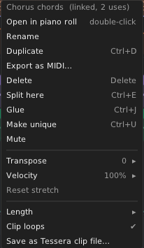
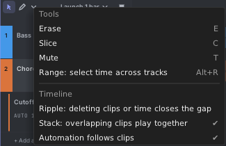

# 6. The timeline

The timeline lays your song out from left to right, bar by bar. Each track is a row. Each clip on it is a tile with
a coloured title bar and a small picture of its notes. Set **Plays** to **Timeline** to hear it.

## Putting clips on the timeline

- **Drag a clip from the clips panel** onto a track. It lands where you drop it, snapped to the grid.
- With the **Draw** tool (D): drag in an empty row to make an empty clip that long, or click for a one-bar clip.
- **Double-click** an empty row for a one-bar clip.
- Right-click an empty row for **Paste**, **Place launcher clip** and **Import MIDI file here…**.
- In a clip's menu in the clips panel: **Place in arrangement at playhead**.

A clip on the timeline points to a clip, the same way a slot does. Many tiles can point to one clip: they are
**linked**. A linked tile shows a link badge (∞) in its title bar. Edit the notes of one and every linked tile
changes.

## Selecting

- **Click** a clip to select it. **Shift+click** adds, **Ctrl+click** adds or removes.
- **Drag from empty space** (Select tool) to draw a box. Every clip it touches is selected.
- **Ctrl+A** selects all clips (with the mouse over the song pane).
- **Double-click** a clip to open it in the piano roll. Double-click again to maximize the notes.

## Moving and copying

- **Drag** a clip to move it. Drag up or down to move it to another track.
- Clips snap to the grid, and also to nearby clip edges, markers, the loop ends and the playhead.
- **Alt** while dragging: no snapping. **Shift**: move only across time, or only across tracks.
- **Ctrl+drag**: a linked copy.
- **Ctrl+Alt+drag**: an independent copy (its own clip).
- **Ctrl+D**: a linked copy right after the selection.
- **Ctrl+U** (**Make unique**): gives each selected tile its own copy of the clip, so you can change it alone.
- **Left / Right arrows** nudge by the grid. **Shift+Left / Right** nudge by a bar.

## Changing a clip's length and content

Hover a clip's edges and body. The mouse cursor shows what a drag will do.

| Drag | What it does |
|---|---|
| **Right edge** of a looping clip | Makes the tile longer: the loop repeats. Small notches mark each repeat. |
| **Right edge** of a clip that doesn't loop | Trims or extends its end. |
| **Left edge** | Trims the start. The notes stay where they are in time. |
| **Alt + body** | Slips the notes inside the tile, without moving the tile. |
| **Alt + right edge** | Time-stretches the tile. The readout shows the factor (×2, ×0.5…). |
| **Title bar, up or down** | Changes the tile's velocity (shown as a percentage). Dragging sideways moves the clip. |

With the keys: **Shift+Alt+Left / Right** makes the selection shorter or longer by one grid step. **Up / Down**
transposes the selected tiles. Transpose, velocity and stretch change only that tile, not the clip.

## Cutting and joining

- **Ctrl+E** splits the selected clips at the mouse (or at the playhead when the mouse is elsewhere).
- The **Slice** tool (C) cuts a clip where you click. A line shows where the cut will go.
- **Ctrl+J** (**Glue**) joins the selected clips into one new clip, with loops, stretch, transpose and velocity
  baked in.
- **Delete** removes the selected clips. **Ctrl+C**, **Ctrl+X** and **Ctrl+V** copy, cut and paste (at the
  playhead).

## The clip menu

Right-click a clip on the timeline:

| Item | What it does |
|---|---|
| **Open in piano roll** | Shows the clip's notes below (same as double-click). |
| **Rename**, **Duplicate**, **Delete** | As usual. |
| **Export as MIDI…** | Saves the clip (or the selected clips) as a MIDI file. |
| **Split here**, **Glue**, **Make unique** | As above. |
| **Mute** | Silences this tile. Muted tiles are drawn dim. |
| **Transpose**, **Velocity** | Per tile. The clip itself doesn't change. |
| **Reset stretch** | Undoes a time-stretch. |
| **Length** | ×2, ×½ or a percentage, for the clip itself and every place it is used. |
| **Clip loops** | Turns the clip's loop on or off. |
| **Save as Tessera clip file…** | Saves the clip to reuse elsewhere. |

When a timeline clip is selected, the inspector shows an **INSTANCE** section with its start, length, offset,
transpose, velocity, stretch and mute.

## Seeing a timeline clip in the piano roll

Click a timeline clip and the piano roll shows its notes. If the tile is longer than the clip's loop, the repeats are
drawn faded, up to a yellow line where the tile ends. The header says, for example, "8 bars on the timeline". A thin
yellow bracket under the ruler's loop bar marks the same span. Drag the bracket's end to make the tile longer or
shorter.

## The song pane's tools and settings

Click the **▾** next to Select and Draw (top left of the song pane):

- **Erase** (E), **Slice** (C), **Mute** (T) and **Range** (Alt+R).
- **Ripple**: deleting clips or time closes the gap, so later clips move left. A **RIPPLE** tag shows while it is on.
- **Stack** (on by default): clips may overlap on a track and all of them play. The row splits to show them. With
  Stack off, a clip you drop on another trims or replaces it.
- **Automation follows clips** (on by default): moving or copying a clip takes the track's automation under it
  along.

## Working with time: the range tool

To change a stretch of time across tracks, select a **range**: **Alt+drag** in empty space on the timeline, or use
the **Range** tool (Alt+R). Then:

| Key | What it does |
|---|---|
| **Delete** | Empties the range. Clips are cut at its edges. (With Ripple on, it deletes the time.) |
| **Ctrl+Shift+Delete** | Deletes the time: everything after it moves left. |
| **Ctrl+Shift+I** | Inserts silence as long as the range: everything after it moves right. |
| **Ctrl+D** | Copies the range right after itself. |
| **Ctrl+L** | Sets the song loop to the range. |

Range edits change clips and automation together.

## The song loop

The loop strip under the markers sets the song loop (see [The editor](03-editor.md#the-ruler-loop-and-markers)).
With the loop on, the timeline repeats that part. Notes never ring past the loop end. **Ctrl+L** with clips selected
loops around them.

## Recording what you launch

You can play the song live from the clips panel and keep the result on the timeline:

1. Open **Launch 1 bar ▾** and turn on **Record into timeline**. The chip turns red.
2. Press play and launch clips and scenes as you like.
3. Stop the transport, or turn **Record into timeline** off.

Each clip you launched now sits on the timeline where it played. It is one undo step. With the song loop on, the last
pass wins.
