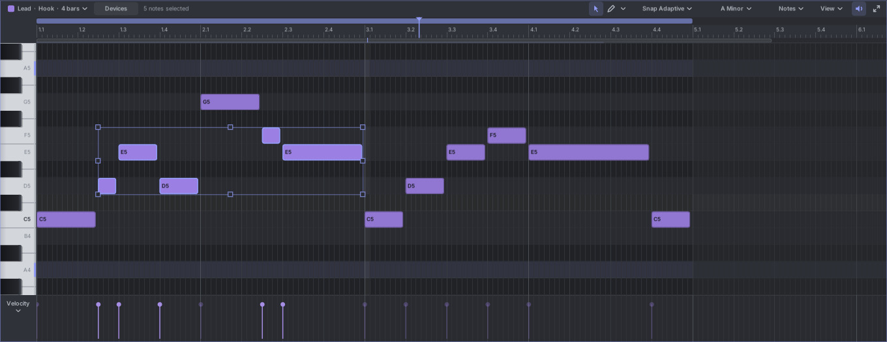
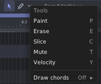
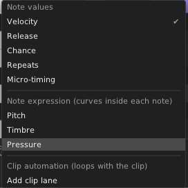
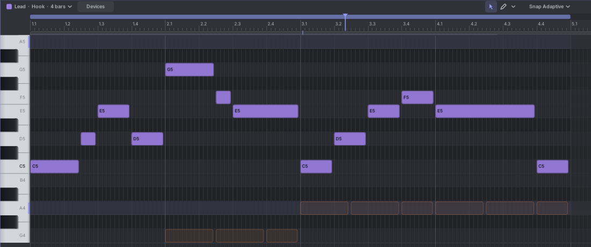

# 7. The piano roll

The piano roll shows the notes of one clip. Time runs from left to right. Pitch runs from bottom to top, with a
keyboard on the left. It shows the clip of the selected track: the clip you clicked, or else the one that plays.

## The notes header

From left to right:

- **The clip chip** ("Lead · Hook · 4 bars ▾"): the track, the clip and its length. Its menu renames the clip, turns
  its loop on or off, sets its length, and switches tracks. See [Clips and scenes](05-clips-and-scenes.md#clip-length-and-loop).
- **Devices**: opens the note effects of this track (F3). See [Devices](13-devices.md).
- How many notes are selected.
- **Select**, **Draw** and **▾** (more tools, see below).
- **Snap ▾**: the grid notes snap to.
- **The key chip** ("A Minor ▾"): the key, and the highlight, snap and fold switches. See
  [Keys, scales and chords](10-scales-and-chords.md).
  A drum track shows **Kit** here instead (see [Drums](09-drums.md)).
- **Notes ▾**: transforms such as quantize, humanize and arpeggiate. See [Shaping notes](08-shaping-notes.md#transforms).
- **View ▾**: ghost notes, badges on notes, note names with flats, and how the view follows the playhead.
- **The speaker**: hear notes while you draw, move and click them (Alt+A).
- **Maximize**: gives the notes the whole editor (Shift+Tab).

When the header is narrow, some of these fold into a **⋯** menu. Nothing is ever lost.

## The keyboard

- **Click** a key to hear it. **Drag** along the keys for a glissando.
- **Ctrl+click** a key to select every note of that pitch.
- With a key chosen, keys outside the key are dimmed and each root is marked.

## Drawing notes

1. Pick **Draw** (D).
2. **Click** to place a note. It uses the length and velocity of the last note you touched, and lands on the grid
   line at or before the mouse.
3. **Drag right** while placing to set its length. **Drag up or down** right after placing to change its pitch. You
   hear each pitch as you go.
4. **Right-click** (or right-drag) a note to delete it.

Other ways:

- **Double-click** empty space with any tool to add a note.
- **Paint** (P, in the ▾ menu): drag across the grid to add a note on every grid step. Move up and down as you drag
  to paint a melody.
- **Draw chords** (in the ▾ menu): Draw places a whole chord. See [Keys, scales and chords](10-scales-and-chords.md#drawing-chords).

If you draw past the end of a looping clip, the clip grows to hold the new notes, in whole bars.

## Selecting notes

- **Click** a note to select it. **Shift+click** adds a note. **Ctrl+click** adds or removes one.
- **Drag from empty space** (Select tool) to draw a box. Notes it touches are selected. **Shift+drag** adds to the
  selection. With any tool, **Ctrl+drag** from empty space draws the box.
- **Ctrl+A** selects all, **Ctrl+Shift+A** selects none, **Ctrl+I** swaps what is selected.
- **Alt+arrow keys** move the selection to the next note left, right, up or down.
- Right-click a note for **Select all notes of this pitch** and **Select all notes on this channel**.
- **Notes ▾ → Select** picks notes by velocity, on or off the grid, every Nth note, muted notes, or notes with
  operators.

## Moving and resizing

- **Drag** a note to move it (and every selected note with it). Its start snaps to the grid. You hear the new pitch.
- **Alt** while dragging: no snapping. **Shift**: move only in time, or only in pitch. **Ctrl**: drag a copy.
- **Drag a note's right edge** to change where it ends. **Drag its left edge** to change where it starts. All
  selected notes change by the same amount.
- Where two notes touch, each side of the seam grabs its own note's edge.
- **Alt+Shift+drag an edge** stretches the whole selection in time.
- A note dropped on another note of the same pitch trims it, or replaces it when it covers it fully.

### The transform box

With two or more notes selected (and the Select tool), a frame with handles appears around them:

- **Side handles** stretch or squeeze the notes in time.
- **Top and bottom handles** spread or squeeze their pitches.
- **Corners** do both.

**Ctrl+Shift+T** hides or shows the box.

### Editing with keys

| Key | What it does |
|---|---|
| **Up / Down** | Transpose by a semitone (by a key step when snapping to a key). |
| **Shift+Up / Down** | Transpose by an octave. |
| **Left / Right** | Move by one grid step. |
| **Shift+Left / Right** | Move by one bar. |
| **Ctrl+Alt+Left / Right** | Move a tiny step. |
| **Shift+Alt+Left / Right** | Shorter or longer by one grid step. |
| **Ctrl+Alt+Up / Down** | Velocity +5% / -5% (add Shift for 1%). |
| **Ctrl+D** | Copy the selection right after itself. The copy lands on the next bar (or beat) so phrases repeat cleanly. |
| **Ctrl+C / Ctrl+X / Ctrl+V** | Copy, cut, paste at the playhead. **Ctrl+Shift+V** pastes at the mouse. |
| **Delete** or **Backspace** | Delete the selection. |
| **Q** | Quantize the selection to the snap grid. **Shift+Q** opens the quantize settings. |

## More tools

| Tool | Key | What it does |
|---|---|---|
| **Erase** | E | Click or drag across notes to delete them. |
| **Slice** | C | Click a note to cut it at the grid line. Drag a line across notes to cut all of them where it crosses. **Shift+click** cuts a note into 2, 3, 4, 6 or 8 equal parts. |
| **Mute** | T | Click or drag to mute notes. Muted notes are hatched and don't play. |
| **Velocity** | Y | Drag up or down on a note to change the velocity of the selection. |

**Alt+drag** on a note with the Select tool also changes its velocity.

## Snap and grid

Click **Snap ▾** to choose the grid:

- **Off**: no snapping (**Ctrl+4** turns snap on and off).
- **Adaptive** (default): the grid follows the zoom. Zoom in for finer steps.
- **Bar**, **1/2**, **1/4**, **1/8**, **1/16**, **1/32**, **1/64**: a fixed grid. The grid lines follow it.
- **Triplet** (**Ctrl+3**) and **Dotted**: change the feel of the grid.
- **Snap to other notes**: notes also snap to the starts and ends of other notes.

**Ctrl+1** makes the grid finer and **Ctrl+2** makes it coarser. Hold **Alt** while dragging to ignore snapping
once.

## The lower lane

Under the grid is one lane of values. Click its name ("Velocity ▾") to choose what it shows.

- **Note values**: **Velocity**, **Release** (release velocity), **Chance**, **Repeats**, **Micro-timing**. Each note
  has a stem.
- **Note expression**: **Pitch**, **Timbre**, **Pressure**. Curves inside each note. See
  [Shaping notes](08-shaping-notes.md#bends-timbre-and-pressure).
- **Clip automation**: the clip's own automation lanes, and **Add clip lane**. See [Automation](12-automation.md#clip-automation).

Editing stems:

- **Drag a stem** to set that note's value. With notes selected, only the selected notes change, all by the same
  amount.
- **Shift+drag** across stems to draw values freehand.
- **Alt+drag** to draw a straight ramp, for example a crescendo.

## Hearing notes

- With the **speaker** on (Alt+A), new and moved notes play briefly on the track's outputs, even while stopped.
- Clicking the keyboard always plays.
- Notes glow briefly as they start playing.
- Hover a note to see its velocity (when the note is big enough).

## Ghost notes

Ghost notes show other parts as faint outlines, so you can write a part that fits. Open **View ▾ → Ghost notes** and
pick:

- **Off**
- **Other clips on this track**
- **All instrument tracks**
- One track by name.

Ghosts follow how the other clips really play (their loops and timeline positions). **Alt+Shift+click** a ghost
note to open its clip.

## Editing several clips together

To write a part against others, open several clips in one piano roll:

- In the clips panel, right-click a clip and choose **Edit this scene's clips together**.
- On the timeline, select several clips, then right-click one and choose **Edit together in the piano roll**.

The other clips show dimmed in their colours. Only one clip is editable at a time: click one of its notes, or its
chip in the strip at the bottom, to switch. Click **×** in the strip to finish.

## The note menu

Right-click a note (or a selection) for: **Delete**, **Duplicate**, **Copy**, **Cut**, **Mute / unmute**, **Channel**,
**Fit to key** (when a key is set), **Transform**, **Select all notes of this pitch** and **Select all notes on this
channel**.

Right-click empty space for **Paste**, **Select all** and **Transform**.

## Typing notes in

- **Step input** (Ctrl+R): play notes on a MIDI keyboard, the REC CV inputs or your computer keyboard, and each
  one is written at a cursor that moves forward by the grid.
- **Keyboard play** (Ctrl+K): your computer keyboard becomes a piano.

Both are explained in [Recording](11-recording.md#step-input).
