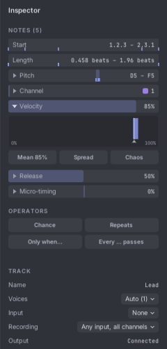
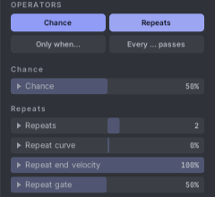
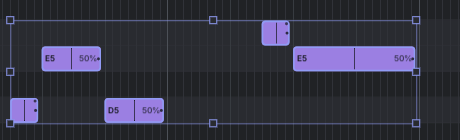
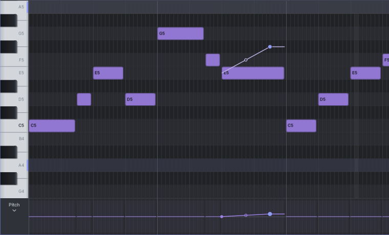
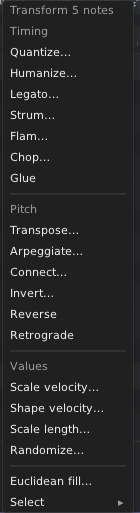
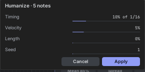

# 8. Shaping notes

This chapter covers everything beyond pitch and timing: the inspector, notes that play only sometimes, ratchets,
bends, transforms and MIDI channels.

## The inspector

The inspector is the panel on the right of the editor. Press **I** to show or hide it. It shows what is selected:

- **NOTES**: the selected notes (or **NOTE** for one).
- **TRACK**: the selected track's name, **Voices**, **Input**, **Recording** and **Output**.
- **CLIP**: the clip's name, length, loop and key.
- **INSTANCE**: a selected timeline clip's start, length, offset, transpose, velocity, stretch and mute.

### Note fields

The note fields are **Start**, **Length**, **Pitch**, **Channel**, **Velocity**, **Release** and **Micro-timing**.
Each field is a slider that fills to its value. With several notes selected, a band shows the range of their values
and a tick marks each note.

| To do this | Do this |
|---|---|
| Change all selected notes together | Drag the field left and right (or up and down). They keep their differences. |
| Type a value | Click the field and type, then Enter. |
| Type a change | Click and type `+10`, `-5%`, `*0.8` (times 0.8) or `=64` (set all to 64). |
| Reset a field | Double-click it. |

**Start** is written as the ruler writes it: bar.beat.sixteenth (1.4.1). **Length** is in bars and beats.
**Micro-timing** moves a note a little early or late (up to half a sixteenth) while it stays on the grid in the
editor.

### The chart: Mean, Spread and Chaos

With several notes selected, click a field such as **Velocity** to open its chart below it. The chart shows how many
notes sit at each value, with a marker at the average.

- **Mean**: drag to move every note's value up or down. Click it to type a value.
- **Spread**: drag right to pull the values apart, left to bring them closer to the average. It springs back when
  you let go, so you can drag again.
- **Chaos**: drag right to scatter the values at random. It also springs back.

Each drag is one undo step. The changes are written into the notes: what you see is what plays, every time. For a
smooth ramp across the notes, use **Notes ▾ → Shape velocity…**.

## Operators: notes that change from pass to pass

Operators make a note play differently on different passes of the loop, without changing the written note. Select
notes, then switch an operator on in the inspector's **OPERATORS** section. Each switch starts with a value you can
hear at once. Switching it off puts the note back to normal. A switch is half lit when only some selected notes use
it.

| Operator | What it does |
|---|---|
| **Chance** | The note plays only some of the time: 50% means about every other pass. |
| **Repeats** | Ratchets: the note is split into fast repeated hits. Set the **number** (a negative number means "this many per beat"), the **curve** (speeding up or slowing down), the **end velocity** (fade in or out) and the **gate** (how long each hit is). |
| **Only when…** | The note plays only on a condition: **First pass**, **Not first**, **After played** (the note before it played), **After silent** (the note before it didn't play), **Fill**, **Not fill**. Fill follows the panel's **FILL** button, the **FILL** input, or the **F1** key. |
| **Every … passes** | The note plays only on some passes of a cycle. A row of 16 bars shows the passes: click a bar to play or skip that pass, click a grey bar to make the cycle longer, right-click to end the cycle there. For example, a cycle of 4 with pass 4 on plays the note only every fourth loop. |

Random choices are repeatable: a loop plays the same way each time you play the song, and the same way in a MIDI
export.

### Badges

Notes with operators show small marks: a percentage for chance, ticks inside the note for repeats, dots along the
bottom for "every … passes". Turn them off in **View ▾ → Show chance and repeats on notes**.

The lower lane can also show **Chance**, **Repeats** and **Micro-timing** as stems, to edit them note by note.

## Bends, timbre and pressure

Each note can carry three curves that change while it sounds:

- **Pitch**: a bend of up to ±48 semitones. It is added to the Track Out's **V/OCT**.
- **Timbre**: 0 to 100%, sent on the Track Out's **TIMB** jack.
- **Pressure**: 0 to 100%, sent on the **PRESS** jack.

### Bending notes

Choose **Pitch** in the lower lane's menu. Now a press on a note in the grid bends it instead of moving it:

1. Press on a note where the bend should start, and drag up or down. A bend point follows the mouse. It snaps to whole
   semitones (to key steps when snapping to a key). Hold **Alt** for any value.
2. A click without a drag adds a point that holds the pitch. So "hold, then glide" is a click and then a drag.
3. Drag the hollow handle in the middle of a glide to make it curve (a slow or fast start).
4. Right-click a point to delete it.

The bend is drawn at the pitch it really plays, so you see which note it lands on. If several notes are selected,
they all bend together, by the same amount (or the same number of key steps). Drag a box from empty space to pick
bend points; drag a picked point to move them all; **Delete** deletes picked points.

Pick another lane (such as Velocity) to move notes with the mouse again. The lower lane itself also edits the curves:
click near a curve to add a point, drag points, double-click a point to delete it.

When you change a note's length or start, its bend stays at the same beat.

### Timbre and pressure

Choose **Timbre** or **Pressure** in the lower lane's menu, and select some notes. A small strip appears just above
them, four rows tall: 0% at the bottom, 100% at the top. Press near a curve to add a point, drag points and arch
handles the same way as bends. With several notes selected, each gets its point at the same beat, so they swell
together.

## Transforms

**Notes ▾** in the header (and **Transform** in the note menu) changes many notes at once. With nothing selected,
it changes the whole clip.

Most transforms open a small panel. The grid shows the result while you change the settings. **Apply** (or Enter)
keeps it as one undo step; **Cancel** (or Esc) leaves the notes alone.

| Group | Transform | What it does |
|---|---|---|
| Timing | **Quantize…** | Pulls notes to the grid, with a strength. **Q** quantizes at once with the last settings. |
| | **Humanize…** | Small random changes to timing, velocity and length, for a looser feel. |
| | **Legato…** | Each note lasts until the next one. |
| | **Strum…** | Spreads the notes of each chord in time, like a guitar strum. |
| | **Flam…** | Adds a quick grace note before each note. |
| | **Chop…** | Cuts each note into several shorter notes. |
| | **Glue** | Joins touching notes of the same pitch. |
| Pitch | **Transpose…** | Moves notes by semitones or key steps. |
| | **Arpeggiate…** | Turns held chords into an arpeggio: pattern, rate, gate and octaves. |
| | **Connect…** | Fills the gaps between notes with passing notes in the key. |
| | **Invert…** | Flips pitches upside down around a centre note. |
| | **Reverse** | Plays the notes backwards in time. |
| | **Retrograde** | Reverses the order of the pitches but keeps the rhythm. |
| Values | **Scale velocity…** | Makes velocities louder or softer by a percentage. |
| | **Shape velocity…** | Draws a shape over velocities: ramps up or down, sine, triangle, random. |
| | **Scale length…** | Makes notes longer or shorter by a percentage. |
| | **Randomize…** | Random changes to the values you choose. |
| | **Euclidean fill…** | Adds evenly spread hits at the note under the cursor. |
| | **Select ▸** | Selects notes by velocity, on or off the grid, every Nth, muted, or with operators. |

Settings are remembered while Rack is open.

## MIDI channels

Every note has a MIDI channel from 1 to 16. Channel 1 is the default. Channels let one clip hold several parts, such
as a bass on channel 2 and chords on channel 1. Another track can then pick out one part: set its **Input** to this
track and add a **Note Filter** device set to that channel.

- Right-click notes and choose **Channel ▸** to set it, or use the inspector's **Channel** field (type `+1` to move
  every note up a channel).
- New notes use the channel of the selected notes, or of the last note you clicked or drew.
- Notes are coloured by channel. Channel 1 uses the track's colour, so songs without channels look as before.
- Notes recorded from MIDI keep their channel.
- MIDI export can write each note on its own channel (**Use note channels**). See [Files](14-files.md#exporting-midi).
