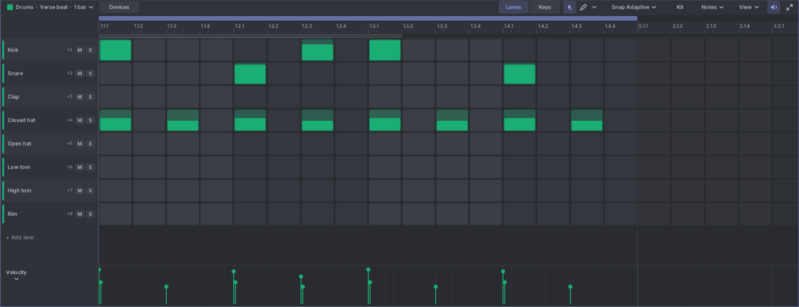
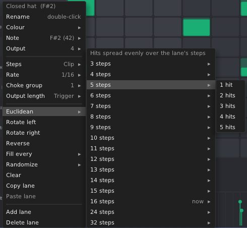

# 9. Drums

A drum track holds drum sounds in **lanes**: Kick, Snare, Closed hat and so on. Each lane has its own output on the
Drum Out module. Select a drum track and the notes pane shows the **drum editor**. It is the piano roll, with the
lanes on the left instead of the keys.

## The drum editor

- Each row is a lane, in the lanes' own order. Each cell is a step of the lane, 16 to a bar by default. Beats are
  shaded light and dark in turn, so you can count them at a glance.
- A hit sits in its step, filled from the bottom: the higher the fill, the louder the velocity.
- Zoomed far out, the steps are too small for cells and the beats show as bands.
- The lane header shows the lane's name, its output ("→1"), and **M** (mute) and **S** (solo). Muted lanes are dimmed.
- **Click a lane's name** to hear it. **Ctrl+click** it to select all its hits.
- Under the grid, the velocity lane shows the hits of the lane you clicked last. The other lanes' hits are faded.
- **+ Add lane** under the last lane adds a lane.

It zooms and scrolls like the piano roll. **Ctrl+wheel** zooms in time, **=** and **-** zoom in and out, and **F**
fits the clip. You can zoom out past the end of the clip and keep drawing there.

A note on a pitch that no lane plays gets a row of its own under the lanes, marked "(no lane)". It doesn't play.
Move it onto a lane, or delete it.

### Lanes or keys

**Lanes | Keys** in the header switches how the same notes are shown. **G** does the same.

- **Lanes** (the default) is the drum editor described here.
- **Keys** shows them on the piano keys as plain notes, like any piano roll, with all 128 notes. The keys of the
  lanes carry the lanes' names. Use it for free timing, long notes, or notes on no lane.

Zoom, selection and tools carry over when you switch. Tessera remembers your choice.

## Making a beat

With the **Draw** tool (D):

- **Click** an empty step to add a hit. **Click** a hit to remove it.
- **Drag** across steps to paint hits. Drag from a hit to remove the hits you pass over.
- **Right-click** or **right-drag** removes hits.
- **Alt+drag** a hit to change its velocity.

A new hit is one step of its lane long, at the last velocity you set. With **Snap Adaptive**, hits land on the lane's
own steps (see **Rate** below), however far you zoom. Pick a fixed snap, like 1/32, to draw finer hits. Hold **Alt**
while you draw to place hits off the grid.

**Draw past the end of the clip** and the clip grows to the end of that bar, in the same undo step. Moving or pasting
hits there does the same. You can also drag the loop end in the ruler, or use the clip chip's lengths.

With the **Select** tool (S), hits work like notes in the piano roll. Click to select, drag to move them in time and
across lanes, **Ctrl+drag** to copy, and drag from empty space to select a box. Drag a hit's edge to change its
length. **Delete** removes the selected hits.

The other tools in the **▾** menu work as in the piano roll. The speaker button turns on **Hear notes while
editing**. Each drag is one undo step.

### Velocity

- **Alt+drag** a hit up or down to change its velocity (Shift for fine steps). If the hit is selected, the whole
  selection changes.
- Or drag across the **velocity lane** under the grid.

### Hit menu

Right-click a hit for its menu. It acts on the selected hits (a hit outside the selection becomes the selection).
Besides the piano roll's note items, it has **Velocity**, **Chance**, **Repeats**, **Only when…** and **Every …
passes**. These are the operators of [Shaping notes](08-shaping-notes.md#operators-notes-that-change-from-pass-to-pass).
With hits selected, the inspector edits them too.

## Lane settings

Right-click a lane's name for its menu.

| Item | What it does |
|---|---|
| **Rename** | Also by double-clicking the name. |
| **Colour** | The lane's colour (or the track's). |
| **Note** | The MIDI note this lane plays. A lane plays the clip's notes of this pitch. |
| **Output** | Which Drum Out output (1 to 16) the lane uses. Outputs 1 to 8 have their own jacks; 9 to 16 are on the poly jacks only. Lanes on the same output share it. |
| **Steps** | The lane's own loop length, in steps. "Clip" follows the clip's loop. See [Polymeter](#polymeter). |
| **Rate** | How long a step is for this lane: 1/4 to 1/32, triplets too. |
| **Choke group** | 1 to 8, or none. When a lane in a group plays, it cuts the other lanes of the same group. In the kits, closed and open hats share group 1, so a closed hat cuts a ringing open hat. |
| **Output length** | **Trigger** (1 ms, the default) or a gate of a fixed length in milliseconds. The note's own length doesn't matter. |

### Pattern tools

Also in the lane menu. Each one is a single undo step.

| Tool | What it does |
|---|---|
| **Euclidean** | Spreads a number of hits as evenly as possible over the lane's steps. The first step always hits. Great for quick rhythms: 3 hits over 8 steps, 5 over 16… |
| **Rotate left / right** | Shifts the pattern one step. |
| **Reverse** | Plays the pattern backwards. |
| **Fill every** | Turns on every 2nd, 3rd, 4th… step. |
| **Randomize** | Random steps: 25%, 50% or 75% of them. |
| **Clear** | Clears the lane. |
| **Copy lane / Paste lane** | Copies a lane's steps to another lane. |
| **Add lane / Delete lane** | A drum track has up to 16 lanes. |

## Kits

The **Kit** button in the header loads a set of lanes:

- **Standard 8**: Kick, Snare, Clap, Closed hat, Open hat, Low tom, High tom, Rim. New drum tracks start with it.
- **16 GM-ish**: 16 lanes on General MIDI drum notes.

Loading a kit changes the lanes only. Notes stay, so lanes with the same notes pick them up again.

## Polymeter

A lane can loop on its own length. Set its **Steps** to 12 while the others use 16, and it drifts against the bar,
coming back in line every few bars. The lane's pattern is the first steps of the clip. On the lane's row, a line in
the lane's colour marks where its own loop ends. After it, the row is dimmed and its repeats are faded. It plays the
same way from the clips panel and from the timeline.

Choose **Steps → Clip** to follow the clip's loop again.

## Clip length

The clip chip on the left of the header works as in the piano roll: rename, loop, lengths of 1 to 16 bars,
**Double** (copies the hits into the new half) and **Halve**.

## Wiring the Drum Out

- Patch jacks **1** to **8** to your drum modules' trigger inputs. Each jack's light flashes on a hit.
- **V1** to **V8** carry each lane's velocity, 0 to 10 V. Patch them to an accent or level input.
- **TRIGS** and **VEL** carry all 16 outputs on poly cables, one channel per output.
- **AUTO** carries the drum track's automation lanes.

See [The modules](02-modules.md#drum-out).
