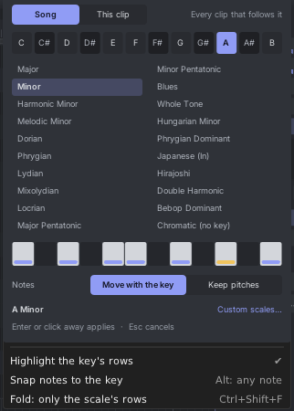
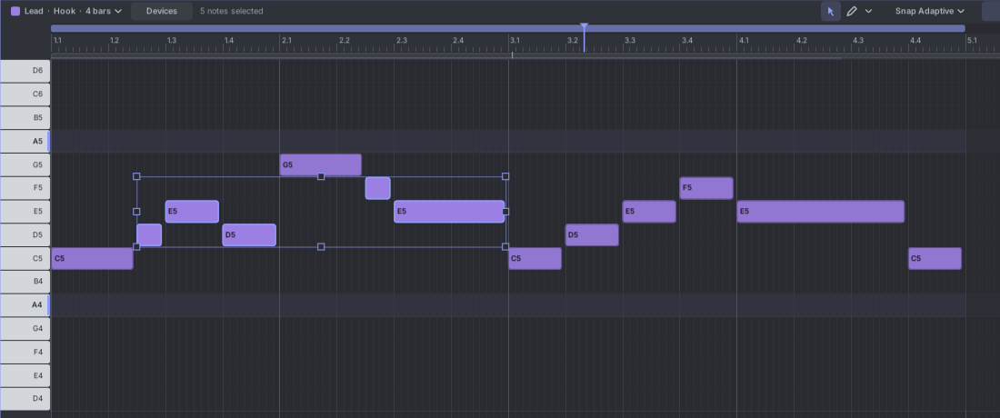
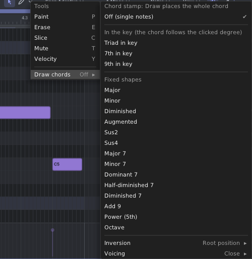

# 10. Keys, scales and chords

A key (such as A minor) helps you stay in tune: Tessera can light up the right rows, snap notes to them, or hide the
others. Nothing is forced until you choose a key.

## Choosing a key

A new song has **No key**. Click the key chip in the notes header ("No key ▾" or "A Minor ▾") to open the key picker.

1. **Song** or **This clip**: set the key for the whole song, or give this clip its own key.
2. Click a **root note** (C to B).
3. Click a **scale**. The piano roll shows each choice at once.
4. Press **Enter** or click outside the picker to keep it (one undo step). **Esc** puts the old key back.

The scales: Major, Minor, Harmonic Minor, Melodic Minor, Dorian, Phrygian, Lydian, Mixolydian, Locrian, Major
Pentatonic, Minor Pentatonic, Blues, Whole Tone, Hungarian Minor, Phrygian Dominant, Japanese (In), Hirajoshi, Double
Harmonic, Bebop Dominant, and **Chromatic (no key)** to turn the key off.

**Notes: Move with the key / Keep pitches** decides what happens to existing notes when you change the key:

- **Move with the key**: notes keep their place in the scale. A melody in C major becomes the same melody in D major.
- **Keep pitches**: notes stay where they are.

Tessera remembers your choice. Drum clips never move.

A clip with its own key shows "(clip)" in the header. To go back to the song's key, open the picker on **This clip**
and choose **Same as song**.

## The three switches

Under the key picker are three switches. The key chip is lit while snap or fold is on.

### Highlight the key's rows (on by default)

Rows of notes in the key are light, the others darker. The root rows are tinted and underlined. The keyboard dims keys
outside the key. A note outside the key gets a small amber corner.

### Snap notes to the key

- Draw and Paint place notes on the nearest note of the key.
- Dragging notes up and down moves them by key steps. Each note moves on its own, so chords stay in the key.
- **Up / Down** keys move by key steps.
- Hold **Alt** while dragging or drawing to use any note.

### Fold: only the scale's rows

Hides every row outside the key, so the grid is compact and every row is a "right" note. Rows that hold a note stay
visible, so folding never hides a note. **Ctrl+Shift+F** turns it on and off.

On a drum track's piano roll, Fold shows one named row per drum lane.

## Fixing notes outside the key

Select notes, right-click, and choose **Fit to key**. Notes outside the key move to the nearest key note. The others
stay.

## Custom scales

Open the key picker and click **Custom scales…**:

- **New scale from this key** copies the notes of the current key into a new scale and uses it.
- Give it a name. Click the 12 keys to turn notes on or off (the root stays on). Each click can be undone.
- **Delete** removes it. A clip or song that used it then has no key, until you undo.

Custom scales are saved with the patch.

## Drawing chords

Open the **▾** tool menu in the notes header and pick a shape under **Draw chords**. Now **Draw** and double-click
place a whole chord.

- **In the key** (**Triad**, **7th**, **9th in key**): the chord is built from notes of the key, so its quality
  follows the degree you click. In A minor, clicking A gives A minor, clicking C gives C major. Without a key, a major
  scale is used.
- **Fixed shapes**: Major, Minor, Diminished, Augmented, Sus2, Sus4, Major 7, Minor 7, Dominant 7, Half-diminished 7,
  Diminished 7, Add 9, Power (5th), Octave. These are the same on every note.
- **Inversion**: moves the lowest notes up an octave.
- **Voicing**: **Close**, **Open** (raises the second note an octave) or **Drop 2** (lowers the second note from the
  top an octave).

Drag while placing to set the chord's length and root. The readout names the chord. Each chord is one undo step.

With snap or fold on, the chord shapes count steps of the key, so every chord stays in the key.

Choose **Off (single notes)** to draw single notes again.

## Keys while recording

In the record button's menu (▾ next to ●), **Snap incoming notes to the key** keeps played notes in the song's key,
both while you hear them and in the recording. See [Recording](11-recording.md).
