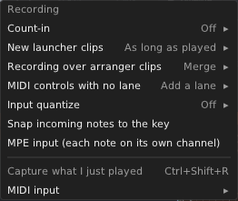

# 11. Recording

You can play notes into Tessera from a MIDI keyboard, from CV and gates in your patch, or from your computer keyboard.
Tessera records them into clips.

## Where notes come from

| Source | How to set it up |
|---|---|
| **MIDI** | Right-click the Tessera panel, **MIDI input (for recording)**, and pick the driver, device and channel. The record button's ▾ menu has the same item. |
| **CV** | Patch the **V/OCT**, **GATE** and (optionally) **VEL** inputs in the panel's lower box. They are polyphonic: each channel is one voice. A note starts when its gate rises above 1 V. Without a VEL cable, notes get 80%. |
| **Computer keyboard** | Press **Ctrl+K** in the editor. See [Keyboard play](#keyboard-play). |

## Arming a track

A track records only when it is **armed**.

- Click the **ring** in the track header, or choose **Armed for recording** in the track menu (also in the
  inspector's **Recording** chip). The ring turns red.
- Arming one track disarms the others. **Ctrl+click** arms more than one.

In the track menu (or the inspector's **Recording** chip):

- **Record from**: **Any** (CV and MIDI), **REC CV inputs**, or **MIDI**.
- **MIDI channel**: all channels, or one channel from 1 to 16. So two players on two MIDI channels can record to two
  tracks.
- **Monitor while armed** (on by default): an armed track plays what comes in through its own outputs and devices, so
  you hear yourself.

Arming a track also records its automation lanes: MIDI controls that have a lane, knobs you turn, and CV on the AUTO
input.
See [Recording automation](12-automation.md#recording-automation).

To play a track from MIDI or CV all the time, without arming it, set its **Input** instead (see
[Tracks](04-tracks.md#a-track-that-plays-another-track-input)).

## The record button

Press **●** in the transport bar, **REC** on the panel, or **R** in the editor:

- **While stopped:** it counts in (if a count-in is set), then plays and records.
- **While playing:** it starts recording at once ("punch in").
- **While recording:** it stops recording ("punch out"). Playback goes on.

**Stop** also ends recording. Jumping the playhead or pressing reset ends the take and starts a new one.

## Recording settings

Click the **▾** next to the record button.

| Setting | Choices |
|---|---|
| **Count-in** | **Off**, **1 bar** or **2 bars**. The record button blinks and the **CLICK** output clicks during the count-in. |
| **New launcher clips** | **As long as played** (rounded up to whole bars when you stop), or a fixed **1, 2, 4 or 8 bars**. A fixed-length clip is finished when full; then it loops and the next passes are added to it. |
| **Recording over arranger clips** | **Overdub** (the take is a new clip stacked over the old ones, which stay as they were) or **Replace** (the new take replaces what was there). |
| **Input quantize** | **Off**, or a grid from 1/4 to 1/32, with a strength from 50% to 100%. |
| **Snap incoming notes to the key** | Keeps played notes in the song's key, both what you hear and what is recorded. |
| **MPE input** | For a controller that sends MPE (each note on its own channel, with its own bend, slide and pressure). See [Expression and controls](#expression-and-controls). A controller that announces MPE switches this on by itself. |
| **Capture what I just played** | See [Capture](#capture-keep-what-you-just-played). |
| **MIDI input** | The MIDI device. |

## Where the recording goes

It depends on what the armed track is doing when your first note arrives:

- **The track plays a clip from the clips panel:** the new notes are added to that clip. Each time the loop comes
  round, that pass is added (one undo step per pass). You hear the new notes on the next pass.
- **Plays is set to Clips, and the track plays nothing:** a new clip is made in an empty slot (the selected scene's
  slot, or the next empty one). It starts at the bar where recording started, and keeps playing when you punch out.
- **Plays is set to Timeline:** a new clip is made on the timeline from punch-in to punch-out, on whole bars. With
  the song loop on, each pass makes its own clip and undo step. With **Overdub** (the default) each take is its own
  clip, stacked over what was there: you can move, mute or delete a take on its own. Where stacked clips have a lane
  on the same AUTO channel, the clip on top plays it. With **Replace**, old clips under the take are cut around it.

If you played nothing, nothing is made.

While recording you see it happen: the target slot is red, a clip being added to has a red outline and its new notes
show in red, and timeline takes grow as a red region.

## Expression and controls

Everything you play on a MIDI keyboard is recorded with the notes, in the same take and the same undo step. There is
nothing to set up.

**On each note** (shown in the piano roll's **Pitch**, **Timbre** and **Pressure** curves):

- **Poly aftertouch**: how hard you press each key becomes that note's **Pressure** curve.
- **MPE**: each finger's bend, slide (CC 74) and pressure become the note's **Pitch**, **Timbre** and **Pressure**
  curves. Turn on **MPE input** in the record button's ▾ menu, unless your controller switches it on by itself.

**For the whole track** (automation lanes in the take's clip):

| You move | Lane | Comes out of |
|---|---|---|
| The pitch bend wheel | **Pitch bend**, ±2 semitones, made for you | Added to **V/OCT** on every voice. No cable needed. |
| Channel aftertouch (one pressure for all keys) | **Pressure**, made for you | **PRESS** on every voice. Where a note has its own pressure too, the higher one wins. |
| Any other control: mod wheel, sustain pedal, a knob that sends a CC | Only if the track has a lane for it, like **Mod wheel (CC 1)** | That lane's **AUTO** channel |

- Pitch bend and pressure always record. They play into the voices, so they use no AUTO channel.
- A CC records only into a lane you added for it: **Add automation lane → MIDI control** on the track. So a knob you
  bump, or the bank change your keyboard sends with a new sound, leaves nothing behind. Each take writes into the
  clip's lane for that CC, on the track lane's AUTO channel, with its range and name.
- If you move a CC that has no lane, a message says so after the take, for example *Lead: Mod wheel (CC 1) not
  recorded, the track has no lane for it*. Click **Add lane** in the message to add it. The next take records it.
- The pitch bend and pressure lanes go back to 0 when no clip plays them, so a track never stays bent.
- The sustain pedal is recorded as a lane that steps on and off. It doesn't make notes longer. Patch its AUTO channel
  to whatever should hold.
- While a track is armed and monitoring, you hear all of this as you play, before and during recording.

## Input quantize and undo

With input quantize on, the recording is first saved as played, then quantized as a second undo step. Press
**Ctrl+Z** once to get your exact timing back.

## Capture: keep what you just played

Tessera always listens. When you play something good without recording, press **Capture**: **Ctrl+Shift+R**, or the
record button's ▾ menu.

- Tessera keeps the last 64 bars of notes played while not recording.
- Capture turns your last phrase (back to a gap of 4 bars of silence) into a clip on the selected track.
- It keeps what you played on the keys (aftertouch, MPE) and the controls you moved during the phrase (bend,
  pressure, and the CCs the track has a lane for), as a recording does. Each control's lane starts where the control was when the phrase began.
- If you played along with the song, the notes keep their place in the bar. If you played while stopped, the clip
  starts on the beat of the first note.

## Keyboard play

Press **Ctrl+K** in the editor to play notes with your computer keyboard. A banner shows the layout:

- The **A S D F G H J K L** row plays white keys, starting at C.
- The **W E T Y U O P** row plays black keys.
- **Z** and **X** move down and up an octave.
- **C** and **V** make notes softer and louder.
- **Ctrl+K** again turns it off.

While keyboard play is on, the letter keys don't switch tools. Armed tracks play and record the notes, like MIDI. If
the selected track isn't armed, you still hear the notes on it.

## Step input

Step input writes notes one step at a time, without playing in time. Press **Ctrl+R** in the piano roll. A red cursor
appears.

- Play a note (MIDI, REC CV or keyboard play). It is written at the cursor, and the cursor moves one grid step.
- Notes held together are written as a chord on one step.
- **Right arrow** adds a rest. **Shift+Right** makes the last note longer (a tie).
- **Backspace** removes the last step. **Left arrow** steps back.
- **Esc** or **Ctrl+R** ends step input.

The step size is the snap grid. Each note is its own undo step.

## Tips

- Recording records the notes as you played them, before the track's devices. The devices are applied again when it
  plays back, so you can change them later.
- Stopping while recording never leaves a note hanging.
- The record settings and the MIDI device are saved with the patch.
