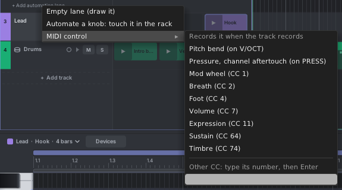
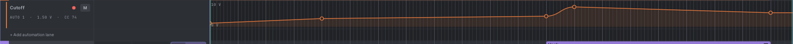
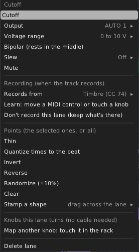

# 12. Automation

Automation is a curve that changes a value over time: a filter opening during the chorus, a slow fade, a wobble.
Tessera sends each curve as a voltage, and it can also turn knobs on other modules directly, with no cable.

## Two kinds of lane

- **Track lanes** follow the song position. They open under their track in the song pane. Use them for changes over
  the whole song.
- **Clip lanes** belong to a clip and loop with it. They open in the piano roll's lower lane. Use them for a movement
  that repeats with a pattern.

Each lane uses an **AUTO channel** from 1 to 8. AUTO channel 3 comes out of:

- channel 3 of the **AUTO** poly jack on the track's Track Out or Drum Out, and
- jack 3 of an **Auto Out** set to that track.

A track and a clip can each have up to 8 lanes.

## Adding a track lane

1. Click the lanes arrow (▸) in the track header, or choose **Show automation lanes** in the track menu.
2. Click **+ Add automation lane** under the track (or **Add automation lane** in the track menu) and choose:
   - **Empty lane (draw it)**: takes the first free AUTO channel.
   - **Automate a knob: touch it in the rack**: see [Turning knobs without cables](#turning-knobs-without-cables).
   - **MIDI control**: **Pitch bend**, **Pressure**, **Mod wheel**, **Sustain** and other common controls by name,
     or any CC by typing its number. The lane is named, records that control when the track records, and plays
     where it belongs: pitch bend on **V/OCT**, pressure on **PRESS**, a CC on the next free AUTO channel. If the
     lane is already there, it is shown instead.

The lane header shows the lane's name, where it plays (its AUTO channel, or **V/OCT** or **PRESS** for pitch bend and
pressure lanes), its value right now in volts, what it records from, any knobs it turns, and mute (M). Drag the
lane's bottom edge to make it taller.

While its track is armed, a mark beside the lane says what the next take does to it:

| Mark | Meaning |
|---|---|
| Red dot | It records. |
| Amber **!** | It has a source that isn't there (the header says what, e.g. nothing patched to its AUTO REC channel). |
| Crossed circle | You chose **Don't record this lane**: takes leave it as it is. |
| Nothing | It has nothing to record from (a lane you draw), or the track isn't armed. |

## Drawing and editing points

| To do this | Do this |
|---|---|
| Add a point | Click. **Alt+click** puts it right on the curve. |
| Move a point | Drag it. It snaps to the grid in time; **Alt** is free; **Shift** keeps one direction and gives fine values. |
| Delete a point | Double-click it. |
| Bend a segment | Drag the handle in the middle of the segment up or down. |
| Move a segment | **Ctrl+drag** the segment: both its points move. |
| Change the curve type | Right-click a point: **Hold**, **Linear**, **Exponential** or **S-curve**. The same menu sets an exact value (in volts) and deletes. |
| Draw freehand | **Draw** tool: drag. The line is turned into a few points when you let go. **Alt** draws a straight line. |
| Draw steps | **Paint** tool: held steps on the grid. |
| Erase points | **Erase** tool: drag across them. |
| Select points | Drag a box from empty space. |

With two or more points selected, a **transform box** appears: drag its top or bottom edge to scale the values (Alt:
around the middle), its sides to stretch in time, and its top corners to tilt.

Keys (with the mouse over the lane): **Delete**, **Ctrl+A**, **Ctrl+C / X / V** (paste at the playhead), **Up /
Down** (1%, Shift for 0.1%), **Left / Right** (one grid step).

The readout always shows the real output voltage.

## The lane menu

Right-click the lane header.

| Item | What it does |
|---|---|
| **Name** | The name shown in the header and on the Auto Out. |
| **Output** | The AUTO channel, 1 to 8. |
| **Voltage range** | 0 to 10 V, ±5 V, 0 to 5 V, ±10 V and more. |
| **Bipolar** | The lane rests in the middle instead of at the bottom. |
| **Slew** | Smooths jumps, from Off to 100 ms. |
| **Mute** | The lane stops sending. |
| **Records from**, **Learn**, **AUTO REC channel**, **Record mode**, **Don't record this lane** | See [Recording automation](#recording-automation). |
| **Thin**, **Quantize times to the beat**, **Invert**, **Reverse**, **Randomize (±10%)**, **Clear** | Act on the selected points, or all of them. |
| **Stamp a shape** | Pick a shape: Sine, Triangle, Saw up, Saw down, Square, Random steps, Smooth random, Exp rise or Exp fall. Then drag across the lane: one cycle per grid step, and dragging up or down sets the depth. |
| **Map another knob: touch it in the rack** | See below. |
| **Delete lane** | Removes the lane. |

## Turning knobs without cables

A track lane can turn up to four knobs anywhere in the rack. The quickest way: **Add automation lane → Automate a
knob: touch it in the rack**. It makes a lane, and the knob you touch is mapped to it, names it, and is what it
records. To map a knob to a lane you already have:

1. In the lane menu, choose **Learn: move a MIDI control or touch a knob** (or **Map another knob** for a second
   one).
2. The editor shrinks to a banner. Click the banner to cancel.
3. Turn or click the knob you want, for example a filter's cutoff. The editor comes back.
4. The lane header now names the knob ("→ VCF · Cutoff"). The knob shows a small mark in the track's colour.

While the song plays, the knob follows the lane. Each mapped knob is listed in the lane menu, where you can set how far
the lane turns it: **Full range**, **Lower half**, **Upper half**, **Middle half** or **Reversed**. A knob only moves when the lane's value changes, so a still lane never fights your
hand. If the knob is already mapped by another module, Tessera asks before taking it over.

Mappings are saved with the patch. They work even if no output module plays the track.

## Clip automation

To add a lane to a clip, open the piano roll's lower lane menu ("Velocity ▾") and choose **Add clip lane**: an empty
lane or a MIDI control, as for track lanes. Pick a
clip lane from the same menu to show it.

Clip lanes are edited the same way. They play while their clip plays, in the clips panel or on the timeline, and loop
with it.

When a clip lane and a track lane use the same AUTO channel, the lane menu decides how they mix:

- **Override**: the clip lane wins.
- **Modulate**: the clip lane moves the track lane's value up and down around its middle.

## How automation plays

- Track lanes follow the song position in both Plays modes. While the timeline plays, a track taken over by a
  launched clip pauses its track lanes until **Back to timeline**.
- Stacked timeline clips: for each AUTO channel, the clip on top that has a lane there plays it.
- A channel with nothing playing holds its last value. Pitch bend and pressure lanes go back to 0 instead, so a track
  never stays bent.
- Muted lanes are left out.

## Moving clips takes their automation along

With **Automation follows clips** on (song pane ▾ menu, on by default), moving or copying a timeline clip also moves
or copies the track automation under it. Range edits (see [The timeline](06-timeline.md#working-with-time-the-range-tool))
change clips and automation together.

## Recording automation

There is one switch: **arm the track**. When it records, every lane that has something to record from records too,
into the same take as the notes, as one undo step.

What a lane records from (lane menu, **Records from**):

- **A MIDI control**: pick it by name, or choose **Another: move it on your controller**. Moving a control while
  recording also makes its lane in the clip for you (see [Recording](11-recording.md#expression-and-controls)).
- **The mapped knob**: the lane's first mapped knob, turned by hand.
- **AUTO REC input**: a channel of the **AUTO** input on the Tessera panel. **AUTO REC channel** picks which one
  (at first, the lane's own AUTO channel), so one mono cable is enough.

**Learn: move a MIDI control or touch a knob** waits for the first thing you move and makes it the source.

For knobs and AUTO REC, a **Record mode**:

- **Touch** (knobs start here): records while the knob or input moves, and lets go half a second after it stops.
- **Latch**: records from the first move until recording stops.
- **Write** (AUTO REC starts here, since a steady CV doesn't move): records all the time.

Where it goes:

- **A launcher take** (into a clip in the clips panel): into the clip's lane on the same AUTO channel, made for you if
  the clip has none. The knob mapping stays on the track lane.
- **A timeline take**: knob and AUTO REC moves go to the track lane, song-wide like a mix. MIDI controls go into the
  clip the notes go into (which one depends on **Recording over arranger clips**: see
  [Where the recording goes](11-recording.md#where-the-recording-goes)).
- **Any take, for a MIDI control the track has its own lane for**: into that track lane, at the song position.

To protect a lane, choose **Don't record this lane (keep what's there)** in its menu.

Each pass is drawn in red while it records. When recording stops (or the loop wraps), it is thinned to a few points.
While you record a mapped knob, its playback pauses so your hand wins.

Device knobs inside Tessera can be automated too. See [Devices](13-devices.md#automating-a-device-knob).
