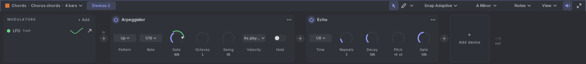
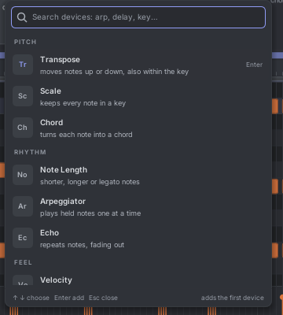
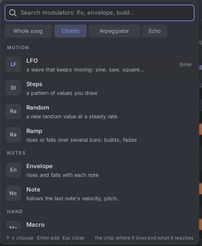
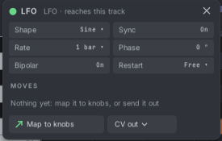
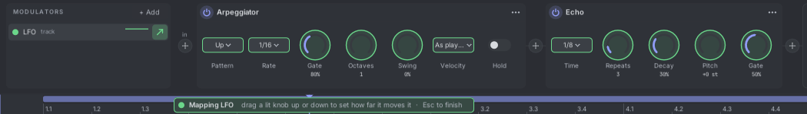

# 13. Devices and modulators

**Devices** are note effects. They change a track's notes on their way out: an arpeggiator plays chords one note at a
time, an echo repeats notes, a chord device turns one note into three. The notes in your clips don't change; you can
switch a device off at any time.

**Modulators** (LFOs, envelopes, steps…) turn device knobs by themselves, so the music keeps moving.

## The device strip

Click **Devices** in the notes header (or press **F3**) to open the strip above the notes. It shows the selected
track's devices from left to right, in the order the notes flow through them: **in** → devices → **out**.

When the strip is closed, a track with devices shows a thin bar naming its chain ("Arpeggiator → Echo"). Click it to
open the strip. A track without devices keeps the strip closed.

## Adding devices

Click **Add device** at the end of the chain, or the **+** between two devices. A searchable list opens.

- Type to filter by name or by purpose: "delay" finds Echo, "loose" finds Humanize.
- **Up / Down** choose, **Enter** adds, **Esc** closes.
- The footer says where the device will go.

A track holds up to 16 devices.

## The devices

| Device | What it does | Its knobs |
|---|---|---|
| **Transpose** | Moves notes up or down. | Semitones, Octaves, Key steps (moves within the key). |
| **Scale** | Keeps every note in a key. | Key from (Clip, Song, Fixed), Root, Scale, Notes off key (Nearest, Up, Down, or Drop them). |
| **Chord** | Turns each note into a chord. | Chord, In key, Inversion, Voicing (Close, Open, Drop 2), Strum. |
| **Note Length** | Makes notes shorter, longer or legato. | Mode (Scale, Fixed, Legato), Scale %, Length, Overlap. |
| **Arpeggiator** | Plays held notes one at a time. | Pattern (Up, Down, Up-down, Down-up, Random, As played, Chord), Rate, Gate, Octaves, Swing, Velocity (As played, Fixed, Accent), Hold. |
| **Echo** | Repeats notes, fading out, like a delay. | Time, Repeats, Decay, Pitch (per repeat), Gate. |
| **Velocity** | Makes notes softer, harder, or keeps them in a range. | Curve, Min, Max, Random. |
| **Humanize** | Loosens timing, velocity and length a little, differently on each pass. | Timing (only ever later), Velocity, Length. |
| **Random** | Changes pitches and drops notes, differently on each pass. | Pitch (steps), In key, Drop (chance to skip a note). |
| **Note Filter** | Lets only some notes through. | Lowest, Highest, Min velocity, Max velocity, Every (play every Nth note), Offset, Channel (Any or 1 to 16). |

**Order matters.** Chord → Arpeggiator arpeggiates the chord. Arpeggiator → Chord makes a chord on every arpeggio step.

Random choices are repeatable: the same pass plays the same way every time, also in a MIDI export.

On **drum tracks**, devices that change pitch (Transpose, Scale, Chord, Random pitch) are skipped by default, because a
pitch is a drum lane there. Turn on **Affect drum lanes** in the device's ⋯ menu to use them anyway.

The track's **Voices** setting (Auto) follows its devices: a chord device adds voices, an arpeggiator plays one at a
time.

## Using a device card

- **Power button** (top left): bypass the device. The notes pass through unchanged.
- **⋯ menu**: rename, duplicate, delete, reset knobs, affect drum lanes, add a modulator to this device.
- **Drag the card's header** to move it in the chain. An orange line shows where it will land. **Ctrl+drag** copies it.
- Click a card, then **Delete** removes it and **Ctrl+D** duplicates it.

### Knobs

- **Drag** up or down (Shift for fine steps). You hear the change while you drag; it is one undo step.
- **Double-click** resets the knob.
- **Click the value** to type it.
- **Right-click** for: Reset, Type a value, **Modulate with ▸**, **Remove modulation ▸**, **Automate in the
  arranger**, **Automate in this clip**.
- Choices (like Pattern) are small menus. Switches (like Hold) flip on a click.

A knob draws an orange arc for its value. Each modulation adds a ring in the modulator's colour, showing how far it can
push the knob, and a white dot shows where the knob is right now.

## Modulators

The **MODULATORS** list on the left of the strip holds the modulators. Click **+ Add** to make one. A chip row at the
top chooses where it lives:

- **Whole song**: one modulator for every track, for example one LFO that sweeps several tracks together.
- **The track**: it can turn any knob of this track's devices.
- **A device**: it can turn only that device's knobs.

| Modulator | What it makes | Settings |
|---|---|---|
| **LFO** | A wave that keeps moving. | Shape (Sine, Triangle, Saw up, Saw down, Square, Sample & hold, Smooth random), Sync, Rate, Phase, Bipolar, Restart (Free, Each bar, Each note). |
| **Envelope** | Rises and falls with each note. | Attack, Decay, Sustain, Release. |
| **Steps** | A pattern of values you draw (1 to 16 steps). | Steps, Rate, Smooth, Bipolar. |
| **Random** | A new random value at a steady rate. | Rate, Smooth, Bipolar. |
| **Ramp** | Rises or falls over several bars: builds and fades. | Length (bars), Direction, Then (Hold or Loop), Curve. |
| **Macro** | One knob you turn (or automate) that moves many knobs at once. | Value. |
| **Note** | Follows the last note. | Follows (Velocity, Pitch, Release, Timbre, Pressure), Smooth. |

Each row in the list shows the modulator's colour, its name, where it lives, a small live graph, and a **↗** arrow.
Click a row to open its settings:

The **MOVES** list in the popover shows every knob the modulator turns, with its amount and a **×** to remove it.
Right-click a row in the list to rename or remove the modulator.

### Connecting a modulator to knobs

1. Click the modulator's **↗** (or **Map to knobs** in its popover).
2. The knobs it can reach light up. A message says "Mapping LFO · drag a lit knob up or down".
3. **Drag a lit knob** up for a positive amount, down for a negative one. A click adds +50%.
4. Press **Esc**, or click empty strip space, to finish.

A knob takes up to four modulations. Modulation adds to the knob's own value (or to its automation).

### Sending a modulator out as CV

In the popover, **CV out ▾** sends the modulator out of Tessera:

- To an **AUTO output** of a track: the value is added to that AUTO channel on its Track Out, Drum Out and Auto Out.
- To **a knob in the rack**: touch any knob, as when mapping automation. Its range can be set.

So one LFO can move an arpeggiator's gate and a filter in your patch together.

## Automating a device knob

Right-click a knob and choose:

- **Automate in the arranger**: a lane under the track, in song time. Its header reads, for example, "Arpeggiator ·
  Gate".
- **Automate in this clip**: a lane in the piano roll's lower pane, looping with the clip.

A new lane starts flat at the knob's value, so nothing changes until you draw. Once a knob has a lane, the menu says
**Show its lane** instead. Edit the lane like any automation lane ([Automation](12-automation.md)); its values are
shown in the knob's own units.

- Knob lanes play only while the transport runs. When stopped, the knob is free to turn and try out.
- A knob held with the mouse wins while you hold it, then the lane takes over again.
- Arm the lane and record to capture your knob moves (Touch, Latch, Write).
- Knob lanes don't use an AUTO channel. A track or clip can have 16 of them.
- If the device is deleted, the lane says **Target missing** until you undo.

## Live playing and recording

Notes played live (MIDI, CV, computer keyboard) go through the armed track's devices, even while stopped, so you hear
the arpeggiator as you play. Recording keeps the notes as you played them, before the devices.

## Devices and export

MIDI and DAWproject export have a **Devices** choice: **Applied** writes what the chain plays (each arpeggio step
becomes a note), **Bypassed** writes the clips as written. See [Files](14-files.md#exporting-midi).
