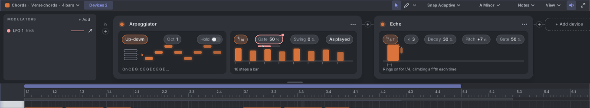
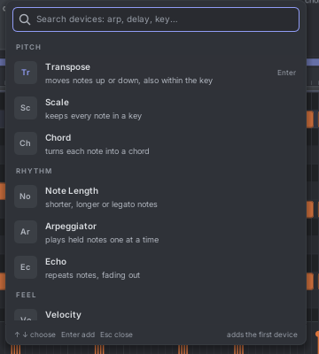
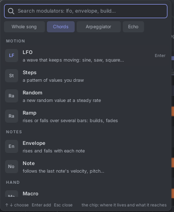
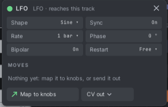
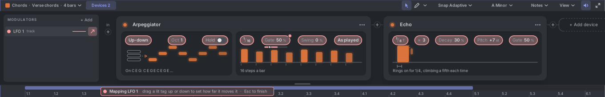

# 13. Devices and modulators

**Devices** are note effects. They change a track's notes on their way out: an arpeggiator plays chords one note at a
time, an echo repeats notes, a chord device turns one note into three. The notes in your clips don't change; you can
switch a device off at any time.

**Modulators** (LFOs, envelopes, steps…) turn device knobs by themselves, so the music keeps moving.

## The device strip

Click **Devices** in the notes header (or press **F3**) to open the strip above the notes. It shows the selected
track's devices from left to right, in the order the notes flow through them: **in** → devices → **out**.

When the strip is closed, a track with devices shows a thin bar naming its chain ("Arpeggiator → Echo"). Click it to
open the strip. A track without devices keeps the strip closed.

## Adding devices

Click **Add device** at the end of the chain, or the **+** between two devices. A searchable list opens.

- Type to filter by name or by purpose: "delay" finds Echo, "loose" finds Humanize.
- **Up / Down** choose, **Enter** adds, **Esc** closes.
- The footer says where the device will go.

A track holds up to 16 devices.

## The devices

| Device | What it does | Its knobs |
|---|---|---|
| **Transpose** | Moves notes up or down. | Semitones, Octaves, Key steps (moves within the key). |
| **Scale** | Keeps every note in a key. | Key from (Clip, Song, Fixed), Root, Scale, Notes off key (Nearest, Up, Down, or Drop them). Root and Scale hide unless Key from is Fixed. |
| **Chord** | Turns each note into a chord. | Chord, In key, Inversion, Voicing (Close, Open, Drop 2), Strum. |
| **Note Length** | Makes notes shorter, longer or legato. | Mode (Scale, Fixed, Legato), Scale %, Length, Overlap. |
| **Arpeggiator** | Plays held notes one at a time. | Pattern (Up, Down, Up-down, Down-up, Random, As played, Chord), Rate, Gate, Octaves, Swing, Velocity (As played, Fixed, Accent), Hold. |
| **Echo** | Repeats notes, fading out, like a delay. | Time, Repeats, Decay, Pitch (per repeat), Gate. |
| **Velocity** | Makes notes softer, harder, or keeps them in a range. | Curve, Min, Max, Random. |
| **Humanize** | Loosens timing, velocity and length a little, differently on each pass. | Timing (only ever later), Velocity, Length. |
| **Random** | Changes pitches and drops notes, differently on each pass. | Pitch (steps), In key, Drop (chance to skip a note). |
| **Groove** | Swings this track its own way, in place of the song's swing: a straight bass under swung drums, or extra-swung hats. Turn its Swing with an LFO or a lane to ride it. A new Groove starts on the grid most of the track's off-beat notes sit on. | Swing (50% straight to 75%), Grid (1/16 or 1/8). |
| **Note Filter** | Lets only some notes through. | Lowest, Highest, Min velocity, Max velocity, Every (play every Nth note), Offset, Channel (Any or 1 to 16). |
| **Motion** | Moves the notes that joined it, a little differently on each pass. See [Notes that drift](#notes-that-drift). | Pitch (steps), Time (a delay in 1/16 steps), Length, Velocity, In key. |

**Playheads** is different from the others: it doesn't change notes, it reads the clip. See
[Playheads](#playheads) below.

**Order matters.** Chord → Arpeggiator arpeggiates the chord. Arpeggiator → Chord makes a chord on every arpeggio step.

Random choices are repeatable: the same pass plays the same way every time, also in a MIDI export.

On **drum tracks**, devices that change pitch (Transpose, Scale, Chord, Random pitch) are skipped by default, because a
pitch is a drum lane there. Turn on **Affect drum lanes** in the device's ⋯ menu to use them anyway.

The track's **Voices** setting (Auto) follows its devices: a chord device adds voices, an arpeggiator plays one at a
time.

## Using a device card

- **Power button** (top left): bypass the device. The notes pass through unchanged.
- **⋯ menu**: rename, duplicate, delete, reset knobs, affect drum lanes, add a modulator to this device.
- **Drag the card's header** to move it in the chain. An orange line shows where it will land. **Ctrl+drag** copies it.
- Click a card, then **Delete** removes it and **Ctrl+D** duplicates it.

### Knobs

- **Drag** up or down (Shift for fine steps). You hear the change while you drag; it is one undo step.
- **Double-click** resets the knob.
- **Click the value** to type it.
- **Right-click** for: Reset, Type a value, **Modulate with ▸**, **Remove modulation ▸**, **Automate in the
  arranger**, **Automate in this clip**.
- Choices (like Pattern) are small menus. Switches (like Hold) flip on a click.

A knob draws an orange arc for its value. Each modulation adds a ring in the modulator's colour, showing how far it can
push the knob, and a white dot shows where the knob is right now.

## Playheads

The **Playheads** device reads the playing clip with several playheads at once. Each one moves through the notes in
its own way: slower, faster, backwards, in another order, an octave down, only the lowest notes… One melody becomes a
canon, a bass and a melody, or a texture that keeps shifting.

It is the first entry in the device browser, and it sits first in the chain: only Motion devices may come before it
(see [Notes that drift](#notes-that-drift)). A track holds one. While it is on,
it replaces the clip's own playhead; turn it off with its power button and the clip plays as usual. The playheads
belong to the track: launch another clip and the same playheads read it.

It starts with two playheads, both reading the whole clip from its start. Change one's **Rate** or segment to hear
them part. Each playhead shows as a line in its colour over the notes (the one the card shows is bolder). The notes it
reads light up in its colour, and so do their keys on the piano at the left. The clip's own playhead isn't drawn:
with playheads, it doesn't say what plays.

**The card.** The chips beside its name are the playheads: click one to show it (the card takes its colour), **+** adds
one (up to 16). The dot at a chip's left end turns that playhead off and on without losing its settings: it is hollow
while the playhead is off. Alt-click the dot to solo it, or press **Shift+M** to turn the shown playhead off and on.
Right-click a chip to rename it, mute or solo it, duplicate or delete it. Under the chips, one row of
settings for the shown playhead. A setting still at its default draws faint, so the ones you changed stand out:

| Setting | What it does |
|---|---|
| **Rate** | Speed against the song, from 1/16x to 16x. |
| **Direction** | Forward, Backward, Ping-pong (turns at the ends) or Freeze (stands still); or read the segment's steps in another order: **Outside in** (first, last, second, second-last…), **Inside out**, **Odd then even** or **Shuffle** (a new order each pass), with the step size. |
| **Repeat** | Plays each piece a number of times, then moves on one piece: 1/4 ×2 plays beat 1, 1, 2, 2, 3, 3… |
| **Notes** | All, or only the **Lowest** or **Highest** of the notes that start together. A bass and a melody out of one piano roll: one playhead on Lowest with a Transpose of −2 octaves in its own chain, one on Highest. |
| **Channel** | The channel its notes go out on (see below). |

Pitch and loudness aren't playhead settings: put a **Transpose** (octaves, key steps) or a **Velocity** device in the
playhead's own chain, like any other note change. Songs made when a playhead had its own Octave, Steps and Velocity
get those devices added for them, curves included.
| **More** | Rarer settings: On a jump, Invert (mirrors its notes inside the clip's range, in the key), note Length (follows the playhead, the default: a note sounds while the playhead is on it, so at ½× it lasts twice as long; or as written; or fixed), Path (from the settings, or drawn in the time map), and rename, mute, solo, duplicate, delete. |

The card's **⋯** menu holds the settings every playhead shares: **Restart** (when the clip starts, or also every so
many bars) and **Same note** (two playheads on the same note at the same moment play it once, or each).

**The segment.** On top of the piano roll's ruler, the shown playhead's segment is a bar in its colour, drawn like the
clip's loop bar, with its name inside and a solid grip at each end: the part of the piano roll that playhead plays, over
and over, starting at its left end. A thin line drops from each grip through the notes, so you can see which notes it
reads. Drag a grip to resize the segment, the bar to move it. For a playhead, the piano roll is a canvas: a segment can
sit anywhere on it, past the clip's end too, and plays the notes written there (where nothing is written, it is
silent). So with playheads on, the clip's loop doesn't decide what plays: the loop bar is hidden, the inspector's
**Loop** reads **Playheads decide**, and the loop only sets where a new segment starts out. A clip played by
playheads shows it: its launcher slot and timeline clips carry one small stripe per playhead in its colour (hollow when
muted), and the piano roll's title adds "read by 3 playheads". For a round, move the second playhead's segment a
beat later. The other playheads' segments show as thin lines in their colours.

**Curves.** Any setting can move by itself, on this card or any device card. Click a knob's name and a curve for it
opens in the piano roll's lower pane. Click to add a point: that makes a **Curve** modulator on the track (see [Modulators](#modulators)), named after
the playhead and the setting, such as "Bass Rate". Up and down are in the setting's own units. For Octaves or Key steps,
each row is one value and points snap to the rows; hold **Alt** to place them between rows. The dashed line in the
middle is the setting as you set it on the knob. A setting with many values, such as Key steps, moves at most 7 either
way. The knob's ring shows the amount; change it there or in the modulator's settings. Drag points, double-click to
delete one. The row on top holds **Counts in** (**Time** or **Passes**), ready **Shapes** and **Remove curve**. Under
it, a bar drawn like a playhead's segment says how long a cycle lasts, such as "repeats every 2 bars"; drag its right
grip to change it (it snaps to the grid). A curve always runs with the song, from its start. A knob with a curve has a
dotted ring and its name underlined. While the song plays, a playhead line crosses the curve; counting in passes,
the pass playing now is lit.

**Moved notes.** When the shown playhead plays notes at another pitch (its Invert, or a Transpose in its own chain,
and the curves on them), the piano roll shows where they go: each moved note appears again at the pitch it plays, in the playhead's
colour, with the change in semitones ("+2 st"). The written note it came from turns see-through with a dashed outline.
While the song plays this follows the pass playing now, so a curve on the Transpose shows each note moving from
pass to pass; stopped, it shows the first pass. The notes you edit stay where they are written.

On a drum clip whose lanes have their own length, the segment is the whole lane cycle, and each lane repeats on its own
length under every playhead. Note operators (chance, repeats…) and note curves work as usual; each playhead makes its
own chance choices.

**When a note plays.** Going forward, a playhead plays a note when it reaches the note's start. Going backward, it plays
it when it reaches the note's end, so the order of the notes is reversed but each note still sounds normally. A
playhead jumps when it goes back for a repeat, wraps to its segment's start, moves to the next step of an order,
restarts, or steps along a drawn path (a ping-pong turn isn't a jump). What happens then is the playhead's **On a
jump** setting, in its **⋯** menu: **Retrigger** (the default) stops the note it was playing and plays again any note
it lands inside, for what is left of it, so a long note under a 1/16 repeat pulses in sixteenths; **Let ring** lets
the note it was playing ring on and plays only notes that start where it lands.

Every setting can also be moved by a modulator or an automation lane, as on any device. Moving **Rate** while it plays
speeds the playhead up or slows it down from where it is.

Playheads read launched clips and timeline clips alike. On the timeline, each clip starts its playheads again, from
where that clip begins (a clip that starts partway in starts the playheads partway in), and a stretched clip slows them
down. MIDI export with **Devices: Applied** writes what the playheads play, each playhead on its channel; **Bypassed**
writes the clips as written. Modulators on playhead settings go into the file when they follow the song alone: synced
curves and LFOs, Steps, Random, Ramp and Macro. A free-running curve or LFO, an Envelope or a Note modulator plays live
only.

### The time map

In the piano roll's lower pane, pick **Time map (playheads)** from the pane's menu. Each playhead gets a row: across is
time since the clip started, lined up with the bars above; up is where in its region the playhead reads. A rising line
is a normal playhead, a steeper one is faster, a falling one goes backwards, a flat one is frozen, a staircase repeats,
and a jump is a wrap.

To draw a path, right-click a playhead's row and pick **Draw this path**: it starts from where the settings take the
playhead, and its cycle becomes as long as the clip.

- **Click** in the row to add a point, and **drag** a point to move it (it snaps to the grid; hold Alt to place it
  freely).
- **Double-click** a point to delete it.
- **Right-click** the row for **Back to settings**, **Clear points** and **Path cycle**.

Between two points the playhead moves straight from one place to the other, and plays the notes it crosses on the way,
in either direction. A drawn path says where the playhead is at every moment.

### Devices for one playhead

Right after the Playheads card come the shown playhead's own devices: devices only that playhead's notes go through,
before the rest of the chain. Each has a thin bar in the playhead's colour along its top and its dot in the title.
Click the **+** right after the Playheads card to add one (up to 4 per playhead). Give the slow reversed playhead an
Echo, or move the fast one up an octave with Transpose, while the devices after them still shape every playhead. Click another chip to see its branch. Branch devices count toward the
track's 16 devices; their cards stay in their branch (they can't be dragged out).

### A sound for each playhead

Each playhead puts its **channel** on the notes it plays: Playhead 1 on channel 1, Playhead 2 on channel 2, and so on.
A Track Out plays **All channels** unless you pick one. To give Playhead 2 its own sound, add a second Track Out for the
same track, click its screen and pick **Channel 2**, and patch it to another voice. See
[Track Out](02-modules.md#track-out). On a drum track, Drum Out has the same picker: the reversed hats can go to one
voice and the straight ones to another.

### Notes that drift

A **Motion** device moves some of your notes while the clip plays: a few notes rise one step each pass and fall back,
a note slides later and later, velocities swell. The written notes never change; the motion plays on top of them.

**Which notes.** Select notes in the piano roll, right-click one and choose **Motion › New motion**. That adds a Motion
device, named "Motion 1" in a colour of its own, and the notes join it. A small corner in that colour marks them. To
add more notes later, select them and click **+ Selected** on the card; to take notes out, select them and click
**− Selected**. The chip beside them (**6 notes**) selects the card's notes in the piano roll. The inspector's
**MOTION** line says which Motion device the selected notes move with, and opens the same choices. Notes from any clip
on the track can join the same Motion device.

**Its knobs.** **Pitch** (steps, in the key unless **In key** is off), **Time** (a delay in 1/16 steps), **Length**
and **Velocity**. To make them change, click a knob's name: its curve opens in the lower pane (see
[Modulators](#modulators)). A curve that **Counts in: Passes** takes one value each pass of the clip, so "up one step a
pass for four passes, then back" is four points. Right-click a knob for **Drift per pass**, a ready-made version of
that. Any modulator or automation lane can move these knobs too.

**Seeing it.** A note a Motion moves to another pitch shows where it plays, in the Motion's colour: the written note
turns see-through with a dashed outline, and the note appears again where it sounds, with its change ("+2 st"). With a
curve on **Pitch**, that is the pass playing now (the first one when stopped), and faint outlines mark the other
pitches the curve takes it to over its cycle. When the note moves out of view, a marker at the top or bottom edge
of its column says how far ("▼ −7 st").

**Where it sits.** A new Motion device goes before the Playheads device, the only place in front of it:

- **Before Playheads:** the notes move inside the clip, and every playhead reads them where they moved to. A note
  pushed later is reached later by a playhead going forward, earlier by one going backward, sooner by a fast one.
  Passes are the clip's, so every playhead hears the same drift.
- **After Playheads** (drag the card there): each note moves as a playhead plays it, and each playhead counts its own
  passes, so the melody and the bass drift apart.
- **In one playhead's own devices:** only that playhead's notes move.

Without playheads, a Motion device moves its notes wherever it sits in the chain. MIDI export with devices applied
plays the motion.

## Modulators

The **MODULATORS** list on the left of the strip holds the modulators. Click **+ Add** to make one. A chip row at the
top chooses where it lives:

- **Whole song**: one modulator for every track, for example one LFO that sweeps several tracks together.
- **The track**: it can turn any knob of this track's devices.
- **A device**: it can turn only that device's knobs.

| Modulator | What it makes | Settings |
|---|---|---|
| **LFO** | A wave that keeps moving. | Shape (Sine, Triangle, Saw up, Saw down, Square, Sample & hold, Smooth random), Sync, Rate, Phase, Bipolar, Restart (Free, Each bar, Each note). |
| **Envelope** | Rises and falls with each note. | Attack, Decay, Sustain, Release. |
| **Steps** | A pattern of values you draw (1 to 16 steps). | Steps, Rate, Smooth, Bipolar. |
| **Random** | A new random value at a steady rate. | Rate, Smooth, Bipolar. |
| **Ramp** | Rises or falls over several bars: builds and fades. | Length (bars), Direction, Then (Hold or Loop), Curve. |
| **Macro** | One knob you turn (or automate) that moves many knobs at once. | Value. |
| **Note** | Follows the last note. | Follows (Velocity, Pitch, Release, Timbre, Pressure), Smooth. |
| **Curve** | A shape you draw that repeats, like an LFO you draw yourself. | Counts in (Time or Passes). |

**Curve** opens its shape in the piano roll's lower pane, under the notes it moves: click its row, or pick it in the
lower pane's menu under **Curves**. It always runs with the song, from its start. **Counts in: Time**: one cycle
lasts as long as the bar over the curve, on the grid; drag the bar's right grip. **Counts in: Passes**: the curve takes
one value each pass of the clip, drawn as one step a pass across the pane, and the bar says how many passes before it
starts again. For a wave that runs at its own speed in Hz, use an **LFO**. The curve's middle line means "no
change": above it moves its knobs up, below it moves them down, by the amount on each knob. Up and down are labelled
in the units of the first knob it moves.

Each row in the list shows the modulator's colour, its name, where it lives, a small live graph, and a **↗** arrow.
Click a row to open its settings:

The **MOVES** list in the popover shows every knob the modulator turns, with its amount and a **×** to remove it.
Right-click a row in the list to rename or remove the modulator.

### Connecting a modulator to knobs

1. Click the modulator's **↗** (or **Map to knobs** in its popover).
2. The knobs it can reach light up. A message says "Mapping LFO · drag a lit knob up or down".
3. **Drag a lit knob** up for a positive amount, down for a negative one. A click adds +50%.
4. Press **Esc**, or click empty strip space, to finish.

A knob takes up to four modulations. Modulation adds to the knob's own value (or to its automation).

### Sending a modulator out as CV

In the popover, **CV out ▾** sends the modulator out of Tessera:

- To an **AUTO output** of a track: the value is added to that AUTO channel on its Track Out, Drum Out and Auto Out.
- To **a knob in the rack**: touch any knob, as when mapping automation. Its range can be set.

So one LFO can move an arpeggiator's gate and a filter in your patch together.

## Automating a device knob

Right-click a knob and choose:

- **Automate in the arranger**: a lane under the track, in song time. Its header reads, for example, "Arpeggiator ·
  Gate".
- **Automate in this clip**: a lane in the piano roll's lower pane, looping with the clip.

A new lane starts flat at the knob's value, so nothing changes until you draw. Once a knob has a lane, the menu says
**Show its lane** instead. Edit the lane like any automation lane ([Automation](12-automation.md)); its values are
shown in the knob's own units.

- Knob lanes play only while the transport runs. When stopped, the knob is free to turn and try out.
- A knob held with the mouse wins while you hold it, then the lane takes over again.
- Arm the track and record to capture your knob moves (Touch, Latch, Write). A clip's knob lane records while that
  clip plays.
- Knob lanes don't use an AUTO channel. A track or clip can have 16 of them.
- If the device is deleted, the lane says **Target missing** until you undo.

## Live playing and recording

Notes played live (MIDI, CV, computer keyboard) go through the armed track's devices, even while stopped, so you hear
the arpeggiator as you play. Recording keeps the notes as you played them, before the devices.

## Devices and export

MIDI and DAWproject export have a **Devices** choice: **Applied** writes what the chain plays (each arpeggio step
becomes a note), **Bypassed** writes the clips as written. See [Files](14-files.md#exporting-midi).
