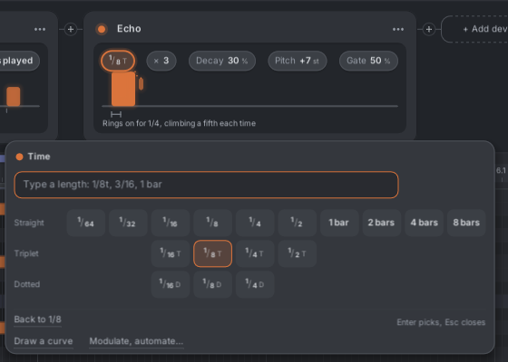
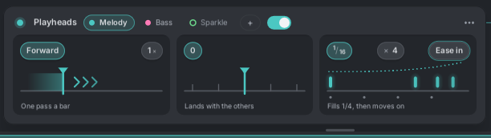
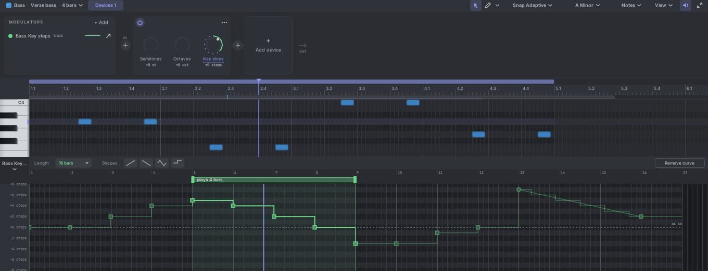
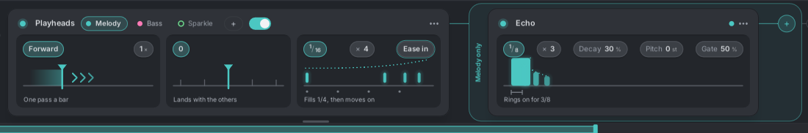
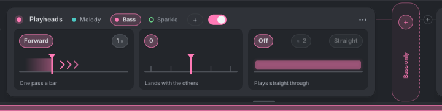

# 13. Devices and modulators

**Devices** are note effects. They change a track's notes on their way out: an arpeggiator plays chords one note at a
time, an echo repeats notes, a chord device turns one note into three. The notes in your clips don't change; you can
switch a device off at any time.

**Modulators** (LFOs, envelopes, steps…) move device settings by themselves, so the music keeps moving.

## The device strip

Click **Devices** in the notes header (or press **F3**) to open the strip above the notes. It shows the selected
track's devices from left to right, in the order the notes flow through them: **in** → devices → **out**. Each device
is a card in the track's colour, with one to three small pictures that show what it does to the notes.

When the strip is closed, a track with devices shows a thin bar naming its chain ("Arpeggiator → Echo"). Click it to
open the strip. A track without devices keeps the strip closed.

**Room for more cards.** The strip shows one row of cards and scrolls sideways when they don't fit. When the cards
need more than one row, a small grip sits in the middle of the strip's bottom edge: drag it down for more rows, up for
fewer. The cards then wrap from one row to the next, and the mouse wheel scrolls up and down. The strip grows only as
far as its cards need, and it always leaves the notes some room.

**A short pane.** When the pane is too short for one row of cards and the notes together (the editor in the module
panel, for example), the devices take the whole pane. **Devices** then sits beside **Notes** (and **Mixer**) at the
left of the pane's header: click it to see the devices, and click **Notes**, or **Devices** again, to go back to the
notes.

## Adding devices

Click **Add device** at the end of the chain, or the **+** between two devices. A searchable list opens.

- Type to filter by name or by purpose: "delay" finds Echo, "loose" finds Humanize.
- **Up / Down** choose, **Enter** adds, **Esc** closes.
- The footer says where the device will go.

A track holds up to 16 devices.

## The devices

| Device | What it does | Its settings |
|---|---|---|
| **Transpose** | Moves notes up or down. | Semitones, Octaves, Key steps (moves within the key). |
| **Scale** | Keeps every note in a key. | Key from (Clip, Song, Fixed), Root, Scale, Notes off key (Nearest, Up, Down, or Drop them). Root and Scale are faint unless Key from is Fixed. |
| **Chord** | Turns each note into a chord. | Chord, In key, Inversion, Voicing (Close, Open, Drop 2), Strum. |
| **Note Length** | Makes notes shorter, longer or legato. | Mode (Scale, Fixed, Legato), and the one setting that mode uses: Scale %, Length or Overlap. |
| **Arpeggiator** | Plays held notes one at a time. | Pattern (see below), Rate, Gate, Octaves, Swing, Velocity (As played, Fixed, Accent), Hold. |
| **Note Repeat** | Plays every note again and again for as long as it lasts, so a held chord repeats as a chord. | Rate, Gate, Decay (each repeat a little quieter). |
| **Echo** | Repeats notes, fading out, like a delay. | Time, Repeats, Decay, Pitch (per repeat), Gate. |
| **Velocity** | Makes notes softer, harder, or keeps them in a range. | Curve, Min, Max, Random. |
| **Humanize** | Loosens timing, velocity and length a little, differently on each pass. | Timing (only ever later), Velocity, Length. |
| **Random** | Changes pitches and drops notes, differently on each pass. | Pitch (steps), In key, Drop (chance to skip a note). |
| **Groove** | Swings this track its own way, in place of the song's swing: a straight bass under swung drums, or extra-swung hats. Turn its Swing with an LFO or a lane to ride it. A new Groove starts on the grid most of the track's off-beat notes sit on. | Swing (50% straight to 75%), Grid (1/16 or 1/8). |
| **Note Filter** | Lets only some notes through. | Lowest, Highest, Min velocity, Max velocity, Every (play every Nth note), Offset, Channels (any channel, or a set of them such as 1–4 and 10). |
| **Motion** | Moves the notes that joined it, a little differently on each pass. See [Notes that drift](#notes-that-drift). | Pitch (steps), Time (a delay in 1/16 steps), Length, Velocity, In key. |

**Playheads** is different from the others: it doesn't change notes, it reads the clip. See
[Playheads](#playheads) below.

**Arpeggiator patterns.** The examples hold C, E and G. All patterns except As played go from the lowest note to the
highest. **Octaves** adds the notes again an octave up, and the pattern runs over all of them.

| Pattern | What it plays | C E G |
|---|---|---|
| **Up** | Low to high, then again. | C E G, C E G… |
| **Down** | High to low, then again. | G E C, G E C… |
| **Up-down** | Up, then back down. The top and bottom notes play once at each turn. | C E G E, C E G E… |
| **Up-down full** | Up, then back down, with the top and bottom notes played twice. Four notes fill exactly 8 steps. | C E G G E C… |
| **Down-up** | Down, then back up, the ends once. | G E C E, G E C E… |
| **Down-up full** | Down, then back up, with the top and bottom notes played twice. | G E C C E G… |
| **Converge** | From the outside in: lowest, highest, then the next pair inward. | C G E, C G E… (with B too: C B E G) |
| **Diverge** | From the middle out, the lower note of each pair first. | E C G, E C G… (with B too: E G C B) |
| **As played** | In the order you played the notes. | as played |
| **Random** | Any note on each step; the same note can come twice. | for example E E C G… |
| **Walk** | Starts on the lowest note and wanders: half the time on to the next note, a quarter of the time the same note again, a quarter back one (round the ends). The same notes always walk the same path. | for example C E E C E G G E… |
| **Shuffled** | Each note once per round, in a mixed order. The same notes always mix the same way, so a loop sounds the same every pass. | for example G C E, G C E… |
| **Pattern** | A 16-step line made from the held notes, the lowest note twice as often as each of the others. Change the notes for a new line; the same notes always make the same line. | for example C G C E C C G E… |
| **Chord** | All the notes together on every step. | C+E+G… |

When you change to a new chord, the pattern starts again from its beginning, also with **Hold** on or when the chords
follow each other without a gap. If only one note of the chord changes (an inner voice moving), the pattern carries
on.

**Order matters.** Chord → Arpeggiator arpeggiates the chord. Arpeggiator → Chord makes a chord on every arpeggio step.

Random choices are repeatable: the same pass plays the same way every time, also in a MIDI export.

On **drum tracks**, devices that change pitch (Transpose, Scale, Chord, Random pitch) are skipped by default, because a
pitch is a drum lane there. Turn on **Affect drum lanes** in the device's ⋯ menu to use them anyway.

The track's **Voices** setting (Auto) follows its devices: a chord device adds voices, an arpeggiator plays one at a
time.

## Using a device card

- **Power dot** (top left): bypass the device. The dot turns hollow, the pictures fade, and the notes pass through
  unchanged.
- **⋯ menu**: rename, duplicate, delete, reset its settings, affect drum lanes, add a modulator to this device.
- **Drag the card's header** to move it in the chain. A line shows where it will land. **Ctrl+drag** copies it.
- Click a card, then **Delete** removes it and **Ctrl+D** duplicates it.

### Pictures and tags

Each picture shows one idea with a few bold shapes: grey outlines are the notes going in, shapes in the card's colour
the notes coming out. A line along its bottom says what the picture can't show, and follows the settings: the notes
an arpeggio plays on C E G, the notes of a chord on C, "A fifth up", "A canon, 1/8 behind".

The settings sit on the pictures as **tags**, pill-shaped labels with the value; the first tag on each picture is
tinted. A short word comes before the value only where the number alone would be unclear ("Gate 50%", "× 3").
Lengths read as fractions, with a small **T** for triplet and **D** for dotted. A setting that does nothing right now is
faint (Times and Curve while Piece is Off); one that doesn't apply is left out (Note Length shows only the setting its
Mode uses).

- **Drag** a tag left, right, up or down to step through its values. The picture redraws as you drag and you hear the
  change; letting go is one undo step. Hold **Shift** for smaller steps.
- **Mouse wheel** over a tag: one step.
- **Arrow keys**: one step on the tag you last touched.
- **Double-click** a tag to set it back to its default.
- On/off settings (In key, Hold) are small switches: click to flip them.

### A tag's panel

Click or right-click a tag to open its panel: the setting's name, a box to type in, and every choice.

- **Type** to find the closest choice: "1/8t", "3/16", "1 bar", "1.5", "reverse", "ease out". **Enter** picks it.
- Lengths are laid out in rows: straight, triplet and dotted. A playhead's Rate is laid out as faster, normal and slower,
  its Curve as drawn shapes, its Direction with small pictures.
- **Hover** a choice to see it in the picture; nothing changes until you click it. **Esc** or a click outside closes
  the panel and leaves the setting as it was.
- **Back to …** sets the default.
- **Draw a curve** opens a curve for the setting in the lower pane (see [Curves](#playheads) below), and
  **Modulate, automate…** has **Modulate with ▸**, **Remove modulation ▸**, **Automate in the arranger** and
  **Automate in this clip**.

The Note Filter's **Channels** panel has **Any** and the 16 channels to switch on and off; each click keeps the change.
You can also type a set: "1-4, 10", "any" or "all".

### When something moves a setting

- **A lane sets it:** the tag takes the lane's colour, and an **A** sits on its corner. Click the A to see the lane.
- **A modulator or a curve moves it:** a dot in the modulator's colour sits on the tag's corner.
- **How far:** a thin bar under the tag spans the setting's whole range. A lane shows the range it covers, from its
  lowest to its highest point; each modulation shows how far it reaches from where the setting is set, in the
  modulator's colour. A white dot shows where the setting is right now.
- The tag and its picture show the value as it plays now. Hover the tag to read each range in words, such as
  "Semitones: −5 st to +7 st".

## Playheads

The **Playheads** device reads the playing clip with several playheads at once. Each one moves through the notes in
its own way: slower, faster, backwards, in another order, an octave down, only the lowest notes… One melody becomes a
canon, a bass and a melody, or a texture that keeps shifting.

It is the first entry in the device browser, and it sits first in the chain: only Motion devices may come before it
(see [Notes that drift](#notes-that-drift)). A track holds one. While it is on,
it replaces the clip's own playhead; turn it off with its power button and the clip plays as usual. The playheads
belong to the track: launch another clip and the same playheads read it.

It starts with two playheads, both reading the whole clip from its start. Change one's **Rate** or segment to hear
them part. Each playhead shows as a line in its colour over the notes (the one the card shows is bolder). The notes it
reads light up in its colour, and so do their keys on the piano at the left. The clip's own playhead isn't drawn:
with playheads, it doesn't say what plays.

**The card.** The chips beside its name are the playheads: click one to show it (the card takes its colour), **+** adds
one (up to 16). The switch after the chips turns the shown playhead off and on without losing its settings, and so
does the dot at a chip's left end: it is hollow while the playhead is off (also while a curve or a lane has turned it
off). Alt-click the dot to solo it, or press
**Shift+M** to turn the shown playhead off and on. A playhead you turn off stops at once: the note it was playing ends
there, and the notes its own devices still had to play (an Echo's repeats) don't come. Right-click a chip to rename it,
pick its **Channel** (see [A sound for each playhead](#a-sound-for-each-playhead); the chip shows it), turn it **On**
or off, solo it, duplicate or delete it, or **Switch it on and off in time…** with a curve. Under the chips, the shown
playhead's settings on three pictures: how it moves (Direction and Rate), where it starts (Offset), and what it plays
again (Piece × Times, and the Curve that spaces the repeats):

| Setting | What it does |
|---|---|
| **On** | Whether it plays: the switch after the chips, or the dot on its chip. Right-click the chip for a curve on it, so the playhead can come in and drop out as the song plays (see **Curves** below). |
| **Rate** | Speed against the song, from 1/32x to 32x: halves and doubles, thirds (1/3x, 2/3x, 4/3x, 3x…), dotted speeds (3/8x, 3/4x, 3/2x) and fives (4/5x, 5/4x). |
| **Direction** | Forward, Backward, Ping-pong (turns at the ends) or Freeze (stands still); or read the segment's steps in another order: **Outside in** (first, last, second, second-last…), **Inside out**, **Odd then even** or **Shuffle** (a new order each pass), with the step size (1/32 to 2 bars, triplets too). |
| **Offset** | Plays this playhead's notes later (+) or earlier (−) than it reads them, by a note value: 1/64 up to a bar either way, with triplet (T) and dotted (D) values, and every 1/16 between (+5/16, +7/16…). Its line over the notes trails or leads by as much, so it crosses each note when you hear it. Two playheads on the same segment, one at **+1/4**, make a round. Double-click it to set it back to **0**. At the very start of a clip, a late playhead waits for its offset, and an early one skips the notes that would have come before the clip started. When the clip loops, notes carry over the loop as usual. A clip's end is a hard stop: a late note that would sound after the clip ends doesn't play, and an early playhead doesn't play notes from past the end. That holds for a timeline clip, and for a launched clip that doesn't loop. When a curve or a lane moves Offset later while the clip plays, the playhead waits until the new time catches up. It never plays the same notes twice. Moved earlier, it skips ahead. |
| **Piece** | The size of the piece it plays again: Off, or 1/64 up to 4 bars, with triplet (T) and dotted (D) sizes between. With **Times**, it plays each piece that many times, then moves on one piece: Piece 1/4, Times 2 plays beat 1, 1, 2, 2, 3, 3… |
| **Times** | How many times each piece plays, 2 to 16. |
| **Curve** | How the repeats are spaced in time (see [Spacing the repeats](#spacing-the-repeats)). **Straight** spaces them evenly. |
| **Rarer settings** | Right-click a playhead's chip: Notes (all, or only the **Lowest** or **Highest** of the notes that start together: a bass and a melody out of one piano roll, one playhead on Lowest with a Transpose of −2 octaves in its own chain, one on Highest), On a jump, Invert (mirrors its notes inside the clip's range, in the key), note Length (follows the playhead, the default: a note sounds while the playhead is on it, so at ½× it lasts twice as long; or as written; or fixed, 1/64 to 2 bars), Path (from the settings, or drawn in the time map), and rename, channel, on, solo, duplicate, delete. Each of these settings' lists ends with **Draw a curve for it** and **Automate or modulate…**, so the rarer settings can move in time too. |

Pitch and loudness aren't playhead settings: put a **Transpose** (octaves, key steps) or a **Velocity** device in the
playhead's own chain, like any other note change. Songs made when a playhead had its own Octave, Steps and Velocity
get those devices added for them, curves included.

The card's **⋯** menu holds the settings every playhead shares: **Restart** (when the clip starts, or also every so
many bars) and **Same note** (two playheads on the same note at the same moment play it once, or each).

**The segment.** On top of the piano roll's ruler, the shown playhead's segment is a bar in its colour, drawn like the
clip's loop bar, with its name inside and a solid grip at each end: the part of the piano roll that playhead plays, over
and over, starting at its left end. A thin line drops from each grip through the notes, so you can see which notes it
reads. Drag a grip to resize the segment, the bar to move it. For a playhead, the piano roll is a canvas: a segment can
sit anywhere on it, past the clip's end too, and plays the notes written there (where nothing is written, it is
silent). So with playheads on, the clip's loop doesn't decide what plays: the loop bar is hidden, the inspector's
**Loop** reads **Playheads decide**, and the loop only sets where a new segment starts out. For a round, give the
second playhead an **Offset** of +1/4, or move its segment a beat later. The other playheads' segments show as thin lines in their colours.
Right-click the segment to move it or resize it as the song plays (**Move it in time with a curve…**, **Resize it in
time with a curve…**), to automate or modulate its start or length, or to make it **Follow the clip's loop** again.

**A clip played by playheads looks different.** Its written notes aren't what plays, so on the timeline and in its
launcher slot it doesn't show them. It shows fine diagonal lines instead, and where each playhead goes: one band per
playhead, with its path in its colour rising from its segment's start (bottom) to its end (top). A forward playhead
draws a ramp each time round, a backward one falls, ping-pong zigzags, a faster one is steeper and repeats show as short
steps back. An off playhead's path is faint. One small stripe per playhead sits at the right end (hollow when it is
off), and the piano roll's title adds "read by 3 playheads". The paths follow the settings as you set them; curves
on them play but aren't drawn there.

**Curves.** Any setting can move by itself, on this card or any device card. Click a setting's tag and pick **Draw a
curve** in its panel: a curve for it opens in the piano roll's lower pane. On this card that is Direction, Rate,
Offset, Piece, Times and Curve (On, and the rarer settings, from a chip's right-click menu, and the segment, from its
right-click menu): a curve on On can bring the
playhead in for bars 5 to 8 only, one on Direction can turn it round in bar 2, one on Piece can start repeating halfway
through. On has two rows: the curve on its top row leaves it on, a step down to the row below turns it off. (The step
orders in the Direction panel, such as Outside in, stay as you pick them.) Click to add a point: that makes a
**Curve** modulator on the track (see [Modulators](#modulators)), named after the playhead and the setting, such as
"Bass Rate".

- **Up and down are the setting's own values.** For Octaves or Key steps each row is one value, labelled with what
  plays, and points snap to the rows (hold **Alt** to place them between rows). The rows cover everything the setting
  can reach. The dashed line is the setting as you set it: the curve adds to it, so with the setting on +2 a point
  on the +5 row plays +5, and changing the setting moves the whole line.
- **Two kinds of point.** A square is a **Step**: it holds its value until the next point. A circle is a **Ramp**:
  it glides to the next point. A new point takes the kind of the point before it; the first point on a setting with
  rows is a Step. A ramp across rows is heard one row at a time, drawn as dotted stairs under it.
- **Picking points.** Click a point to pick it: it draws brighter, and a drag moves every picked point together, so
  a shape you built moves as one. **Shift+click** picks one more (or unpicks it). Drag an empty spot and a box
  picks the points it touches; **Shift** adds them to the picked ones. A plain click in empty space still adds a
  point, picked.
- **Step and Ramp in the row on top** make every picked point that kind, as one undo step; right-clicking a point
  does the same (it picks the point first). The count between the two says how many points are picked, and a button
  lights when every picked point is already its kind. Right-click a point also deletes it. **Delete** removes every
  picked point, after you have clicked in the curve pane. Selecting another track closes the curve.
- **Its own zoom.** The curve zooms and scrolls on its own: **Ctrl+wheel** across, **Alt+wheel** up and down, the
  wheel scrolls up and down, **Shift+wheel** across. Double-click its ruler to see the whole drawing. It opens lined
  up under the notes; right-click for **Line up under the notes** or **Show the whole drawing**.
- **Length** in the row on top says how much curve there is to draw: 1 to 256 bars. Next to it are ready **Shapes**
  (drawn across the segment and the rows shown), then **Moves ▾** with what the curve moves (click it to take a
  setting off the curve, map it to more knobs, or send it out as CV), **Remove curve** and a close button that puts
  the note lane back. Drag the pane's top edge to make it taller or shorter; it keeps the height you set. Double-click the edge to
  go back to the default height.
- **The segment says what plays.** On the curve's ruler, a bar drawn like a playhead's segment marks the part that
  plays, such as "plays 4 bars". Drag its grips to resize it, or the bar to move it; dragging past the drawing's
  end grows **Length** with it. It loops: when the clip starts
  (launched, or reached on the timeline), the curve plays from the segment's start and goes round. Draw 16 bars and
  play bars 5 to 8, or draw 100 bars with the segment covering them all for a slow change over the song. A new curve
  is as long as the clip, with the segment covering all of it.

Drag points, double-click to delete one. A tag that a curve moves has a dot in the curve's colour on its corner and a
bar under it showing how far the curve takes it. While the song
plays, a playhead line crosses the curve where it reads now.

**Moved notes.** When the shown playhead plays notes at another pitch (its Invert, or a Transpose in its own chain,
and the curves on them), the piano roll shows where they go: each moved note appears again at the pitch it plays, in the playhead's
colour, with the change in semitones ("+2 st"). The written note it came from turns see-through with a dashed outline.
While the song plays this follows the pass playing now, so a curve on the Transpose shows each note moving from
pass to pass; stopped, it shows the first pass. The notes you edit stay where they are written.

On a drum clip whose lanes have their own length, the segment is the whole lane cycle, and each lane repeats on its own
length under every playhead. Note operators (chance, repeats…) and note curves work as usual; each playhead makes its
own chance choices.

**When a note plays.** Going forward, a playhead plays a note when it reaches the note's start. Going backward, it plays
it when it reaches the note's end, so the order of the notes is reversed but each note still sounds normally. A
playhead jumps when it goes back for a repeat, moves to the next repeated piece, wraps to its segment's start, moves
to the next step of an order, restarts, or steps along a drawn path (a ping-pong turn isn't a jump). What happens then
is the playhead's **On a jump** setting, in its **⋯** menu: **Retrigger** (the default) stops the note it was playing
and plays again any note it lands inside, for what is left of it, so a long note under a 1/16 repeat pulses in
sixteenths; **Let ring** lets the note it was playing ring on and plays only notes that start where it lands.

Every setting can also be moved by a modulator or an automation lane, as on any device. Moving **Rate** while it plays
speeds the playhead up or slows it down from where it is.

A clip read by playheads shows one band per playhead, with a block wherever that playhead is over a note, so you can see
how many there are and the rhythm of each. When the clip is too short for bands, the playheads' paths are drawn instead.

Playheads read launched clips and timeline clips alike. On the timeline, each clip starts its playheads again, from
where that clip begins (a clip that starts partway in starts the playheads partway in), and a stretched clip slows them
down. MIDI export with **Devices: Applied** writes what the playheads play, each playhead on its channel; **Bypassed**
writes the clips as written. Modulators on playhead settings go into the file when they follow the song alone: synced
curves and LFOs, Steps, Random, Ramp and Macro. A free-running curve or LFO, an Envelope or a Note modulator plays live
only.

### Spacing the repeats

The third picture on the Playheads card shows where the repeats of one group land: Piece 1/16, Times 4 is four hits in
a beat.
**Curve** keeps the same hits in the same time, but spaces them differently. Eight repeats over eight seconds come one
a second when the Curve is **Straight**; with **Ease in** they start far apart and bunch up at the end, like a
bouncing ball; with **Ease out** they start bunched up and slow down. The first hit of each group stays where it was,
so the next group still lands on time. Dots under the hits show where they would land straight.

When a curve, another modulator or a lane moves Piece, Times or Curve, the picture shows them as they play now, and so
do their tags.

Click the Curve tag for its panel; each shape is drawn. **Ease in** and **Ease out** come soft, medium and
hard; then **Ease in-out** (slow, fast, slow), **Swing light** and **Swing heavy** (the first half lingers) and
**Stairs** (slow-fast steps). With Piece off, Times and Curve are faint: there is nothing to space.

With **Length → Follows playhead** (the default), a held note lasts until the next repeat. A drawn path (a chip's right-click menu ›
Path › Drawn) replaces the repeats and their spacing.

### The time map

In the piano roll's lower pane, pick **Time map (playheads)** from the pane's menu. Each playhead gets a row: across is
time since the clip started, lined up with the bars above; up is where in its region the playhead reads. A rising line
is a normal playhead, a steeper one is faster, a falling one goes backwards, a flat one is frozen, a staircase repeats,
and a jump is a wrap.

To draw a path, right-click a playhead's row and pick **Draw this path**: it starts from where the settings take the
playhead, and its cycle becomes as long as the clip.

- **Click** in the row to add a point, and **drag** a point to move it (it snaps to the grid; hold Alt to place it
  freely).
- **Double-click** a point to delete it.
- **Right-click** the row for **Back to settings**, **Clear points** and **Path cycle** (1/4 bar to 64 bars).

Between two points the playhead moves straight from one place to the other, and plays the notes it crosses on the way,
in either direction. A drawn path says where the playhead is at every moment.

### Devices for one playhead

Right after the Playheads card come the shown playhead's own devices: devices only that playhead's notes go through,
before the rest of the chain. They sit in a frame in the playhead's colour, with "Melody only" (its name) written down
its side; the cards inside take that colour too. Click the round **+** at the frame's end to add one (up to 4 per
playhead).

A playhead without its own devices shows a slim dashed slot with a **+** and "Bass only" down its side. Click it to
add the first one.

 Give the slow reversed playhead an
Echo, or move the fast one up an octave with Transpose, while the devices after them still shape every playhead. Click another chip to see its branch. Branch devices count toward the
track's 16 devices; their cards stay in their branch (they can't be dragged out).

### A sound for each playhead

Each playhead puts its **channel** on the notes it plays: Playhead 1 on channel 1, Playhead 2 on channel 2, and so on.
Right-click its chip and pick **Channel** to change it, or **Each note's own** to keep the channels the notes were
written on.
A Track Out plays **All channels** unless you pick one. To give Playhead 2 its own sound, add a second Track Out for the
same track, click its screen and pick **Channel 2**, and patch it to another voice. See
[Track Out](02-modules.md#track-out). On a drum track, Drum Out has the same picker: the reversed hats can go to one
voice and the straight ones to another.

### Notes that drift

A **Motion** device moves some of your notes while the clip plays: a few notes rise one step each pass and fall back,
a note slides later and later, velocities swell. The written notes never change; the motion plays on top of them.

**Which notes.** Select notes in the piano roll, right-click one and choose **Motion › New motion**. That adds a Motion
device, named "Motion 1" in a colour of its own, and the notes join it. A small corner in that colour marks them. To
add more notes later, select them and click **+ Selected** on the card; to take notes out, select them and click
**− Selected**. The chip beside them (**6 notes**) selects the card's notes in the piano roll. The inspector's
**MOTION** line says which Motion device the selected notes move with, and opens the same choices. Notes from any clip
on the track can join the same Motion device.

**Its settings.** **Pitch** (steps, in the key unless **In key** is off), **Time** (a delay in 1/16 steps), **Length**
and **Velocity**. To make them change, click a tag and pick **Draw a curve**: its curve opens in the lower pane (see
[Modulators](#modulators)). For one value each pass of the clip ("up one step a pass for four passes, then back"),
click a tag, then **Modulate, automate…** › **Drift per pass**: a **Steps** modulator set to **Per pass**, one step each pass. Any modulator
or automation lane can move these settings too.

**Seeing it.** A note a Motion moves shows where it plays, in the Motion's colour: the written note turns see-through
with a dashed outline, a thin line runs from its middle (a dot) to the middle of the note where it sounds, and that
note says what changed ("+7 st", "+2 steps", or both). It sits at the new pitch, starts later by the Time setting and
is as long as Length makes it. With curves on its settings it follows them: with playheads (which can read the note at
any moment) it is where the curves are right now, moving as the song plays; without, it is the pass playing now (the
first one when stopped). When the note moves out of view, a marker at the top or bottom edge
of its column says how far ("▼ −7 st").

**Where it sits.** A new Motion device goes before the Playheads device, the only place in front of it:

- **Before Playheads:** the notes move inside the clip, and every playhead reads them where they moved to. A note
  pushed later is reached later by a playhead going forward, earlier by one going backward, sooner by a fast one.
  Passes are the clip's, so every playhead hears the same drift.
- **After Playheads** (drag the card there): each note moves as a playhead plays it, and each playhead counts its own
  passes, so the melody and the bass drift apart.
- **In one playhead's own devices:** only that playhead's notes move.

Without playheads, a Motion device moves its notes wherever it sits in the chain. MIDI export with devices applied
plays the motion.

## Modulators

The **MODULATORS** list on the left of the strip holds the modulators. Click **+ Add** to make one. A chip row at the
top chooses where it lives:

- **Whole song**: one modulator for every track, for example one LFO that sweeps several tracks together.
- **The track**: it can move any setting of this track's devices.
- **A device**: it can move only that device's settings.

| Modulator | What it makes | Settings |
|---|---|---|
| **LFO** | A wave that keeps moving. | Shape (Sine, Triangle, Saw up, Saw down, Square, Sample & hold, Smooth random), Sync, Rate, Phase, Bipolar, Restart (Free, Each bar, Each note). |
| **Envelope** | Rises and falls with each note. | Attack, Decay, Sustain, Release. |
| **Steps** | A pattern of values you draw (1 to 16 steps). | Steps, Rate, Smooth, Bipolar. |
| **Random** | A new random value at a steady rate. | Rate, Smooth, Bipolar. |
| **Ramp** | Rises or falls over several bars: builds and fades. | Length (bars), Direction, Then (Hold or Loop), Curve. |
| **Macro** | One value you turn (or automate) that moves many settings at once. | Value. |
| **Note** | Follows the last note. | Follows (Velocity, Pitch, Release, Timbre, Pressure), Smooth. |
| **Curve** | A shape you draw, of any length; the part its segment marks plays and repeats. | None: Length and the segment sit over the drawing. |

**Curve** opens its drawing in the piano roll's lower pane: click its row (click it again to put the notes back), or
pick it in the lower pane's menu under **Curves**. A Curve has no popover: what it moves, **Map to more knobs** and
**CV out…** are under **Moves ▾** in the pane's top row, and in its row's right-click menu. It plays the part of the drawing its segment marks, from when its track's clip starts, round and round
(a song modulator counts from the song's start). The pane works as described under [Curves](#playheads) above. For a
wave that runs at its own speed in Hz, use an **LFO**. The dashed line means "no change": above it moves the setting
up, below it down. Up and down are the values of the first setting it moves, which it turns all the way (its row in
**Moves** says **as drawn**, with no amount); other settings it moves follow by their own amounts.

Each row in the list shows the modulator's colour, its name, where it lives, a small live graph, and a **↗** arrow.
Click a row to open its settings (a Curve opens its drawing instead, see above):

The **MOVES** list in the popover shows every setting the modulator moves, with its amount and a **×** to remove it.
Right-click a row in the list to rename or remove the modulator.

### Connecting a modulator to settings

1. Click the modulator's **↗** (or **Map to knobs** in its popover; for a Curve, **Moves ▾** › **Map to more knobs**).
2. The tags it can reach light up in its colour; the others fade. A message says "Mapping LFO · drag a lit tag up or
   down".
3. **Drag a lit tag** up for a positive amount, down for a negative one. The bar under the tag shows how far it will
   reach. A click adds +50%.
4. Press **Esc**, or click empty strip space, to finish.

A setting takes up to four modulations. Modulation adds to the setting's own value (or to its automation). The Note
Filter's Channels are only ever picked by hand: modulators, lanes and curves can't move them.

### Sending a modulator out as CV

In the popover, **CV out ▾** sends the modulator out of Roll (for a Curve: **Moves ▾** › **CV out…**, or right-click
its row):

- To an **AUTO output** of a track: the value is added to that AUTO channel on its Track Out, Drum Out and Auto Out.
- To **a knob in the rack**: touch any knob, as when mapping automation. Its range can be set.

So one LFO can move an arpeggiator's gate and a filter in your patch together.

## Automating a device setting

Click or right-click a tag, pick **Modulate, automate…** in its panel, and choose:

- **Automate in the arranger**: a lane under the track, in song time. Its header reads, for example, "Arpeggiator ·
  Gate".
- **Automate in this clip**: a lane in the piano roll's lower pane, looping with the clip.

A new lane starts flat at the setting's value, so nothing changes until you draw. Once a setting has a lane, its tag
takes the lane's colour and shows an **A**: click the A to see the lane (the menu also says **Show its lane**). Edit
the lane like any automation lane ([Automation](12-automation.md)); its values are shown in the setting's own units.

- Setting lanes play only while the transport runs. When stopped, the setting is free to change and try out.
- A tag held with the mouse wins while you hold it, then the lane takes over again.
- Arm the track and record to capture your moves (Touch, Latch, Write). A clip's setting lane records while that
  clip plays.
- Setting lanes don't use an AUTO channel. A track or clip can have 16 of them.
- If the device is deleted, the lane says **Target missing** until you undo.

## Live playing and recording

Notes played live (MIDI, CV, computer keyboard) go through the armed track's devices, even while stopped, so you hear
the arpeggiator as you play. Recording keeps the notes as you played them, before the devices.

## Devices and export

MIDI and DAWproject export have a **Devices** choice: **Applied** writes what the chain plays (each arpeggio step
becomes a note), **Bypassed** writes the clips as written. See [Files](14-files.md#exporting-midi).
