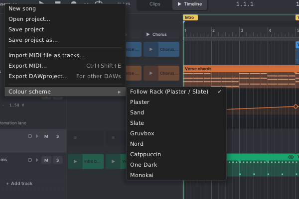
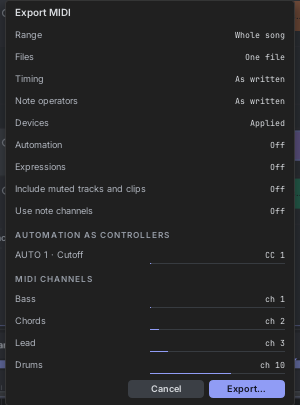

# 14. Files, export and import

## Saving with the patch

Tessera saves everything inside your Rack patch: the song, the transport settings, the editor layout and the output
modules' tracks. Save the patch as usual. Rack's module presets (right-click → **Preset**) also save and load the
whole song.

## The File menu

Click **Tessera ▾** at the top left of the editor. The module's right-click menu has the same items under **File**,
so you can use them without opening the editor.

| Item | What it does |
|---|---|
| **New song** | Starts again: an empty song, the default tempo and loop, Plays set to Clips. One undo step brings the old song back. Your tools, snap and layout stay. |
| **Open project…** | Opens a `.tessera` project file. |
| **Save project** | Saves to the project file you opened or saved last (its name shows in the menu). |
| **Save project as…** | Saves a new `.tessera` file. |
| **Import MIDI file as tracks…** | Adds a track for each part of a MIDI file. See [Importing MIDI](#importing-midi-files). |
| **Export MIDI…** | Ctrl+Shift+E. See [Exporting MIDI](#exporting-midi). |
| **Export DAWproject…** | For other music programs that read DAWproject. See [Exporting DAWproject](#exporting-dawproject). |
| **Colour scheme** | See [The editor](03-editor.md#colour-schemes). |

## Project files (.tessera)

A project file holds one Tessera's song on its own, outside the patch: tracks, clips, scenes, devices, automation,
tempo, loop, Plays, the instance name and the editor layout. Use it to keep songs, share them, or move a song to
another patch.

It doesn't hold what belongs to the patch: the MIDI device, the panel's width and the editor size.

Opening a project is one undo step. Output modules in the same patch keep their tracks.

## Clip files (.tessera-clip)

To reuse one clip in another patch, right-click it and choose **Save as Tessera clip file…**. To load it, right-click
an empty slot and choose **Load a Tessera clip file…** (or **Replace with Tessera clip file…** on a clip).

## Exporting MIDI

Export your music as a Standard MIDI File, to open it in any music program.

- **The song** (or the tracks selected in the headers): **Tessera ▾ → Export MIDI…** or **Ctrl+Shift+E**.
- **One clip, or the selected clips**: right-click a clip in the clips panel or on the timeline and choose **Export as
  MIDI…**. You choose one file per clip, or one file with a track per clip.

| Option | Choices |
|---|---|
| **Range** | **Whole song** (to the end of the last timeline clip), **Loop**, or the timeline's **range selection** when there is one. |
| **Files** | **One file**, or **one file per track** ("song - Bass.mid"…). |
| **Timing** | **As written** (on the grid), or **As played** (with swing and micro-timing). |
| **Note operators** | **As written** (every note, ignoring chance and repeats), or **Rendered** (each loop pass as it really plays, with chance, repeats and conditions). |
| **Devices** | **Applied** (what the devices play: arpeggios, echoes, chords), or **Bypassed** (the clips as written). |
| **Automation** | **Off**, **As CC** (each AUTO lane as a MIDI controller), or **As CC + 14-bit** (finer steps). |
| **Expressions** | **Off**, **MPE** (each note on its own channel, with its bend, timbre and pressure), or **Flatten** (timbre as CC74, pressure as polyphonic aftertouch; bends are dropped). |
| **Include muted tracks and clips** | Off by default. Muted notes are never exported. |
| **Use note channels** | Each note goes out on its own MIDI channel. Off: each track uses one channel. |
| **Automation as controllers** | The CC number for each AUTO lane in use (1, 2, 11, 16… by default). |
| **MIDI channels** | The channel of each track (shown for songs of up to 12 tracks). By default instrument tracks take 1, 2, 3… (skipping 10) and drum tracks take 10. |

Click **Export…**, choose where to save, and a message tells you what was written. Your choices are saved with the
patch.

**What is in the file:** a MIDI file of type 1 at 960 ticks per beat. The first track holds the song name, tempo,
time signature, markers and the loop (as "Loop start" and "Loop end" cue points). Then one track per Tessera track, in
order, named after it. Clips are written as they play on the timeline: with their loops, stretch, transpose and
velocity.

## Exporting DAWproject

DAWproject is an open file format that several music programs can open. **Tessera ▾ → Export DAWproject…**
writes:

- one track per Tessera track, with its name and colour;
- the timeline clips where they are, with their notes (as MIDI export plays them, using the same Timing, Note
  operators and Devices choices);
- the clips panel's clips as scenes (looping);
- tempo, time signature and markers;
- AUTO lanes as automation (with Automation set to As CC).

Per-note bends, timbre and pressure, and the devices themselves, don't go across (with Devices applied, their notes
do).

## Importing MIDI files

There are three ways in. Each is one undo step.

| Where | What you get |
|---|---|
| Right-click an **empty slot** → **Import MIDI file…** | One clip in that slot. |
| Right-click **empty timeline space** → **Import MIDI file here…** | One clip placed where you clicked. |
| **Tessera ▾ → Import MIDI file as tracks…** | A new track for each part, with its clip on the timeline at bar 1 and in its first slot. The file's time signature and tempo are used too. |

- Each MIDI track's channels are its parts. A file with several parts asks which one to import, or all of them as one
  clip. An MPE part (each note on its own channel) is one part.
- Channel 10 becomes a drum track, with a lane for each drum sound used (General MIDI names where known, up to 16
  lanes).
- Notes keep their timing, velocity and release velocity. Clips are whole bars long and loop.
- Poly aftertouch and MPE come in as each note's **Pressure**, **Timbre** and **Pitch** curves. Pitch bend, channel
  aftertouch and controllers become clip lanes (see [Expression and controls](11-recording.md#expression-and-controls)).
- Only controllers that move get a lane, such as the mod wheel or expression. Setup a file sends once and never
  changes (volume, pan, reverb and chorus amounts) gets none, and nor do bank select and messages like "all notes
  off". So the AUTO channels go to what you want to hear.
- Files timed in SMPTE frames can't be imported.
