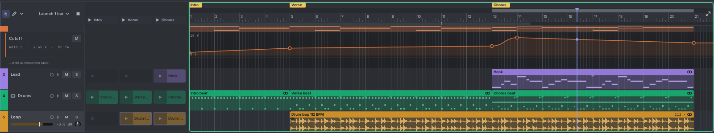
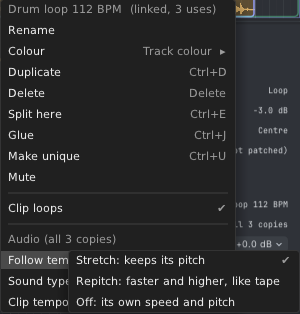

# 17. Audio

Tessera plays audio files too: drum loops, breaks, vocals, one-shot hits, whole recordings. They sit on **audio
tracks**, next to your note tracks, and play out of the **MAIN L** and **MAIN R** jacks on the Tessera panel.

## Bringing in a file

Drag one or more files from your computer and drop them:

| Drop them on | What happens |
|---|---|
| The Tessera panel | One new audio track per file. With **Plays = Timeline** the clip goes on the timeline at bar 1; with **Plays = Clips** it goes in the new track's first slot. |
| An audio track in the timeline | At the drop point, snapped to the beat. Several files go end to end. |
| A launcher slot of an audio track | Into that slot. Several files fill the slots below it. |
| A note track | A new audio track just below it. |
| Empty space in the timeline or the launcher | New audio tracks at the end, at the bar you dropped on (timeline) or in their first slot (launcher). |

Or use **File → Import audio…** (**Ctrl+Shift+O**): the file goes on a new track at the playhead's bar.

Tessera reads **WAV, AIFF, FLAC and MP3**. A file with more than two channels is mixed down to stereo; its clip says
"6→2" (six channels into two). A file Tessera can't read is skipped, and a message says which one.

Every drop is one undo step. **Ctrl+Z** takes it all back.

### The file is copied into the patch

Tessera copies each file into the patch, so a saved patch always has its audio with it. You can move, rename or
delete the original: the patch keeps playing. Copying a Tessera keeps its audio too.

A very long file takes a lot of memory (a 4-minute stereo file needs about 100 MB). Before importing a file longer
than 20 minutes, or files that need more than 1 GB together, Tessera asks first.

## Tempo: how a clip keeps time with the song

When you drop a file, Tessera works out the tempo it was played at. It looks, in this order, at:

1. a tempo stored in the file (many loop libraries write one into their WAV files);
2. the file name, such as "drums_92bpm.wav" or "Loop 120 BPM.aif";
3. the length: a loop that lasts exactly 8 beats at 92 BPM is a 92 BPM loop;
4. the beats in the sound itself, for longer files.

A short single hit (a kick, a clap) is a **one-shot**: it plays once, at its own speed.

**The first loop sets the song tempo.** Drop a loop into a song that has no clips yet, and the song takes the loop's
tempo, so the loop plays exactly as it was made. The message offers **Keep 120 BPM** (or whatever the tempo was) to
put the song tempo back.

Every audio clip shows its tempo after its name, like **92 ▾**. Its menu (right-click the clip) has:

- **Clip tempo**: the guess, double, half, or a tempo you type. This is the one place a clip's speed is set.
- **Follow tempo**: how the clip meets the song tempo.
  - **Stretch**: the clip follows the song tempo and keeps its pitch. The default for loops.
  - **Repitch**: the clip follows the song tempo like tape: faster is higher.
  - **Off**: the clip plays at its own speed and pitch, whatever the song does. The default for one-shots. The clip
    shows **own speed** instead of a tempo.
- **Sound type**: what the clip holds, so stretching treats it right: **Drums** keeps attacks sharp, **Melody** is
  smooth for one instrument, **Voice** keeps a voice's character, **Full mix** balances for finished music.

### Moving the tempo sounds like tape

Stretching a clip well takes a moment of work. While Tessera makes the stretched version, the clip plays a quick
version that runs faster or slower like tape, and the clip shows how far along it is ("… 40%"). When the clean
version is ready, it takes over without a click. Turning the **TEMPO** knob does the same: while the tempo moves,
clips follow it like tape, and half a second after it settles they get their clean stretched version.

Alt+drag a clip's right edge to change its clip tempo by hand: a clip made twice as long plays at half the speed.

## Editing audio clips on the timeline

Audio clips move, copy, trim, loop and split with the same gestures as note clips (see
[The timeline](06-timeline.md)). Audio clips have a few more:

| Gesture | What it does |
|---|---|
| Drag the title bar up or down | The clip's gain. The waveform grows and shrinks while you drag. Every selected audio clip changes by the same amount. Snaps to 0 dB; Alt skips the snap. |
| Drag a top corner of the clip body | The fade in (left) or fade out (right). The fade shades the waveform. |
| Alt+drag the right edge | The clip tempo (see above). |

The clip's settings (gain, follow tempo, sound type, tempo) belong to the clip, so every linked copy of it changes
together. The inspector says **all 3 copies** when there are several.

Where two clips on one audio track overlap, they crossfade over the overlap. Every clip edge gets a tiny fade, so a
cut never clicks.

## The inspector

With an audio clip selected, the inspector shows its **Gain**, **Follow tempo**, **Sound type** and **Clip tempo**
(click one to change it), its length and loop, and its file: name, length, sample rate, mono or stereo. With a
timeline copy selected, it shows that copy's fade in and fade out too.

For the track, it shows its **Volume**, **Pan** and **Output** (MAIN).

## What a clip's marks mean

| Mark | Meaning | What plays |
|---|---|---|
| **Loading 40%** | The file is being read. | Silence until it is read, then the clip at once. |
| **… 40%** | The stretched version is being made. | The quick, tape-like version. |
| Amber **!** | The stretched version couldn't be made. The clip menu has **Try again**. | The quick version. |
| **Missing file**, stripes | The file isn't in the patch any more. The clip menu has **Find file…**. | Silence. |
| **6→2** | The file had six channels, mixed down to stereo. | The stereo mix. |
| **own speed** | Follow tempo is Off. | The clip at its own speed. |

When a patch loads with files missing, a message says how many, with **Find…** to point at the first one.

## Hearing it: MAIN L and MAIN R

Audio tracks play out of the **MAIN L** and **MAIN R** jacks on the Tessera panel (see
[The modules](02-modules.md#9-outputs)). Patch them into Rack's **Audio** module, or into any effect first.

If the patch has an Audio module, right-click Tessera and choose **Connect MAIN to Audio module**: it patches MAIN
into the Audio module's first two inputs, as one undo step. If those inputs are taken, it says so and changes nothing.

Full scale (0 dB) is 10 V, the level Rack's Audio module sends to your sound card at full volume. A file comes in at
5 V (−6 dB), the level of most rack oscillators.

## Removing audio you don't use

**File → Remove unused audio** removes the files no clip plays any more. It is one undo step; the files themselves
go when the patch is next loaded.
