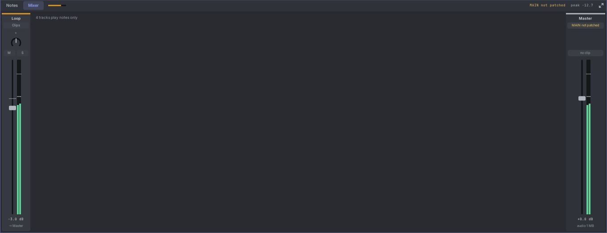

# 18. The mixer

The mixer sets how loud each audio track plays and where it sits from left to right, and shows the levels as they
play. It appears as soon as the song has an audio track.

## Opening it

The mixer is the third pane, under the notes pane, folded to a thin bar named **Mixer**:

- **Click** the bar to open the mixer or fold it again.
- **Drag** the bar up or down to set its height.
- The **maximize** button at the bar's right end is the same one the song and notes panes have: it fills the editor
  with the mixer, and restores the panes. **Double-click** the bar or press **F4** to do the same.
- Like the other panes, a click in the mixer gives it the keys (a thin ring shows it), **Tab** reaches it while it is
  open, and **Shift+Tab** maximizes it.

Folded, the bar still shows a small live meter for each audio track, the Master's peak level, and **MAIN not
patched** in amber when the Master plays but nothing is patched into MAIN.

## A strip

Each audio track has a strip, in the same order as the tracks. From top to bottom:

1. **The name**, under a bar in the track's colour. Click it to select the track.
2. **The source**: **Clips** (what the track plays), or **Missing file** in amber when a clip's file is gone.
3. **Pan**: drag it to move the sound left or right. Double-click centres it.
4. **M** and **S**: mute and solo, the same switches as in the track rows.
5. **The fader and the meter**. The fader sets the volume; the meter beside it shows the level as it plays.
6. **The volume** in dB, and **→ Master**: where the track goes.

The **Master** strip sits at the right. It sets the level of everything together on its way to MAIN. Its light near
the top turns red and shows the peak (like **+2.3**) when the sound went over full scale; click it to clear it.
Under its fader it says how much memory the song's audio uses. When MAIN has no cable and the patch has an Audio
module, it offers **Connect to Audio**.

## Drum lanes

When a drum module's output is patched into a lane's **IN** on the Drum Out, that lane gets a narrow strip of its own,
right after the drum track's strip, in the lane's colour and named after it (**Kick**, **Snare**). Each has a pan
knob, a fader with a meter, and its level in dB. Faders and pan knobs work as on any strip: drag, double-click to
reset, scroll, right-click to type a level.

Use them to balance the kit inside Tessera; the drum track's own fader then sets the whole kit. The kit's **OUT**
on the Drum Out carries the lanes at these levels and pans.

## Faders

- **Drag** a fader up or down. It moves from where it is: a click never makes it jump.
- **Shift+drag** or **Ctrl+drag** moves it finely.
- It catches at **0 dB** as you pass; hold **Alt** to move through freely.
- **Double-click** sets 0 dB.
- **Scroll** over it to move 0.5 dB at a time (Shift: 0.1 dB).
- **Right-click** it, or double-click its value, to type a level.
- Select several audio tracks and drag one of their faders: all of them move by the same amount. A track at −inf
  stays there.

A drag is one undo step. You hear the new level while you drag.

## Levels

0 dB on every meter is full scale: 10 V on MAIN, the most Rack's Audio module sends to your sound card without
clipping. The meters run from −60 dB to +6 dB. They turn amber in the top 6 dB, and red above 0 dB. A thin line
holds each peak for a moment.

## Levels in the track rows

Audio tracks also show their level in the track rows, as a second line under the name: a level bar, its dB value,
and a small pan knob.

- The level bar is the fader and the meter in one. It glows in the track's colour as it plays, brightest in the top
  6 dB. The thin bright line is the fader.
- **Drag** it sideways to change the volume. A click without moving just selects the track.
- **Double-click** the bar for 0 dB, or the pan knob to centre it.
- **Scroll** over the bar to move 0.5 dB at a time.

Rows too short for a second line don't show it; make the row taller (drag its bottom edge) to see it.

## Automating the fader and pan

Right-click a fader, a level bar or a pan knob and choose **Automate in the timeline**. The track gets a **Volume**
(or **Pan**) lane, starting at the control's value, and its lanes open in the timeline. You can also add one from
**+ Add automation lane**.

- Draw the lane like any other: its scale reads in dB (from **-inf** up to **+6 dB**) or in pan.
- While the song plays, the fader, the level bar and the pan knob follow the lane, in the mixer and in the track
  rows. A control with a lane has a ring in the lane's colour.
- Drag the control while it plays and your hand wins for as long as you hold it.
- Mute the lane (its **M**) to give the control back to the strip.

## The Master row

Under **+ Add track**, a thin **Master** row shows the Master's level bar and its volume in dB. It works like a
track's level bar: drag it sideways, double-click it for 0 dB, scroll over it to move 0.5 dB at a time. Click the
word **Master** to open the mixer. Like the mixer, it appears once the song has an audio track.
