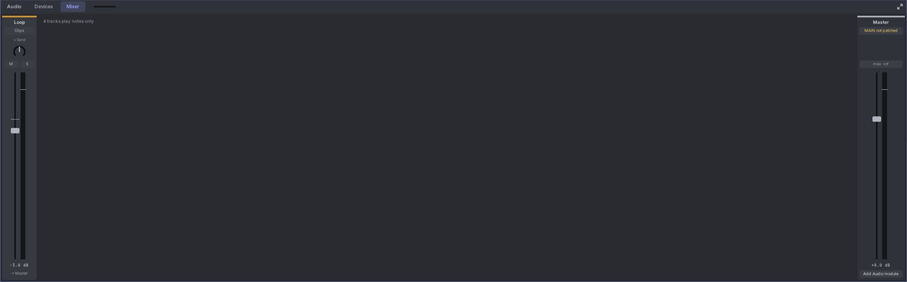
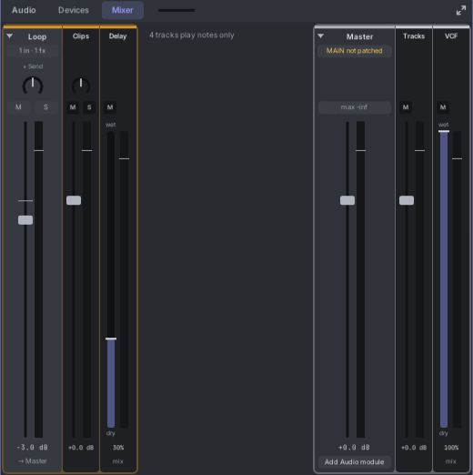
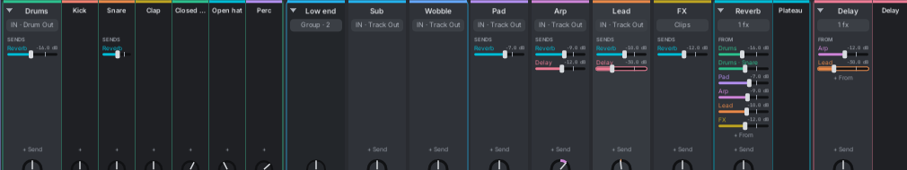

# 18. The mixer

The mixer sets how loud each track that makes sound plays and where it sits from left to right, and shows the levels as they
play. It appears as soon as the song has an audio track.

## Opening it

The mixer shares the lower pane with the notes (or the audio editor) and the devices. The pane's header starts with
**Notes · Devices · Mixer** (**Audio · Mixer** when an audio track is selected: it has no devices): click **Mixer** to show
the mixer there and **Notes** to go back, or press **F5** (mixer) and **F3** (notes). Clicking any clip also goes back to it. **Mixer**
appears once something in the song makes sound.

- It is the same pane: the line between the panes resizes it, its **maximize** button in the top-right corner
  fills the editor with it and restores the panes, and **Tab**, **Shift+Tab** and the focus ring work as for the
  notes.
- The header shows a small live meter for each track that makes sound, and **MAIN not patched** in amber when the
  Master plays but nothing is patched into MAIN.
- **When the strips don't fit**, the tracks scroll sideways while the Master stays at the right; a thin bar along the
  bottom shows which part is in view. Scroll as in the other panes: **Shift+wheel**, a sideways swipe on a trackpad,
  the wheel anywhere but on a fader or a send, **middle-drag**, or hold **Space** and drag. **Home** and **End** go to
  the first and last strip, **Page Up** and **Page Down** a screen at a time.
- **Zoom**, as in the piano roll: **Ctrl+wheel** widens or narrows every strip, keeping the one under the mouse in
  place; **=** and **-** zoom a step; **F** (or **Shift+F**) fits every strip in view.

## What belongs to what

Some strips belong to another one: a track's input strips and drum lanes, a group's tracks, the Master's inputs. The
rule is the same everywhere: **the parent comes first, and what it holds opens to its right.** A frame in the
parent's colour holds them together: filled behind a track and its input or lane strips, an outline round a group and
its tracks.

The small arrow left of a parent's name folds what it holds, and unfolds it again: pointing down while open, right
while folded. A folded group shows only its own strip. A track's input and lane strips start folded, and its arrow is
the same one as the mix arrow in its track row: opening one opens the other.

## A strip

Each track that makes sound has a strip, in the same order as the tracks: an audio track, or any track whose sound
comes back on a Track Out's or Drum Out's IN. From top to bottom:

1. **The name**, under a bar in the track's colour. Click it to select the track. Right-click it for the same menu
   as the track's header (rename, colour, recording, sends, Track Out…), with the mixer's own items on top: **Show
   sends to this track** and the track's **Latency**. A group strip's name opens the group's menu.
2. **The source**: where the sound comes from. **Clips** for an audio track's clips; **IN · Track Out** or
   **IN · Drum Out** for a note track whose voice comes back on that module's IN; **2 sources** when the track has
   more than one; **1 in · 1 fx** when it has an effect, or **1 fx** when an effect is all it has (a track that
   other tracks send to). A click opens the sources list (see
   [Several sources on one track](#several-sources-on-one-track) and [Effects on a track](#effects-on-a-track)). In amber: **Missing file** when
   a clip's file is gone, **Bypassed** when a module that brings the sound is bypassed. With one source, click it for a menu:
   **Show Track Out in the rack** scrolls the rack to the module and makes its screen flash; **Add another Track Out**
   (or **Add a Track Out for this track** when it has none) places a new Track Out (a Drum Out for a drum track) bound
   to it, right of Roll.
3. **Sends**: under **SENDS**, a slider for each send under the receiving track's name, then **+ Send**. A track
   that receives sends also lists them under **FROM**, with **+ From**. See
   [Sending to other tracks](#sending-to-other-tracks).
4. **Pan**: drag it to move the sound left or right. Double-click centres it.
5. **M** and **S**: mute and solo, the same switches as in the track rows. A click on **S** adds the track to the solo; **Shift+click** solos only this track.
6. **The fader and the meter**. The fader sets the volume; the meter beside it shows the level as it plays.
7. **The volume** in dB, and **→ Master**: where the track goes after its fader. Click it to choose **To the Master**
   (or to its group) or **Only its sends**: then the track feeds what it sends to, a reverb say, and isn't heard dry.
   The label then reads **sends only**, and the meter still shows the track's level.

The **Master** strip sits at the right. It sets the level of everything together on its way to MAIN. Its light near
the top shows the loudest moment so far (like **max -4.1**); it turns red and says **over +2.3** when the sound went
over full scale. Click it to clear it. Under its fader it says **→ MAIN**. (How much memory the song's audio uses is in
**File ▸ Audio files…**.) When MAIN has no cable, its chip says **MAIN not patched**, and a button under its fader
offers the fix: click either for **Connect MAIN to the Audio module**, or, when the patch has no Audio module, **Add an
Audio module and connect MAIN** (one undo step; pick your sound card on the new module). With an effect on the
Master, its input strips sit right of it: **Tracks** (all the tracks together) and the effect. Right-click **Master**
for the same MAIN item, **Automate its volume in the timeline**, and the master's Track Out items (a Track Out on the
master puts an effect on everything).

## Several sources on one track

A track can hear more than one thing at once: an audio track's clips and a synth on its Track Out's IN, or two
Track Outs on one track, each with its own synth, to layer them. Each is a **source**, and every source plays.
When you patch a second source, a message says so: "Lead has 2 sources now. Both play", with **Use only the new
one** to switch the others off.

With two or more sources, each gets its own narrow strip next to the track's strip: **Clips** on an audio track, and
one for each Track Out, named after the module patched into its IN ("Plaits", "FM-OP"), or **IN** (**IN 1**, **IN 2**)
when nothing is. A drum lane without a name is named the same way. Each has a fader, pan, **M**, **S** and a meter. The track's own strip is
the master amount for all of them. The arrow left of the track's name folds the strips away.

- **M** silences that input, without pulling a cable. Everything after it in the track's chain hears it go too: to
  keep an effect and drop the dry sound, set the effect's **Mix** to 100% instead.
- **S** plays that input alone, and solos its track too. **Shift+click** works as on a track: only this input of the track, and only this track.
- Right-click an **IN** strip's name for **Rename…** and **Show this module in the rack**. Give each input a name
  ("Synth", "Vocal mic"): the strip, the sends' **FROM** rows and the track's source list then use it. The Track Out's
  own right-click menu has the same name under **Input name**. Clear the name to go back to the module's name.
- **Counted once**: when one cable feeds the INs of two Track Outs on the same track, the second adds nothing.

A Track Out's **Use** and **Level** are kept in the module and also sit in its right-click menu, under **As a source
of its track**. Its screen shows **IN OFF** or the level (like **IN -6.0 dB**) while they change the sound. They go
with the module when you move, duplicate or delete it.

## Effects on a track

Put an effect on a track by patching it through one of the track's Track Outs: the Track Out's **OUT** into the
effect, the effect's output back into the same Track Out's **IN**. That Track Out is now an **effect loop**: its OUT
carries the track's sound, and what comes back takes its place.

- **The Mix**: the loop gets a narrow strip next to the track's, named after the module patched into its OUT
  (**Delay**). Its **Mix** is a bar that fills from **dry** at the bottom to **wet** at the top: how much of the effect
  you hear. It is shaped differently from the faders so it never reads as a volume. At **100%**, where it starts, you
  hear only what comes back. At **50%** you hear the dry sound and the effect both in full. Under 50% the effect fades out,
  down to none at **0%**.
- The Mix bar works like a fader: drag it (Shift for fine), double-click for 100%, scroll for 5% steps (Alt:
  1%), right-click to type a value. **M** turns the effect off: the sound passes by it untouched.
- **A chain**: put two or more Track Outs on one track, each with its own effect. The sound goes through them in
  order, left to right in the mixer. Drag a loop strip's name sideways to move it in the chain, or right-click the
  name for **Move left** and **Move right**. A new Track Out joins at the end. Each module keeps its place, so the
  order stays when you save, move or duplicate it.
- **Sources have a place too**: a Track Out with nothing on its OUT adds what comes in on its IN (a synth, a live
  input). An effect after it in the chain hears it; an effect before it doesn't.
- **The Master** works the same way: bind a Track Out to the Master and patch an effect through it.
- **A drum track**: patch the Drum Out's **Kit OUT** into the effect and its output back into **Kit IN**. The loop's
  strip comes after the lane strips.
- A Track Out with a cable on OUT and nothing on IN (into a scope, say) sends the sound out and lets it pass on
  untouched.
- Roll lines the dry sound up with what comes back, so 50% never sounds hollow. Each loop makes the track a few
  samples late, and the other tracks wait for it.
- The Track Out's screen shows **FX MIX 30%** (or **FX OFF**), and its right-click menu has **On** and **Mix** under
  **As an effect loop of its track**.
- **Older patches** sound as they did: their loops open at 50%, the dry sound and the effect both in full. An audio
  track whose Clips were turned down to hear only the effect gets its Clips back at 0 dB, and its loop the Mix that
  keeps the dry sound where it was.

## A short mixer

When the pane is less than about 200 px tall, for example in the in-panel editor, the strips change shape. Each has a level
knob, with what is sounding on the ring inside it, a pan knob, **M** and **S**. Drag the level knob up or down; everything
else works the same. An effect loop's knob is its **Mix**.

The knobs sit one above the other, spaced to fill the strip, with its setting in dB when there is room for it. In a very short
pane, under about 80 px, they sit side by side.

## Sending to other tracks

To share one effect between tracks, send to it. Any track can receive sends: add a track, name it "Reverb", patch
its Track Out **OUT** into a reverb module and the reverb's output back into its **IN** (an
[effect loop](#effects-on-a-track) at 100% Mix). Its chip then says **1 fx**, and the reverb's **Mix** strip sits
beside it, as on any track with an effect. Then send other tracks to it.

- **Sends are also in the track menu**: right-click a track header ▸ **Sends**. It lists the track's sends, each with
  its level and its own menu, then **Send to ▸**, and at the top where the track goes after its fader (**To the
  Master** or **Only its sends**). The inspector lists them under **SENDS** as well.
- **Add a send**: click **+ Send** on a strip (or **Send to ▸** in the track menu) and pick a track. **Tracks with an effect** come first, each with the
  effect's name on the right (**Reverb · Plateau**), then **Other tracks**. Tracks that would feed back into this one
  are listed but can't be picked ("Would feed back into Bass"). The send starts at -12 dB, so you hear it at once.
- **The SENDS rows**: each send has a slider on the sending strip, under the receiving track's name in its colour:
  a groove filled to the level, a small tick at 0 dB, and a handle. The level shows on the right when there is room,
  with **pre** when the send goes before the fader; on a narrow strip it shows while you point at the row or drag it.
  Drag the row sideways; double-click for -inf; scroll for 0.5 dB steps (Alt: finer). Right-click it to type a level,
  put it **before** or **after the fader**, or **remove** it. Hover it for its level. In a pane too short for the
  rows, each send is a coloured dot instead, brighter the louder: drag it up or down, and hover it for the name and
  level.
- **FROM on the receiving track**: a track that gets sends, or that has an effect patched to it, lists under **FROM**
  a slider for each send coming in, named after who sends ("Vox", or "Drums · Snare" for one lane). It is the same
  send as on the sending strip, so the two always agree: set the reverb for the whole song from the reverb's own
  strip. **+ From** adds a send to this track from any track, drum lane or input. Right-click the track's name ▸
  **Sends to this track** lists them too.

- What a track is sent joins its sound before its chain. With a reverb loop at 100% Mix you hear only the reverb;
  with no effect patched yet, you hear what it is sent as it is.
- A track that receives sends has a thin **OUT meter** beside its fader: what goes into its chain. It is dim while
  no Track Out of the track has a cable on OUT.
- **Mute** stops a track's sound and its sends. A muted receiving track still passes what it is sent to its OUT,
  so the effect's tail is ready when you unmute.
- **Solo follows the sends**: solo Bass and you hear Bass through the reverb it sends to. Solo the reverb track and
  you hear the reverb, still fed by the tracks that send to it, but not their dry sound.
- Sends you make in the rack with cables (a mult into the reverb) also work, but they don't follow the fader, mute
  or solo.
- **Automate a send**: right-click its row ▸ **Automate in the timeline**. A **Send to Reverb** lane opens under the
  track; draw it like a Volume lane. While it plays, the row follows it and its bar has an outline in the lane's
  colour. Arm
  the track and record to write a knob move into it.
- **The inspector** lists the selected track's sends under **SENDS**: each with its level and whether it is before
  or after the fader (click for the same menu as the row), then **Send to +**, and **Gets sends from** with the
  tracks that send to it.
- Deleting a track removes the sends to it, in the same undo step.

### Sending one drum lane or one input

The narrow strips can send too: a drum lane's strip (**Kick**, **Snare**), and on a track with a strip per input,
**Clips** and each **IN**. Click the small **+** under the strip's name to send only that sound, for example only the
snare to the reverb.

- **What it sends**: the lane's or input's sound after its own fader and pan. The track's fader doesn't change it, so
  you can turn the kit down and keep the snare's reverb.
- **The track's mute stops it**, and so does a solo elsewhere, as for the track's own sends.
- It has no before/after the fader choice and no automation lane yet; its menu says so.
- An input's send belongs to its Track Out: delete the module and the send plays nothing.

## Group strips

A group of tracks (select them and press **Ctrl+G**) gets a strip of its own in the mixer, right before its tracks
(see [What belongs to what](#what-belongs-to-what)): the sum of its tracks that make sound passes through it on the way to the Master. Its tracks say **→ Group
name** under their faders. The group strip has a pan knob, **M** (mute the whole group), a fader with a meter, and its
level. Drag, double-click and right-click work as on a track's fader. Stems in an export are each track on its own,
before the group strip.

## Drum lanes

When a drum module's output is patched into a lane's **IN** on the Drum Out, that lane gets a narrow strip of its own,
right after the drum track's strip, in the lane's colour and named after it (**Kick**, **Snare**). Each has a pan
knob, a fader with a meter, and its level in dB. Faders and pan knobs work as on any strip: drag, double-click to
reset, scroll, right-click to type a level.

Use them to balance the kit inside Roll; the drum track's own fader then sets the whole kit. A lane strip can also
send on its own, for example only the snare to a reverb: see
[Sending one drum lane or one input](#sending-one-drum-lane-or-one-input). The kit's **OUT**
on the Drum Out carries the lanes at these levels and pans.

## Faders

- **Drag** a fader up or down. It moves from where it is: a click never makes it jump.
- **Shift+drag** or **Ctrl+drag** moves it finely.
- It catches at **0 dB** as you pass; hold **Alt** to move through freely.
- **Double-click** sets 0 dB.
- **Scroll** over it to move 0.5 dB at a time (Alt: 0.1 dB). Shift+wheel scrolls the mixer sideways, Ctrl+wheel
  zooms it.
- **Right-click** it, or double-click its value, to type a level.
- Select several audio tracks and drag one of their faders: all of them move by the same amount. A track at −inf
  stays there.

A drag is one undo step. You hear the new level while you drag.

## Levels

0 dB on every meter is full scale: 10 V on MAIN, the most Rack's Audio module sends to your sound card without
clipping. The meters run from −60 dB to +6 dB. They turn amber in the top 6 dB, and red above 0 dB. A thin line
holds each peak for a moment.

## Levels in the track rows

Audio tracks also show their level in the track rows, as a second line under the name: a level bar, its dB value,
and a small pan knob.

- The level bar is the fader and the meter in one. It glows in the track's colour as it plays, brightest in the top
  6 dB. The thin bright line is the fader.
- **Drag** it sideways to change the volume. A click without moving just selects the track.
- **Double-click** the bar for 0 dB, or the pan knob to centre it.
- **Scroll** over the bar to move 0.5 dB at a time.

Rows too short for a second line don't show it; make the row taller (drag its bottom edge) to see it.

## Parts and sends in the track rows

A track's mix arrow (▸ before its name) opens small rows under it, so you can mix a kit or a send without opening
the mixer. Next to the arrow, one dot per row it would open: parts in the track's colour, sends in the colour of the
track they go to. Everything starts folded.

- **A part**: each drum lane with a cable on its Drum Out IN, or each input of a track with two or more (**Clips**,
  **IN 1**, **IN 2**). It has a level bar and a pan knob, the same as its strip in the mixer. An input also has **M**
  and **S**.
- **A send**: "→ Reverb", with its level. The track's own sends sit at the parts' level. A part's sends sit under
  that part, one step further in, behind its own arrow: Snare's "→ Reverb" opens under Snare.
- **A send coming in**: a track that others send to (a reverb) lists them, "← Drums", "← Drums · Snare", each with
  the level of that send. It is the same send, seen from the other end.

Double-click a drum lane's or an input's name (or right-click it, **Rename…**) to rename it; the piano roll's lane
and the mixer strip take the new name too. In a narrow column, such as the in-panel editor, a part keeps its level
and drops its pan knob (still in the mixer); widen the column to get it back.

Drag a level sideways or a pan knob up and down; **Shift** or **Ctrl** for fine steps. **Double-click** for 0 dB or
centre. Right-click a send for its menu (type a level, before or after the fader, remove), or a part to reset it or
send it to another track. Every change is one undo step. The rows are 24 px tall and keep that height.

## Automating the fader and pan

Right-click a fader, a level bar or a pan knob and choose **Automate in the timeline**. The track gets a **Volume**
(or **Pan**) lane, starting at the control's value, and its lanes open in the timeline. You can also add one from
**+ Add automation lane**.

- Draw the lane like any other: its scale reads in dB (from **-inf** up to **+6 dB**) or in pan.
- While the song plays, the fader, the level bar and the pan knob follow the lane, in the mixer and in the track
  rows. A control with a lane has a ring in the lane's colour.
- Drag the control while it plays and your hand wins for as long as you hold it. Dragging the pan leaves the
  Volume lane playing, and the other way round.
- **Record a move**: arm the track and record. While you drag the fader (or pan), its lane records your hand, like a
  knob lane (see [Recording](11-recording.md)): by default it writes while you move and stops half a second after you
  hold still or let go. The whole take is one undo step. Stopped, a drag only moves the control.
- Mute the lane (its **M**) to give the control back to the strip.

## The Master row

After the last track, above **+ Add track**, a thin **Master** row shows the Master's level bar and its volume in
dB. It works like a track's level bar: drag it sideways, double-click it for 0 dB, scroll over it to move 0.5 dB at
a time. Click the word **Master** to open the mixer. Like the mixer, it appears once a track makes sound.

**Automate the Master**: right-click its level bar (or the Master fader in the mixer) and choose **Automate in the
timeline**. A **Volume** lane opens under the Master row; draw it like any lane, for a fade-out at the end of a
song, say. The arrow beside the word **Master** shows or hides it. While it plays, the level bar and the Master
fader follow it, with a ring in the lane's colour. The Master has no arm, so its lane is only drawn, never recorded.
